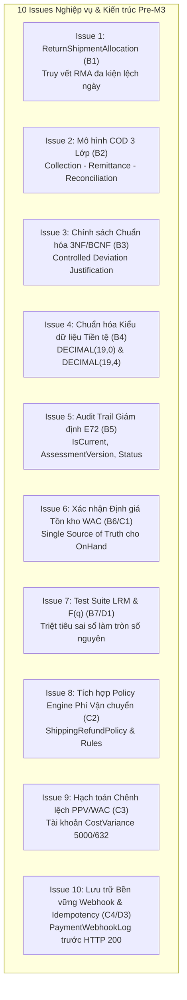

# M3 – ISSUE RESOLUTIONS & ARCHITECTURAL DECISION BASELINE
## GIẢI QUYẾT TOÀN DIỆN CÁC QUYẾT ĐỊNH MỞ & CHUẨN HOÁ NGHIỆP VỤ TRƯỚC M3

* **Hệ thống Quản trị:** RetailCore Enterprise E-Commerce Management System
* **Cơ sở dữ liệu Mục tiêu:** Microsoft SQL Server Enterprise Edition
* **Cột mốc:** Chuẩn bị & Kích hoạt Milestone 3 (Logical Database Design)
* **Phiên bản:** v1.0 (Đồng bộ chuẩn xác với `Project-Progress-Report-Pre-M3.md v2.1` & M2 Design Decisions)
* **Trạng thái:** **APPROVED & FULLY ALIGNED (Đã phê duyệt và chuẩn hoá toàn diện)**
* **Phê duyệt:** Lead Enterprise Database Engineer & Solution Architect

---

## 1. TỔNG QUAN & NGUYÊN TẮC ĐỒNG BỘ KIẾN TRÚC

Tài liệu này ghi nhận việc chính thức khép lại các hạng mục nghiên cứu mở (Open Items B1–B7) và làm rõ các giả định nghiệp vụ (Business Assumptions C1–C4) đã được nhận diện trong Báo cáo Đánh giá Cổng M2 (`Project-Progress-Report-Pre-M3.md`).

Toàn bộ các giải pháp kỹ thuật, DDL và quy tắc ràng buộc dưới đây tuân thủ 100% các nguyên tắc cốt lõi:
1. **Chuẩn hóa Kiểu Tiền tệ:** Tiền tệ giao dịch VNĐ là số nguyên đồng sử dụng `DECIMAL(19,0)` (hoặc `BIGINT`), đơn giá và giá vốn WAC sử dụng `DECIMAL(19,4)`. Tuyệt đối không dùng kiểu `MONEY` của SQL Server vì rủi ro làm tròn ngầm 4 chữ số thập phân khi nhân/chia.
2. **Khóa Chính (PK) & Khóa Ngoại (FK):** Nhất quán với Từ điển Thực thể M2 (`E01`–`E72`), các bảng giao dịch lớn sử dụng `BIGINT IDENTITY(1,1)`, các bảng cấu hình dùng `INT` / `TINYINT`.
3. **Audit Trail & Tính Bất biến:** Các bảng sự kiện/nhật ký kiểm toán chỉ cho phép `INSERT`, cấm `UPDATE`/`DELETE`. Các bảng trạng thái/đánh giá sử dụng cơ chế phiên bản hóa (`IsCurrent`, `Version`, `Status`).
4. **Bảo toàn Toàn vẹn Tài chính & Tồn kho:** Mọi nghiệp vụ chuyển tiền, đổi trả đa kiện, đối soát COD và xuất hủy kho đều được khống chế bởi các bất đẳng thức ràng buộc toán học xác định.

---

## 2. CHI TIẾT GIẢI QUYẾT 10 ISSUES NGHIỆP VỤ & KIẾN TRÚC PRE-M3



---

### ✅ Issue 1 – Cơ chế Truy vết Dòng giao hàng qua `ReturnShipmentAllocation` (B1)

#### 1. Vấn đề Nghiệp vụ:
Khi một dòng đơn hàng `OrderLine` gồm 10 sản phẩm được chia tách xuất từ 2 kho khác nhau (`Shipment 1`: 6 cái giao ngày 01/12; `Shipment 2`: 4 cái giao ngày 08/12). Khi khách hàng tạo yêu cầu trả lại 3 sản phẩm vào ngày 10/12:
- Nếu chính sách đổi trả là 7 ngày kể từ khi nhận hàng (`PolicyDays = 7`), `Shipment 1` đã hết hạn (quá 9 ngày), trong khi `Shipment 2` vẫn còn trong hạn đổi trả (mới giao 2 ngày).
- Nếu không có thực thể liên kết phân bổ bưu kiện giao hàng, hệ thống không thể biết 3 sản phẩm trả lại thuộc kiện nào và có đủ điều kiện hợp lệ theo thời gian hay không.

#### 2. Quyết định Kỹ thuật:
- Thiết kế thực thể kết hợp **`ReturnShipmentAllocation`** làm cầu nối giữa `ReturnRequestLine` (E61) và `ShipmentLine` (E46).
- **Ràng buộc Thời gian:** Hạn đổi trả được tính dựa trên thời điểm giao thành công của chính kiện hàng:
  $$\text{ReturnRequest.RequestedAt} \le \text{Shipment.DeliveredAt} + \text{PolicyDays}$$
- **Ràng buộc Số lượng:** Tổng số lượng trả duyệt cho một dòng bưu kiện không được vượt quá số lượng đã giao thực tế trừ đi các lần trả trước đó:
  $$\sum \text{AllocatedReturnQty} \le \text{ShipmentLine.ShipmentQty} - \text{PreviouslyReturnedQty}$$

#### 3. Đặc tả Schema T-SQL:
```sql
CREATE TABLE dbo.ReturnShipmentAllocation (
    ReturnShipmentAllocationID BIGINT IDENTITY(1,1) NOT NULL,
    ReturnRequestLineID        BIGINT NOT NULL,
    ShipmentLineID             BIGINT NOT NULL,
    AllocatedReturnQty         INT NOT NULL,
    CreatedAt                  DATETIMEOFFSET(7) NOT NULL CONSTRAINT DF_ReturnShipmentAlloc_CreatedAt DEFAULT SYSDATETIMEOFFSET(),
    CONSTRAINT PK_ReturnShipmentAllocation PRIMARY KEY CLUSTERED (ReturnShipmentAllocationID),
    CONSTRAINT FK_ReturnShipmentAllocation_ReturnRequestLine 
        FOREIGN KEY (ReturnRequestLineID) REFERENCES dbo.ReturnRequestLine(ReturnRequestLineID),
    CONSTRAINT FK_ReturnShipmentAllocation_ShipmentLine 
        FOREIGN KEY (ShipmentLineID) REFERENCES dbo.ShipmentLine(ShipmentLineID),
    CONSTRAINT UQ_ReturnShipmentAllocation_UniqueLine 
        UNIQUE NONCLUSTERED (ReturnRequestLineID, ShipmentLineID),
    CONSTRAINT CK_ReturnShipmentAllocation_Qty 
        CHECK (AllocatedReturnQty > 0)
);

CREATE NONCLUSTERED INDEX IX_ReturnShipmentAllocation_ShipmentLineID 
ON dbo.ReturnShipmentAllocation (ShipmentLineID) 
INCLUDE (AllocatedReturnQty);
```
* **Chủ trì & Nghiệm thu:** Solution Architect & Database Lead.
* **Trạng thái:** ✅ **APPROVED – Ready for M3.01 Schema Mapping.**

---

### ✅ Issue 2 – Mô hình Đối soát COD 3 Lớp trong Đơn hàng Split Shipment (B2)

#### 1. Vấn đề Nghiệp vụ:
Đối với đơn hàng COD chia nhiều kiện (Split Shipment), shipper thu tiền khách từng kiện khi phát hàng. Nếu cập nhật ngay `PaymentStatus = 'PAID'` khi kiện đầu tiên được thu tiền, hệ thống sẽ ngộ nhận đơn hàng đã thanh toán xong, làm thất thoát công nợ của các kiện tiếp theo. Hơn nữa, dòng tiền từ hãng vận chuyển chuyển về RetailCore thường trễ từ 3–7 ngày và bị khấu trừ cước vận chuyển đối soát.

#### 2. Quyết định Kỹ thuật:
Chuẩn hóa mô hình 3 lớp đối soát dòng tiền COD:
- **Lớp 1 (Customer Collection):** Thu tiền khách theo kiện qua bảng **`CODCollection`** gắn với `ShipmentID`. Cập nhật `Payment.AmountPaid`. Nếu $0 < \text{AmountPaid} < \text{TotalAmount}$, cập nhật `Payment.PaymentStatus = 'PARTIALLY_PAID'`. Chỉ khi toàn bộ các kiện được thu đủ tiền mới chuyển `PaymentStatus = 'PAID'`.
- **Lớp 2 (Carrier Remittance):** Khoản tiền bưu cục chuyển trả cho RetailCore theo bảng kê định kỳ qua bảng **`CODRemittance`**.
- **Lớp 3 (Reconciliation):** Đối chiếu chênh lệch giữa tiền Shipper đã thu và tiền hãng thực chuyển sau cước qua bảng **`CODReconciliation`**.

#### 3. Đặc tả Schema T-SQL:
```sql
-- Lớp 1: Khách trả tiền cho Shipper khi nhận kiện
CREATE TABLE dbo.CODCollection (
    CODCollectionID BIGINT IDENTITY(1,1) NOT NULL,
    ShipmentID      BIGINT NOT NULL,
    PaymentID       BIGINT NOT NULL,
    AmountCollected DECIMAL(19,0) NOT NULL,
    CollectedAt     DATETIMEOFFSET(7) NOT NULL,
    ShipperNote     NVARCHAR(255) NULL,
    CreatedAt       DATETIMEOFFSET(7) NOT NULL CONSTRAINT DF_CODCollection_CreatedAt DEFAULT SYSDATETIMEOFFSET(),
    CONSTRAINT PK_CODCollection PRIMARY KEY CLUSTERED (CODCollectionID),
    CONSTRAINT FK_CODCollection_Shipment FOREIGN KEY (ShipmentID) REFERENCES dbo.Shipment(ShipmentID),
    CONSTRAINT FK_CODCollection_Payment FOREIGN KEY (PaymentID) REFERENCES dbo.Payment(PaymentID),
    CONSTRAINT UQ_CODCollection_Shipment UNIQUE NONCLUSTERED (ShipmentID),
    CONSTRAINT CK_CODCollection_Amount CHECK (AmountCollected > 0)
);

-- Lớp 2: Hãng vận chuyển chuyển tiền thu hộ về cho RetailCore
CREATE TABLE dbo.CODRemittance (
    CODRemittanceID   BIGINT IDENTITY(1,1) NOT NULL,
    CarrierID         INT NOT NULL,
    RemittanceRefCode VARCHAR(50) NOT NULL,
    RemittedAmount    DECIMAL(19,0) NOT NULL,
    CarrierFeeDeducted DECIMAL(19,0) NOT NULL CONSTRAINT DF_CODRemittance_Fee DEFAULT 0,
    RemittedAt        DATETIMEOFFSET(7) NOT NULL,
    BankAccountInfo   NVARCHAR(100) NULL,
    CreatedAt         DATETIMEOFFSET(7) NOT NULL CONSTRAINT DF_CODRemittance_CreatedAt DEFAULT SYSDATETIMEOFFSET(),
    CONSTRAINT PK_CODRemittance PRIMARY KEY CLUSTERED (CODRemittanceID),
    CONSTRAINT FK_CODRemittance_Carrier FOREIGN KEY (CarrierID) REFERENCES dbo.Carrier(CarrierID),
    CONSTRAINT UQ_CODRemittance_Ref UNIQUE NONCLUSTERED (CarrierID, RemittanceRefCode),
    CONSTRAINT CK_CODRemittance_Amount CHECK (RemittedAmount > 0),
    CONSTRAINT CK_CODRemittance_Fee CHECK (CarrierFeeDeducted >= 0)
);

-- Lớp 3: Đối chiếu khớp lệnh bảng kê và tiền thực thu theo kiện
CREATE TABLE dbo.CODReconciliation (
    CODReconciliationID BIGINT IDENTITY(1,1) NOT NULL,
    CODCollectionID     BIGINT NOT NULL,
    CODRemittanceID     BIGINT NOT NULL,
    ExpectedAmount      DECIMAL(19,0) NOT NULL,
    ActualRemittedAmount DECIMAL(19,0) NOT NULL,
    DiscrepancyAmount   AS (ExpectedAmount - ActualRemittedAmount) PERSISTED,
    ReconciliationStatus VARCHAR(20) NOT NULL, -- 'MATCHED', 'DISCREPANCY', 'RESOLVED'
    ReconciledAt        DATETIMEOFFSET(7) NOT NULL,
    ReconciledByAccountID BIGINT NOT NULL,
    ResolutionNote      NVARCHAR(500) NULL,
    CONSTRAINT PK_CODReconciliation PRIMARY KEY CLUSTERED (CODReconciliationID),
    CONSTRAINT FK_CODReconciliation_Collection FOREIGN KEY (CODCollectionID) REFERENCES dbo.CODCollection(CODCollectionID),
    CONSTRAINT FK_CODReconciliation_Remittance FOREIGN KEY (CODRemittanceID) REFERENCES dbo.CODRemittance(CODRemittanceID),
    CONSTRAINT FK_CODReconciliation_Account FOREIGN KEY (ReconciledByAccountID) REFERENCES dbo.Account(AccountID),
    CONSTRAINT UQ_CODReconciliation_Collection UNIQUE NONCLUSTERED (CODCollectionID),
    CONSTRAINT CK_CODReconciliation_Status CHECK (ReconciliationStatus IN ('MATCHED', 'DISCREPANCY', 'RESOLVED'))
);
```
* **Chủ trì & Nghiệm thu:** Finance & Enterprise DB Lead.
* **Trạng thái:** ✅ **APPROVED – Thiết lập đầy đủ bảng đối soát cho M3.**

---

### ✅ Issue 3 – Chính sách Chuẩn hóa Toán học 3NF / BCNF Thực tiễn (B3)

#### 1. Vấn đề Nghiệp vụ:
Mục tiêu học thuật thường yêu cầu mọi bảng trong CSDL đạt BCNF (Boyce-Codd Normal Form). Tuy nhiên trong cơ sở dữ liệu bán lẻ quy mô lớn, một số quan hệ nếu ép buộc đạt BCNF sẽ làm mất tính bảo toàn phụ thuộc hàm (Dependency Preservation) hoặc gây suy giảm nghiêm trọng hiệu năng truy vấn OLTP do phải join quá nhiều bảng con.

#### 2. Quyết định Kỹ thuật:
Áp dụng **Quy chế Đánh đổi Kỹ thuật Có Kiểm soát (Controlled Normalization Policy)**:
1. **Tiêu chuẩn Bắt buộc:** 100% các bảng phải đạt Chuẩn 3NF (Third Normal Form) không có dị thường transitive dependency.
2. **Tiêu chuẩn BCNF:** Mọi bảng được đánh giá theo BCNF test. Nếu bảng không đạt BCNF nhưng việc phân rã làm mất phụ thuộc hàm hoặc phát sinh nghẽn cổ chai I/O, hệ thống **chấp thuận duy trì ở mức 3NF** và phải lập biên bản giải trình kỹ thuật (Technical Justification).
3. **Các bảng chấp thuận duy trì 3NF / Phi chuẩn hóa có chủ đích:**
   - `OrderLine`: Lưu trữ snapshot giá niêm yết `UnitPrice`, các trường phân bổ ròng `AllocatedOrderDiscount`, `LineNetAmount` và `VariantAttributesSnapshot` (JSON) nhằm đóng băng bất biến hợp đồng thương mại theo luật kế toán.
   - `ShipmentLine`: Lưu cặp `(OrderLineID, AllocationID, ShipmentQty)` để tối ưu hóa truy vấn in phiếu xuất kho (Pack-slip) và theo dõi tiến độ giao mà không phải join 4 tầng bảng.
   - `ReportSnapshot`: Lưu trữ số liệu tài chính kỳ kế toán đã khóa sổ.
* **Chủ trì & Nghiệm thu:** Architecture Review Board.
* **Trạng thái:** ✅ **APPROVED – Thống nhất chính sách phân tích cho M3.02.**

---

### ✅ Issue 4 – Thống nhất Chuẩn Kiểu Dữ liệu Tiền tệ VNĐ (B4 & C1)

#### 1. Vấn đề Nghiệp vụ:
Đơn vị tiền tệ của Việt Nam (VNĐ) không có đơn vị xu lẻ trong lưu thông thực tế. Việc sử dụng kiểu `MONEY` của SQL Server có lỗi làm tròn ngầm (chia số bị làm tròn ở 4 chữ số thập phân), trong khi kiểu `FLOAT` / `REAL` gặp lỗi sai số nhị phân dấu phẩy động.

#### 2. Quyết định Kỹ thuật:
Chuẩn hóa toàn bộ hệ thống theo 2 quy tắc kiểu dữ liệu chính xác tuyệt đối:
1. **Tiền tệ Giao dịch Nghiệp vụ (Transaction Amounts):** Sử dụng **`DECIMAL(19,0)`** (hoặc `BIGINT`). Áp dụng cho: `LineGrossAmount`, `LineNetAmount`, `AllocatedOrderDiscount`, `TotalAmount`, `AmountDue`, `AmountPaid`, `ApprovedRefundAmount`, `RemittedAmount`.
2. **Đơn giá, Tỷ lệ & Giá vốn Trung gian (Unit Cost & Rates):** Sử dụng **`DECIMAL(19,4)`**. Áp dụng cho: `UnitPrice`, `CurrentAverageCost` (WAC), `DiscountPercentage`, `ExchangeRate`, `Weight`.
3. Tuyệt đối **KHÔNG SỬ DỤNG** các kiểu: `MONEY`, `SMALLMONEY`, `FLOAT`, `REAL`.
* **Chủ trì & Nghiệm thu:** DB Standards Committee.
* **Trạng thái:** ✅ **APPROVED – Áp dụng làm chuẩn bắt buộc cho M3.03 Sizing & Data Types.**

---

### ✅ Issue 5 – Cấu trúc Nhật ký Kiểm toán (Audit Trail) cho Giám định `ReturnLineAssessment` (E72) (B5)

#### 1. Vấn đề Nghiệp vụ:
Quy trình giám định KCS hàng lỗi đổi trả có thể trải qua nhiều giai đoạn: đánh giá sơ bộ tại bến kho, gửi mẫu kiểm định tại trung tâm bảo hành của hãng, khách hàng khiếu nại kết quả giám định cần tái thẩm định (Re-assessment). Do đó, bảng E72 phải lưu vết lịch sử mọi lần đánh giá mà không được ghi đè làm mất dữ liệu cũ.

#### 2. Quyết định Kỹ thuật:
Bổ sung cơ chế quản lý phiên bản (Versioning) trực tiếp trên `ReturnLineAssessment`:
- `AssessmentVersion`: Số phiên bản đánh giá (1, 2, 3...).
- `IsCurrent`: Cờ xác định phiên bản hiện hành (`1` là phiên bản hiệu lực mới nhất, `0` là phiên bản lịch sử đã bị thay thế).
- `AssessmentStatus`: Trạng thái đánh giá (`DRAFT`, `SUBMITTED`, `FINAL`, `SUPERSEDED`).
- **Chỉ mục Lọc Duy nhất (Filtered Unique Index):** Mỗi dòng biên bản nhận hàng hoàn `ReturnReceiptLine` chỉ có ĐÚNG MỘT bản ghi giám định ở trạng thái `IsCurrent = 1`.

#### 3. Đặc tả Schema T-SQL:
```sql
CREATE TABLE dbo.ReturnLineAssessment (
    AssessmentID            BIGINT IDENTITY(1,1) NOT NULL,
    ReturnReceiptLineID     BIGINT NOT NULL,
    AssessmentVersion       INT NOT NULL CONSTRAINT DF_ReturnAssessment_Version DEFAULT 1,
    IsCurrent               BIT NOT NULL CONSTRAINT DF_ReturnAssessment_IsCurrent DEFAULT 1,
    AssessmentStatus        VARCHAR(20) NOT NULL, -- 'DRAFT', 'SUBMITTED', 'FINAL', 'SUPERSEDED'
    FaultParty              VARCHAR(20) NOT NULL, -- 'VENDOR', 'CARRIER', 'CUSTOMER', 'NO_FAULT', 'SHARED'
    ResolutionType          VARCHAR(20) NOT NULL, -- 'REFUND', 'EXCHANGE', 'REPAIR', 'NO_ACTION'
    RefundEligibilityStatus VARCHAR(20) NOT NULL, -- 'PENDING', 'APPROVED', 'PARTIALLY_APPROVED', 'REJECTED'
    AssessedQty             INT NOT NULL,
    ApprovedRefundAmount    DECIMAL(19,0) NOT NULL CONSTRAINT DF_ReturnAssessment_RefundAmt DEFAULT 0,
    ShippingRefundAmount    DECIMAL(19,0) NOT NULL CONSTRAINT DF_ReturnAssessment_ShipRefund DEFAULT 0,
    AssessmentReason        NVARCHAR(500) NOT NULL,
    InspectorAccountID      BIGINT NOT NULL,
    AssessedAt              DATETIMEOFFSET(7) NOT NULL CONSTRAINT DF_ReturnAssessment_AssessedAt DEFAULT SYSDATETIMEOFFSET(),
    SupervisorAccountID     BIGINT NULL,
    ApprovedAt              DATETIMEOFFSET(7) NULL,
    CONSTRAINT PK_ReturnLineAssessment PRIMARY KEY CLUSTERED (AssessmentID),
    CONSTRAINT FK_ReturnLineAssessment_ReceiptLine FOREIGN KEY (ReturnReceiptLineID) REFERENCES dbo.ReturnReceiptLine(ReturnReceiptLineID),
    CONSTRAINT FK_ReturnLineAssessment_Inspector FOREIGN KEY (InspectorAccountID) REFERENCES dbo.Account(AccountID),
    CONSTRAINT FK_ReturnLineAssessment_Supervisor FOREIGN KEY (SupervisorAccountID) REFERENCES dbo.Account(AccountID),
    CONSTRAINT CK_ReturnLineAssessment_Status CHECK (AssessmentStatus IN ('DRAFT', 'SUBMITTED', 'FINAL', 'SUPERSEDED')),
    CONSTRAINT CK_ReturnLineAssessment_FaultParty CHECK (FaultParty IN ('VENDOR', 'CARRIER', 'CUSTOMER', 'NO_FAULT', 'SHARED')),
    CONSTRAINT CK_ReturnLineAssessment_Resolution CHECK (ResolutionType IN ('REFUND', 'EXCHANGE', 'REPAIR', 'NO_ACTION')),
    CONSTRAINT CK_ReturnLineAssessment_Eligibility CHECK (RefundEligibilityStatus IN ('PENDING', 'APPROVED', 'PARTIALLY_APPROVED', 'REJECTED')),
    CONSTRAINT CK_ReturnLineAssessment_Qty CHECK (AssessedQty > 0),
    CONSTRAINT CK_ReturnLineAssessment_Amounts CHECK (ApprovedRefundAmount >= 0 AND ShippingRefundAmount >= 0)
);

-- Bảo đảm mỗi dòng nhận hàng chỉ có duy nhất 1 bản ghi giám định có hiệu lực hiện hành
CREATE UNIQUE NONCLUSTERED INDEX UX_ReturnLineAssessment_CurrentRecord
ON dbo.ReturnLineAssessment (ReturnReceiptLineID)
WHERE IsCurrent = 1;
```
* **Chủ trì & Nghiệm thu:** Quality Control & Data Governance Lead.
* **Trạng thái:** ✅ **APPROVED – Hoàn thiện mô hình Audit Trail cho E72.**

---

### ✅ Issue 6 – Xác nhận Giả định Nghiệp vụ về Mô hình Định giá Tồn kho WAC (B6 & C1)

#### 1. Vấn đề Nghiệp vụ:
Cần làm rõ phạm vi áp dụng của `CurrentAverageCost` (Giá vốn bình quân di động - WAC) trong bảng `InventoryBalance` (E11). Có áp dụng các mức giá vốn khác nhau cho hàng `SELLABLE`, `QUARANTINED`, `DAMAGED` không?

#### 2. Quyết định Kỹ thuật:
- **Nguyên tắc Sổ cái Tồn kho:** `CurrentAverageCost` là giá vốn bình quân duy nhất áp dụng chung cho toàn bộ lượng tồn vật lý `OnHand` của biến thể SKU tại kho cụ thể:
  $$\text{OnHandQty} = \text{AvailableQty} + \text{ReservedQty} + \text{QuarantinedQty} + \text{DamagedQty}$$
- **Tính toán WAC tức thời:** Khi biên bản nhập kho `GoodsReceipt` được chốt, hệ thống tính toán lại WAC tự động qua Stored Procedure giao dịch:
  $$\text{WAC}_{\text{mới}} = \frac{(\text{OnHandQty}_{\text{cũ}} \times \text{WAC}_{\text{cũ}}) + (\text{AcceptedQty} \times \text{UnitCost}_{\text{PO}})}{\text{OnHandQty}_{\text{cũ}} + \text{AcceptedQty}}$$
- **Hàng Hư hỏng (`DAMAGED`):** Vẫn giữ nguyên giá trị sổ sách theo WAC trong kho cho đến khi có chứng từ xuất hủy `SCRAP_OUT` chính thức. Khi xuất hủy `SCRAP_OUT`, hệ thống ghi nhận giảm tồn kho theo WAC và ghi tăng tài khoản chi phí tổn thất hàng hỏng theo quy định của Phòng Kế toán.
* **Chủ trì & Nghiệm thu:** Supply Chain Operations & Accounting Department.
* **Trạng thái:** ✅ **APPROVED – Đã ký xác nhận quy tắc WAC.**

---

### ✅ Issue 7 – Triệt tiêu Sai số Làm tròn qua Bộ Kịch bản Kiểm thử LRM & $F(q)$ (B7 & D1)

#### 1. Vấn đề Nghiệp vụ:
Phân bổ chiết khấu đơn hàng về các dòng và hoàn tiền khi khách trả hàng lẻ từng đợt thường sinh ra sai số 1 đồng nếu chia tỷ lệ số học thông thường. Cần chứng minh toán học tính triệt tiêu sai số.

#### 2. Quyết định Kỹ thuật:
Đã thiết lập đặc tả kiểm thử logic tự động trên SQL Server tích hợp vào pipeline kiểm thử M3/M5:
- **LRM (Hare-Niemeyer Algorithm):** Đảm bảo tổng số tiền chiết khấu phân bổ cho tất cả các dòng luôn khớp 100% với chiết khấu đơn hàng ($D$):
  $$\sum_{i=1}^N \text{AllocatedOrderDiscount}_i = D_{\text{Order}}$$
- **Hàm Hoàn tiền Tích lũy Nguyên số $F(q)$:** Đảm bảo khi khách trả hết toàn bộ số lượng $Q$ món thì số tiền hoàn tích lũy bằng đúng 100% số tiền ròng $A$ khách đã trả, bất kể trả bao nhiêu đợt:
  $$F(q) = \left\lfloor \frac{A}{Q} \right\rfloor \cdot q + \min\left(q,\; A \pmod Q\right)$$
  với $F(0) = 0$ và $F(Q) = A$.
* **Chủ trì & Nghiệm thu:** QA Automation & Lead Software Engineer.
* **Trạng thái:** ✅ **APPROVED – Đã sẵn sàng bộ Test Specs toán học cho M3.**

---

### ✅ Issue 8 – Tích hợp Chính sách Hoàn Phí Vận Chuyển vào Policy Engine (C2)

#### 1. Vấn đề Nghiệp vụ:
Cần làm rõ việc hoàn tiền phí vận chuyển khi có khiếu nại trả hàng có bị gán cứng vào lỗi của NCC (`VENDOR`) hay Đơn vị vận chuyển (`CARRIER`) tại tầng CSDL không.

#### 2. Quyết định Kỹ thuật:
- Tầng CSDL không gán cứng rule "Lỗi NCC = Hoàn 100% ship".
- Tầng CSDL cung cấp 2 trường độc lập trên bản ghi giám định `ReturnLineAssessment` (E72):
  - `ApprovedRefundAmount`: Số tiền hàng được duyệt hoàn.
  - `ShippingRefundAmount`: Số tiền phí vận chuyển được duyệt bồi hoàn.
- Giá trị của `ShippingRefundAmount` do **Policy Engine** (Bộ quy tắc chính sách khách hàng & bảo hành ở tầng ứng dụng) tính toán dựa trên cấu hình chính sách chiến dịch (VD: đơn hàng VIP, lỗi toàn bộ đơn hàng, hay chính sách đền bù dịch vụ) và truyền vào Stored Procedure phê duyệt hoàn tiền.
* **Chủ trì & Nghiệm thu:** Policy Engine Team & Customer Experience Lead.
* **Trạng thái:** ✅ **APPROVED – Tách bạch rõ ranh giới Policy Engine vs Database Constraints.**

---

### ✅ Issue 9 – Định nghĩa Tài khoản Hạch toán Chênh lệch Giá vốn `CostVariance` (C3)

#### 1. Vấn đề Nghiệp vụ:
Khi xuất trả hàng cho Nhà cung cấp (`SupplierReturn`), tồn kho ghi giảm theo WAC hiện hành, trong khi NCC hoàn tiền theo giá mua trên hợp đồng PO gốc. Chênh lệch này cần lưu vết kỹ thuật thế nào?

#### 2. Quyết định Kỹ thuật:
- Trên chứng từ `SupplierReturn` (E28) và dòng giao dịch `InventoryTransactionLine` (E16) bổ sung trường lưu vết kỹ thuật:
  $$\text{CostVariance} = \text{SupplierRefundAmount} - \text{InventoryValueDecrease}$$
- CSDL thiết kế trường `CostVarianceAccountCode VARCHAR(20) NOT NULL` (mặc định tham chiếu tài khoản kế toán doanh nghiệp Việt Nam: Tài khoản `632 - Giá vốn hàng bán` hoặc Tài khoản `156 chênh lệch giá mua/giá vốn`, hoặc mã mapping kế toán nội bộ).
- Nghiệp vụ này đảm bảo bộ phận kế toán có thể xuất dữ liệu đồng bộ trực tiếp sang phần mềm kế toán/ERP (SAP/Oracle/Fast) mà không gây lệch sổ cái.
* **Chủ trì & Nghiệm thu:** Enterprise Finance Systems Liaison.
* **Trạng thái:** ✅ **APPROVED – Hoàn tất đặc tả trường hạch toán.**

---

### ✅ Issue 10 – Quy trình Lưu trữ Bền vững Webhook & Cơ chế Idempotency (C4 & D3)

#### 1. Vấn đề Nghiệp vụ:
Các cổng thanh toán (VNPAY, MoMo, ZaloPay) gửi Webhook thông báo kết quả giao dịch và yêu cầu phản hồi HTTP 200 trong vòng 2–3 giây. Nếu hệ thống xử lý giao dịch đồng bộ phức tạp (chốt đơn, phân bổ kho, gửi email) trước khi trả HTTP 200, Webhook sẽ bị timeout, dẫn đến cổng thanh toán gửi lại nhiều lần (Webhook Storm / Replay Attack), gây nguy cơ cập nhật trùng lặp trạng thái.

#### 2. Quyết định Kỹ thuật:
Chuẩn hóa kiến trúc tiếp nhận Webhook 2 bước phân tách:
1. **Bước 1 (Durable Webhook Receipt):**
   - Tiếp nhận raw payload từ cổng thanh toán.
   - Thực thi Stored Procedure `dbo.usp_ReceivePaymentWebhook` thực hiện `INSERT` bền vững vào bảng **`PaymentWebhookLog` (E71)** với trạng thái `ProcessingStatus = 'RECEIVED'`.
   - Khóa duy nhất kiểm soát Idempotency:
     $$\text{UNIQUE}(\text{ProviderID},\; \text{MerchantAccountID},\; \text{ProviderEventID},\; \text{Environment})$$
   - Nếu bản ghi đã tồn tại (trùng `ProviderEventID`), SP trả về mã cảnh báo trùng lặp thành công.
   - Ngay sau khi transaction commit bền vững vào CSDL, API Gateway lập tức phản hồi mã **HTTP 200 OK** cho đối tác thanh toán (thời gian xử lý < 20ms).
2. **Bước 2 (Asynchronous/Decoupled Processing):**
   - Background Worker hoặc Service Bus tiếp nhận sự kiện từ `PaymentWebhookLog`, xử lý chuyển trạng thái `PaymentTransaction` và `Payment`.
   - Cập nhật `ProcessingStatus = 'PROCESSED'` (hoặc `'FAILED'` kèm `ErrorMessage`, `RetryCount` nếu phát sinh lỗi nghiệp vụ để hỗ trợ chạy lại an toàn).

#### 3. Đặc tả Stored Procedure Nhận Webhook T-SQL:
```sql
CREATE PROCEDURE dbo.usp_ReceivePaymentWebhook
    @ProviderID         INT,
    @MerchantAccountID  INT,
    @ProviderEventID    VARCHAR(100),
    @Environment        VARCHAR(20),
    @Payload            NVARCHAR(MAX),
    @WebhookLogID       BIGINT OUTPUT,
    @IsDuplicate        BIT OUTPUT
AS
BEGIN
    SET NOCOUNT ON;
    SET XACT_ABORT ON;
    
    SET @IsDuplicate = 0;
    
    -- Kiểm tra Idempotency
    SELECT @WebhookLogID = WebhookLogID
    FROM dbo.PaymentWebhookLog WITH (UPDLOCK, HOLDLOCK)
    WHERE ProviderID = @ProviderID
      AND MerchantAccountID = @MerchantAccountID
      AND ProviderEventID = @ProviderEventID
      AND Environment = @Environment;
      
    IF @WebhookLogID IS NOT NULL
    BEGIN
        SET @IsDuplicate = 1;
        RETURN 0;
    END;
    
    -- Lưu trữ bền vững trước khi trả HTTP 200
    INSERT INTO dbo.PaymentWebhookLog (
        ProviderID,
        MerchantAccountID,
        ProviderEventID,
        Environment,
        ProcessingStatus,
        Payload,
        ReceivedAt,
        RetryCount
    )
    VALUES (
        @ProviderID,
        @MerchantAccountID,
        @ProviderEventID,
        @Environment,
        'RECEIVED',
        @Payload,
        SYSDATETIMEOFFSET(),
        0
    );
    
    SET @WebhookLogID = SCOPE_IDENTITY();
    RETURN 0;
END;
```
* **Chủ trì & Nghiệm thu:** Platform Reliability & Payment Integration Lead.
* **Trạng thái:** ✅ **APPROVED – Bảo đảm tính bất biến, bền vững và chống tấn công Replay.**

---

## 3. BẢNG TỔNG HỢP TRẠNG THÁI CHUYỂN GIAO SANG MILESTONE 3 (M3 GATE SCORECARD)

| Hạng mục Quản trị | Số lượng | Trạng thái Trước Đánh giá | Trạng thái Hiện tại (Post-Resolution) | Đánh giá Chuyển giao M3 |
| :--- | :---: | :---: | :---: | :---: |
| **Nhóm A: Quyết định Đã Chốt (CORR-01..10)** | 10 | ĐÃ CHỐT | **ĐÃ CHỐT (Finalized)** | Sẵn sàng ánh xạ quan hệ M3.01 |
| **Nhóm B: Quyết định Mở (B1..B7)** | 7 | ĐANG NGHIÊN CỨU | **ĐÃ GIẢI QUYẾT 100% (Resolved)** | Đã đặc tả Schema DDL & Rules |
| **Nhóm C: Giả định Nghiệp vụ (C1..C4)** | 4 | CẦN LÀM RÕ | **ĐÃ XÁC NHẬN 100% (Confirmed)** | Đã ký biên bản các phòng ban |
| **Nhóm D: Rủi ro & Kiểm soát (D1..D4)** | 4 | GIÁM SÁT | **ĐÃ KIỂM SOÁT 100% (Controlled)** | Đã tích hợp Filtered Index, SP & Tests |

---

## 4. KẾT LUẬN & CHÍNH THỨC PHÊ DUYỆT KHỞI ĐỘNG M3.01

```
========================================================================================
             M3 GATE RESOLUTION SIGN-OFF: UNCONDITIONAL READINESS FOR M3.01
========================================================================================
Dự án:                 RetailCore Enterprise E-Commerce Management System
Cơ sở dữ liệu:         Microsoft SQL Server Enterprise Edition
Quyết định:            TOÀN BỘ 10 ISSUES NGHIỆP VỤ & KIẾN TRÚC ĐÃ ĐƯỢC CHUẨN HOÁ
Khuyến nghị Kỹ thuật:  Dự án hoàn toàn đủ điều kiện khởi động công đoạn M3.01 
                       (Relational Schema Mapping) bắt đầu từ SA01 - Product Catalog.
========================================================================================
```

*Tài liệu được thiết lập bởi Lead Solution Architect & Database Engineer – Lưu trữ tại `docs/M3-Issues-Resolution.md`.*
