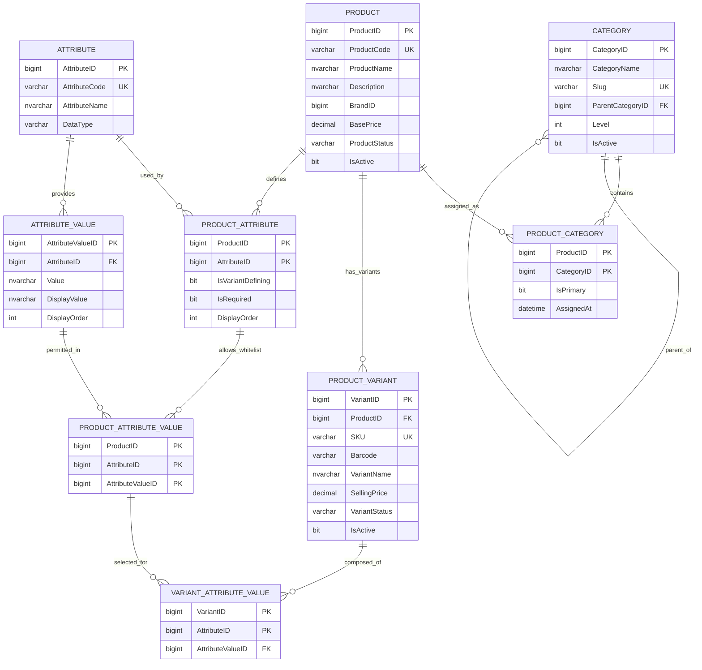
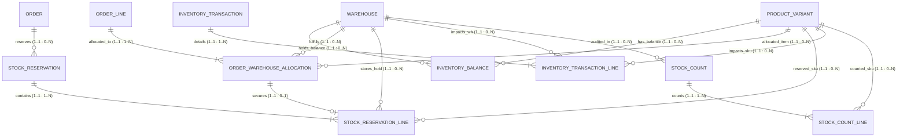

# M2.02 - RELATIONSHIP ANALYSIS & CARDINALITY (PHÂN TÍCH QUAN HỆ & BẢN SỐ)

* **Milestone:** M2 – Conceptual Database Design
* **Phiên bản:** 1.0
* **Subject Area:** 01 – Product Catalog
* **Kế thừa:** 9 Thực thể ứng viên (E01 đến E09), Quyết định BD-01, BD-06 & PC-Q01 đến PC-Q06

---

## 1. Phương pháp luận Phân tích Quan hệ ở Tầng Conceptual (M2)

* **Bản số (Cardinality Ratio):** $1:1$, $1:N$, hoặc $M:N$.
* **Tính tham gia (Participation Constraints):**
  * **Toàn phần (Total Participation - Bắt buộc):** Mọi thực thể của tập thực thể phải tham gia vào mối quan hệ (ví dụ: `ProductVariant` bắt buộc phải thuộc một `Product`).
  * **Một phần (Partial Participation - Tùy chọn):** Một số thực thể có thể không tham gia (ví dụ: `Product` ở trạng thái nháp có thể chưa có `Category` hoặc `ProductVariant`).
* **Không đưa Khóa ngoại (FK) vào giai đoạn này:** Quan hệ được thể hiện thuần túy bằng đường nối, vai trò (Role names) và bản số.

---

## 2. Phân tích 6 Nhóm Quan hệ Cốt lõi của Product Catalog

### 2.1. Quan hệ Product – Category ($N:N$ thông qua `ProductCategory`)

| Thực thể nguồn | Quan hệ / Hành vi | Thực thể đích | Bản số | Tính tham gia (Participation) |
| :--- | :---: | :--- | :---: | :--- |
| `Product` | được gán vào | `ProductCategory` | $1:N$ | Một phần (Draft có thể chưa gán, Published bắt buộc có $\ge 1$) |
| `Category` | chứa | `ProductCategory` | $1:N$ | Một phần (Category có thể chưa có sản phẩm) |

* **Bản chất nghiệp vụ:** Một sản phẩm có thể thuộc nhiều danh mục (Áo khoác nam, BST Thu Đông 2026); Một danh mục chứa nhiều sản phẩm.
* **Thực thể kết hợp:** `ProductCategory` mang thuộc tính `IsPrimary` (BD-01, BR-PR05, BR-PR10).
* **Ràng buộc nghiệp vụ toàn vẹn:**
  * Mỗi `Product` có **tối đa một** bản ghi `ProductCategory` được đánh dấu `IsPrimary = TRUE`.
  * Khi sản phẩm chuyển sang trạng thái `Published`, hệ thống bắt buộc phải có **đúng một** danh mục chính (`PC-Q01`).

---

### 2.2. Quan hệ Product – ProductVariant ($1:N$)

| Thực thể nguồn | Quan hệ / Hành vi | Thực thể đích | Bản số | Tính tham gia (Participation) |
| :--- | :---: | :--- | :---: | :--- |
| `Product` | sở hữu các phiên bản bán | `ProductVariant` | $1:N$ | Một phần (Draft có thể chưa có SKU, Published phải có $\ge 1$ SKU) |
| `ProductVariant` | thuộc về dòng sản phẩm | `Product` | $N:1$ | **Toàn phần (Bắt buộc)** – Không có SKU mồ côi |

* **Bản chất nghiệp vụ:** Sản phẩm phân rã thành các SKU cụ thể để quản lý giá bán và tồn kho (BR-PR03, BR-PR04).
* **Quy tắc sản phẩm đơn giản (PC-Q03):** Nếu sản phẩm không có biến thể thuộc tính (như đồ gia dụng đơn chiếc), hệ thống tự động sinh 1 SKU mặc định.

---

### 2.3. Quan hệ Attribute – AttributeValue ($1:N$)

| Thực thể nguồn | Quan hệ / Hành vi | Thực thể đích | Bản số | Tính tham gia (Participation) |
| :--- | :---: | :--- | :---: | :--- |
| `Attribute` | định nghĩa các giá trị | `AttributeValue` | $1:N$ | Một phần (Thuộc tính mới tạo có thể chưa có giá trị) |
| `AttributeValue` | thuộc về loại thuộc tính | `Attribute` | $N:1$ | **Toàn phần (Bắt buộc)** |

* **Bản chất nghiệp vụ:** Từ điển thuộc tính dùng chung toàn hệ thống (PC-Q05).
* **Ví dụ:** `Color` $\rightarrow$ `Black`, `White`, `Blue`; `Size` $\rightarrow$ `S`, `M`, `L`, `XL`.
* **Định danh ứng viên:** `(AttributeID, Value)` là duy nhất.

---

### 2.4. Quan hệ Product – Attribute ($N:N$ thông qua `ProductAttribute`)

| Thực thể nguồn | Quan hệ / Hành vi | Thực thể đích | Bản số | Tính tham gia (Participation) |
| :--- | :---: | :--- | :---: | :--- |
| `Product` | khai báo sử dụng | `ProductAttribute` | $1:N$ | Một phần |
| `Attribute` | được áp dụng cho | `ProductAttribute` | $1:N$ | Một phần |

* **Bản chất nghiệp vụ:** Xác định phạm vi các thuộc tính mà sản phẩm này được phép có (ngăn chặn gán nhầm thuộc tính không phù hợp).
* **Thực thể kết hợp:** `ProductAttribute` mang thuộc tính cấu hình:
  * `IsVariantDefining`: Xác định thuộc tính này có dùng để phân tách SKU không (như Size, Color) hay chỉ mô tả chung (Chất liệu, Xuất xứ) (PC-Q04).
  * `IsRequired`: Có bắt buộc chọn khi tạo biến thể không.
  * `DisplayOrder`: Thứ tự hiển thị trên giao diện Website.

---

### 2.5. Quan hệ ProductAttribute – AttributeValue ($N:N$ thông qua `ProductAttributeValue`)

| Thực thể nguồn | Quan hệ / Hành vi | Thực thể đích | Bản số | Tính tham gia (Participation) |
| :--- | :---: | :--- | :---: | :--- |
| `ProductAttribute` | cho phép tập giá trị | `ProductAttributeValue` | $1:N$ | Một phần |
| `AttributeValue` | được kích hoạt cho | `ProductAttributeValue` | $1:N$ | Một phần |

* **Bản chất nghiệp vụ:** **Bộ lọc Whitelist giá trị được phép** của từng sản phẩm cụ thể.
* **Ví dụ:** Áo khoác Denim sử dụng thuộc tính `Color` nhưng chỉ cho phép chọn `Black` và `Blue` trong số hàng chục màu của hệ thống.
* **Định danh:** Khóa phức hợp `(ProductID, AttributeID, AttributeValueID)`.

---

### 2.6. Quan hệ ProductVariant – AttributeValue ($N:N$ thông qua `VariantAttributeValue`)

| Thực thể nguồn | Quan hệ / Hành vi | Thực thể đích | Bản số | Tính tham gia (Participation) |
| :--- | :---: | :--- | :---: | :--- |
| `ProductVariant` | được cấu thành bởi | `VariantAttributeValue` | $1:N$ | Một phần (SKU mặc định có thể rỗng) |
| `ProductAttributeValue` | được chọn cho SKU | `VariantAttributeValue` | $1:N$ | Một phần |

* **Bản chất nghiệp vụ:** Gán giá trị cụ thể tạo nên một SKU độc nhất.
* **Ràng buộc nghiệp vụ sống còn:**
  1. Một Variant không được có 2 giá trị cho cùng một `AttributeID`.
  2. Giá trị gán cho SKU phải nằm trong tập `ProductAttributeValue` hợp lệ của sản phẩm đó.
  3. **Không được tồn tại 2 SKU trong cùng một sản phẩm có cùng tổ hợp các thuộc tính `IsVariantDefining = TRUE`** (BR-PR12).

---

## 3. Sơ đồ Quan hệ Khái niệm (Conceptual ERD – Subject Area 01)

---

## 4. Tóm tắt Kiểm tra Tính Toàn vẹn (Integrity Check)

* [x] **BD-01:** Phản ánh qua thực thể liên kết `ProductCategory` với cờ `IsPrimary`.
* [x] **BD-06:** Mô hình 6 thực thể thuộc tính động có kiểm soát (`Attribute`, `AttributeValue`, `ProductAttribute`, `ProductAttributeValue`, `VariantAttributeValue`), hoàn toàn không bị trôi nổi EAV mất kiểm soát.
* [x] **BR-PR02 & BR-PR12:** Bảo đảm tính duy nhất của `SKU` toàn hệ thống và cấm trùng lặp tổ hợp thuộc tính biến thể trong cùng một `Product`.

---

## 5. Subject Area 02: Warehouse & Inventory – Phân tích Quan hệ & Bản số

### 5.1. Bảng Quan hệ và Bản số Crow's Foot

| Quan hệ | Bản số (Cardinality) | Ký hiệu Crow's Foot | Ý nghĩa nghiệp vụ & Ràng buộc |
| :--- | :---: | :---: | :--- |
| `Warehouse` – `InventoryBalance` | $1:N$ | `|| ─── }o` | Một kho có thể có nhiều bản ghi số dư tồn kho; mỗi bản ghi thuộc đúng 1 kho. |
| `ProductVariant` – `InventoryBalance` | $1:N$ | `|| ─── }o` | Một SKU có thể có số dư tồn kho tại nhiều kho; mỗi bản ghi gắn với đúng 1 SKU. |
| `OrderLine` – `OrderWarehouseAllocation` | $1:N$ | `|| ─── }|` | Một dòng đơn hàng có thể phân bổ cho nhiều kho (Split Shipment); mỗi allocation thuộc đúng 1 dòng đơn. |
| `Warehouse` – `OrderWarehouseAllocation` | $1:N$ | `|| ─── }o` | Một kho có thể nhận nhiều phân bổ giao hàng; mỗi allocation trỏ đúng 1 kho xuất. |
| `ProductVariant` – `OrderWarehouseAllocation` | $1:N$ | `|| ─── }o` | Allocation xác định chính xác SKU cần lấy từ kho. |
| `Order` – `StockReservation` | $1:N$ | `|| ─── }o` | Một đơn hàng có thể có nhiều lần giữ hàng trong vòng đời; mỗi reservation thuộc đúng 1 đơn hàng. |
| `StockReservation` – `StockReservationLine` | $1:N$ | `|| ─── }|` | Một phiếu giữ hàng gồm nhiều dòng giữ hàng theo từng kho/SKU. |
| `OrderWarehouseAllocation` – `StockReservationLine` | $1:0..1$ | `|| ─── o|` | Mỗi allocation có tối đa 1 dòng reservation tương ứng đang có hiệu lực. |
| `Warehouse` – `StockReservationLine` | $1:N$ | `|| ─── }o` | Dòng reservation xác định hàng được giữ tại kho vật lý nào. |
| `ProductVariant` – `StockReservationLine` | $1:N$ | `|| ─── }o` | Dòng reservation xác định SKU được giữ. |
| `InventoryTransaction` – `InventoryTransactionLine` | $1:N$ | `|| ─── }|` | Một chứng từ sổ cái có nhiều dòng biến động chi tiết. |
| `ProductVariant` – `InventoryTransactionLine` | $1:N$ | `|| ─── }o` | Dòng biến động ghi nhận mức thay đổi tồn kho của 1 SKU. |
| `Warehouse` – `InventoryTransactionLine` | $1:N$ | `|| ─── }o` | Dòng biến động ghi nhận mức thay đổi tồn kho tại 1 kho cụ thể. |
| `Warehouse` – `StockCount` | $1:N$ | `|| ─── }o` | Một kho có thể có nhiều đợt kiểm kê; mỗi phiếu kiểm kê thuộc đúng 1 kho. |
| `StockCount` – `StockCountLine` | $1:N$ | `|| ─── }|` | Một phiếu kiểm kê gồm nhiều dòng kiểm đếm SKU. |
| `ProductVariant` – `StockCountLine` | $1:N$ | `|| ─── }o` | Mỗi dòng kiểm kê đối soát số lượng của đúng 1 SKU. |

### 5.2. Sơ đồ Quan hệ Khái niệm (Subject Area 02: Warehouse & Inventory)

