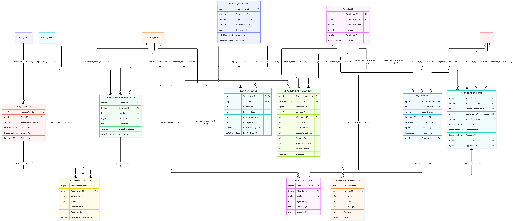
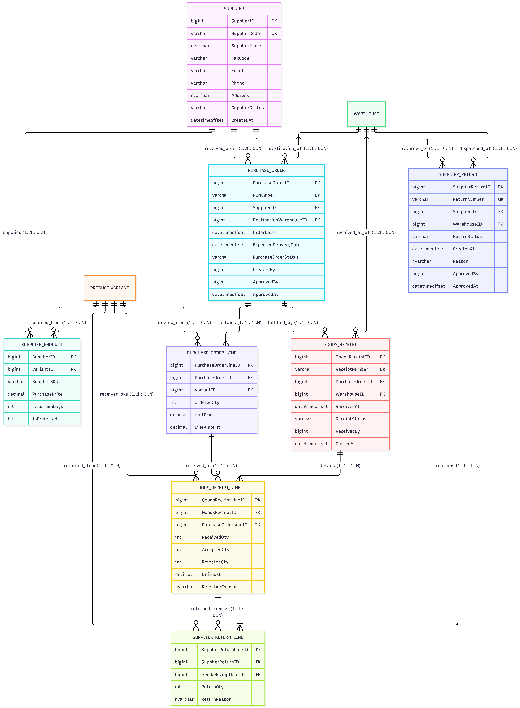
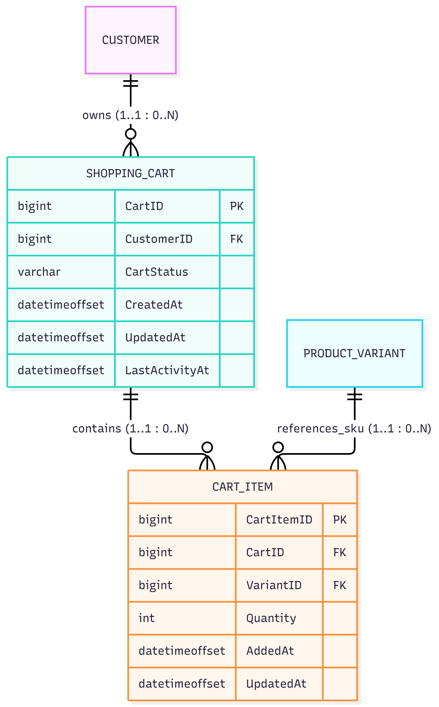
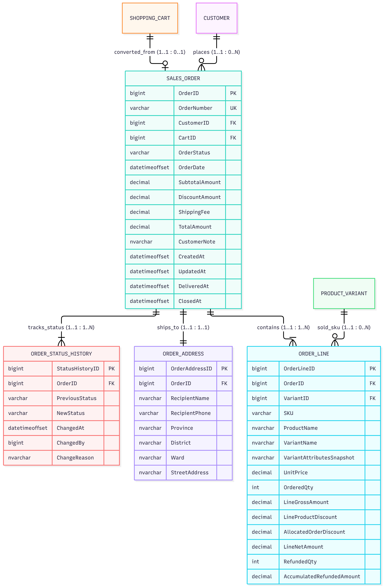
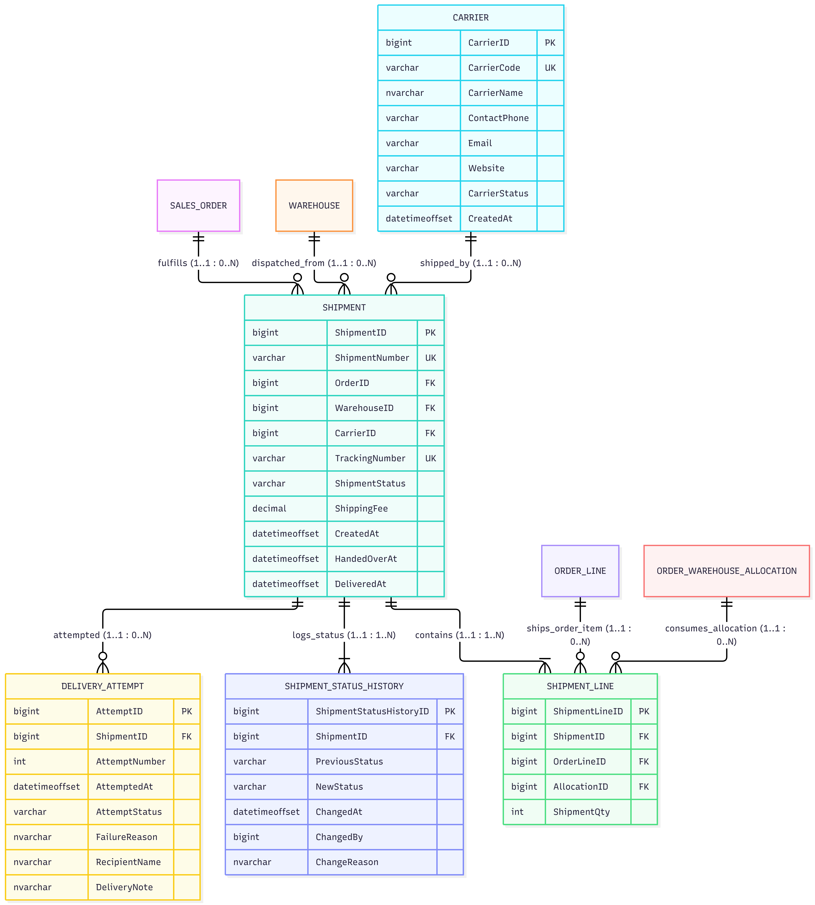
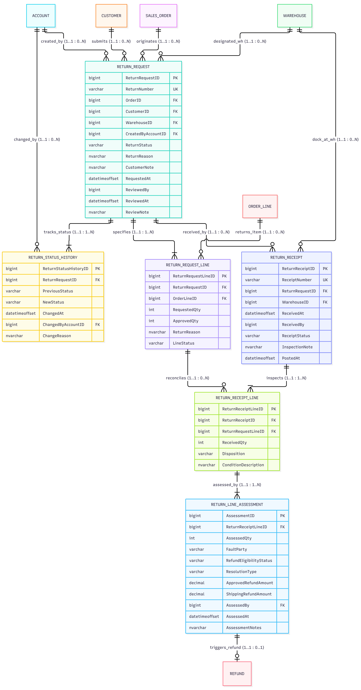

# M2.02 - RELATIONSHIP ANALYSIS & CARDINALITY (PHÂN TÍCH QUAN HỆ & BẢN SỐ)

* **Milestone:** M2 – Conceptual Database Design
* **Phiên bản:** 2.0 – Canonical SSOT Baseline (**79 Thực thể `E01` – `E79`**)
* **Subject Area:** Toàn bộ 11 Phân hệ (`SA01` – `SA11`)
* **Kế thừa:** 79 Thực thể chuẩn hóa (`E01` đến `E79`), Quyết định `BD-01`..`BD-07` & `CORR-01`..`CORR-10`

---

## 1. Phương pháp luận Phân tích Quan hệ ở Tầng Conceptual (M2)

* **Bản số (Cardinality Ratio):** $1:1$, $1:N$, hoặc $M:N$.
* **Tính tham gia (Participation Constraints):**
  * **Toàn phần (Total Participation - Bắt buộc):** Mọi thực thể của tập thực thể phải tham gia vào mối quan hệ (ví dụ: `ProductVariant` bắt buộc phải thuộc một `Product`).
  * **Một phần (Partial Participation - Tùy chọn):** Một số thực thể có thể không tham gia (ví dụ: `Product` ở trạng thái nháp có thể chưa gán `Brand` hoặc `Category`).
* **Đồng bộ trực tiếp với Logical Schema:** Mọi thực thể liên kết $N:N$ đều được tường minh hóa thành thực thể kết hợp độc lập để ánh xạ `1:1` sang 79 bảng quan hệ ở M3.

---

## 2. Phân tích 7 Nhóm Quan hệ Cốt lõi của Product Catalog (`SA01`)

### 2.0. Quan hệ Brand – Product ($1:0..N$)

| Thực thể nguồn | Quan hệ / Hành vi | Thực thể đích | Bản số | Tính tham gia (Participation) |
| :--- | :---: | :--- | :---: | :--- |
| `Brand` (E73) | sở hữu sản phẩm | `Product` (E01) | $1:N$ | Một phần (`Brand` mới tạo có thể chưa có sản phẩm; `Product` không thương hiệu có thể để `BrandID IS NULL`) |

### 2.1. Quan hệ Product – Category ($N:N$ thông qua `ProductCategory`)

| Thực thể nguồn | Quan hệ / Hành vi | Thực thể đích | Bản số | Tính tham gia (Participation) |
| :--- | :---: | :--- | :---: | :--- |
| `Product` | được gán vào | `ProductCategory` | $1:N$ | Một phần (Draft có thể chưa gán, Published bắt buộc có $\ge 1$) |
| `Category` | chứa | `ProductCategory` | $1:N$ | Một phần (Category có thể chưa có sản phẩm) |

* **Bản chất nghiệp vụ:** Một sản phẩm có thể thuộc nhiều danh mục (Áo khoác nam, BST Thu Đông 2026); Một danh mục chứa nhiều sản phẩm.
* **Thực thể kết hợp:** `ProductCategory` mang thuộc tính `IsPrimary` (BD-01, BR-PR05, BR-PR10).
* **Ràng buộc nghiệp vụ toàn vẹn:**
  * Mỗi `Product` có **tối đa một** bản ghi `ProductCategory` được đánh dấu `IsPrimary = TRUE`.
  * Khi sản phẩm chuyển sang trạng thái `Published`, hệ thống bắt buộc phải có **đúng một** danh mục chính (`PC-Q01`).

---

### 2.2. Quan hệ Product – ProductVariant ($1:N$)

| Thực thể nguồn | Quan hệ / Hành vi | Thực thể đích | Bản số | Tính tham gia (Participation) |
| :--- | :---: | :--- | :---: | :--- |
| `Product` | sở hữu các phiên bản bán | `ProductVariant` | $1:N$ | Một phần (Draft có thể chưa có SKU, Published phải có $\ge 1$ SKU) |
| `ProductVariant` | thuộc về dòng sản phẩm | `Product` | $N:1$ | **Toàn phần (Bắt buộc)** – Không có SKU mồ côi |

* **Bản chất nghiệp vụ:** Sản phẩm phân rã thành các SKU cụ thể để quản lý giá bán và tồn kho (BR-PR03, BR-PR04).
* **Quy tắc sản phẩm đơn giản (PC-Q03):** Nếu sản phẩm không có biến thể thuộc tính (như đồ gia dụng đơn chiếc), hệ thống tự động sinh 1 SKU mặc định.

---

### 2.3. Quan hệ Attribute – AttributeValue ($1:N$)

| Thực thể nguồn | Quan hệ / Hành vi | Thực thể đích | Bản số | Tính tham gia (Participation) |
| :--- | :---: | :--- | :---: | :--- |
| `Attribute` | định nghĩa các giá trị | `AttributeValue` | $1:N$ | Một phần (Thuộc tính mới tạo có thể chưa có giá trị) |
| `AttributeValue` | thuộc về loại thuộc tính | `Attribute` | $N:1$ | **Toàn phần (Bắt buộc)** |

* **Bản chất nghiệp vụ:** Từ điển thuộc tính dùng chung toàn hệ thống (PC-Q05).
* **Ví dụ:** `Color` $\rightarrow$ `Black`, `White`, `Blue`; `Size` $\rightarrow$ `S`, `M`, `L`, `XL`.
* **Định danh ứng viên:** `(AttributeID, Value)` là duy nhất.

---

### 2.4. Quan hệ Product – Attribute ($N:N$ thông qua `ProductAttribute`)

| Thực thể nguồn | Quan hệ / Hành vi | Thực thể đích | Bản số | Tính tham gia (Participation) |
| :--- | :---: | :--- | :---: | :--- |
| `Product` | khai báo sử dụng | `ProductAttribute` | $1:N$ | Một phần |
| `Attribute` | được áp dụng cho | `ProductAttribute` | $1:N$ | Một phần |

* **Bản chất nghiệp vụ:** Xác định phạm vi các thuộc tính mà sản phẩm này được phép có (ngăn chặn gán nhầm thuộc tính không phù hợp).
* **Thực thể kết hợp:** `ProductAttribute` mang thuộc tính cấu hình:
  * `AttributeRole`: Xác định vai trò của thuộc tính trên sản phẩm (`DESCRIPTIVE` cho thuộc tính chỉ mô tả chung hoặc `VARIANT_DEFINING` cho thuộc tính phân tách SKU như Size, Color) - độc quyền loại trừ lẫn nhau (BR-PR13, PC-Q04).
  * `IsRequired`: Có bắt buộc chọn khi tạo biến thể không.
  * `DisplayOrder`: Thứ tự hiển thị trên giao diện Website.

---

### 2.5. Quan hệ ProductAttribute – AttributeValue ($N:N$ thông qua `ProductAttributeValue`)

| Thực thể nguồn | Quan hệ / Hành vi | Thực thể đích | Bản số | Tính tham gia (Participation) |
| :--- | :---: | :--- | :---: | :--- |
| `ProductAttribute` | cho phép tập giá trị | `ProductAttributeValue` | $1:N$ | Một phần |
| `AttributeValue` | được kích hoạt cho | `ProductAttributeValue` | $1:N$ | Một phần |

* **Bản chất nghiệp vụ:** **Bộ lọc Whitelist giá trị được phép** của từng sản phẩm cụ thể.
* **Ví dụ:** Áo khoác Denim sử dụng thuộc tính `Color` nhưng chỉ cho phép chọn `Black` và `Blue` trong số hàng chục màu của hệ thống.
* **Định danh:** Khóa phức hợp `(ProductID, AttributeID, AttributeValueID)`.

---

### 2.6. Quan hệ ProductVariant – AttributeValue ($N:N$ thông qua `VariantAttributeValue`)

| Thực thể nguồn | Quan hệ / Hành vi | Thực thể đích | Bản số | Tính tham gia (Participation) |
| :--- | :---: | :--- | :---: | :--- |
| `ProductVariant` | được cấu thành bởi | `VariantAttributeValue` | $1:N$ | Một phần (SKU mặc định có thể rỗng) |
| `Attribute` & `AttributeValue` | định danh chiều & giá trị SKU | `VariantAttributeValue` | $1:N$ | Một phần (Composite FK `(AttributeID, AttributeValueID)` thuộc tập Whitelist `ProductAttributeValue`) |

* **Bản chất nghiệp vụ:** Gán giá trị cụ thể tạo nên một SKU độc nhất.
* **Ràng buộc nghiệp vụ sống còn:**
  1. Một Variant không được có 2 giá trị cho cùng một `AttributeID`.
  2. Giá trị gán cho SKU phải nằm trong tập `ProductAttributeValue` hợp lệ của sản phẩm đó và mang vai trò `AttributeRole = 'VARIANT_DEFINING'` (`BR-PR13`, `BR-PR14`).
  3. **Không được tồn tại 2 SKU trong cùng một sản phẩm có cùng tổ hợp các thuộc tính `AttributeRole = 'VARIANT_DEFINING'`** (BR-PR12).

---

## 3. Sơ đồ Quan hệ Khái niệm (Conceptual ERD – Subject Area 01)

> [!NOTE]
> **Tham chiếu Sơ đồ & Mã nguồn:**  
> * **Mã nguồn Mermaid:** [Product-Catalog.md](file:///c:/Users/ADMIN/OneDrive/Desktop/RetailCore%20%E2%80%93%20E-commerce%20Management%20System/docs/erd/mermaid/Product-Catalog.md)  
> * **Sơ đồ ảnh Render:** [Product-Catalog.png](file:///c:/Users/ADMIN/OneDrive/Desktop/RetailCore%20%E2%80%93%20E-commerce%20Management%20System/docs/erd/images/Product-Catalog.png)

---

## 4. Tóm tắt Kiểm tra Tính Toàn vẹn (Integrity Check)

* [x] **BD-01:** Phản ánh qua thực thể liên kết `ProductCategory` với cờ `IsPrimary`.
* [x] **BD-06:** Mô hình 5 thực thể thuộc tính động có kiểm soát (`Attribute`, `AttributeValue`, `ProductAttribute`, `ProductAttributeValue`, `VariantAttributeValue`), hoàn toàn không bị trôi nổi EAV mất kiểm soát.
* [x] **BR-PR02 & BR-PR12:** Bảo đảm tính duy nhất của `SKU` toàn hệ thống và cấm trùng lặp tổ hợp thuộc tính biến thể trong cùng một `Product`.

---

## 5. Subject Area 02: Warehouse & Inventory – Phân tích Quan hệ & Bản số

### 5.1. Bảng Quan hệ và Bản số Crow's Foot

| Quan hệ | Bản số (Cardinality) | Ký hiệu Crow's Foot | Ý nghĩa nghiệp vụ & Ràng buộc |
| :--- | :---: | :---: | :--- |
| `Warehouse` – `InventoryBalance` | $1:N$ | `|| ─── }o` | Một kho có thể có nhiều bản ghi số dư tồn kho; mỗi bản ghi thuộc đúng 1 kho. |
| `ProductVariant` – `InventoryBalance` | $1:N$ | `|| ─── }o` | Một SKU có thể có số dư tồn kho tại nhiều kho; mỗi bản ghi gắn với đúng 1 SKU. |
| `OrderLine` – `OrderWarehouseAllocation` | $1:N$ | `|| ─── }|` | Một dòng đơn hàng có thể phân bổ cho nhiều kho (Split Shipment); mỗi allocation thuộc đúng 1 dòng đơn. |
| `Warehouse` – `OrderWarehouseAllocation` | $1:N$ | `|| ─── }o` | Một kho có thể nhận nhiều phân bổ giao hàng; mỗi allocation trỏ đúng 1 kho xuất. |
| `ProductVariant` – `OrderWarehouseAllocation` | $1:N$ | `|| ─── }o` | Allocation xác định chính xác SKU cần lấy từ kho. |
| `SalesOrder` – `StockReservation` | $1:N$ | `|| ─── }o` | Một đơn hàng có thể có nhiều lần giữ hàng trong vòng đời; mỗi reservation thuộc đúng 1 đơn hàng. |
| `StockReservation` – `StockReservationLine` | $1:N$ | `|| ─── }|` | Một phiếu giữ hàng gồm nhiều dòng giữ hàng theo từng kho/SKU. |
| `OrderWarehouseAllocation` – `StockReservationLine` | $1 : 0..N$ | `|| ─── }o` | Một phân bổ kho có thể trải qua nhiều lần giữ hàng (khách thanh toán lại sau timeout); mỗi dòng reservation thuộc đúng 1 allocation. Dùng Filtered Unique Index bảo đảm tối đa 1 dòng ACTIVE tại một thời điểm (CORR-10). |
| `Warehouse` – `StockReservationLine` | $1:N$ | `|| ─── }o` | Dòng reservation xác định hàng được giữ tại kho vật lý nào. |
| `ProductVariant` – `StockReservationLine` | $1:N$ | `|| ─── }o` | Dòng reservation xác định SKU được giữ. |
| `InventoryTransaction` – `InventoryTransactionLine` | $1:N$ | `|| ─── }|` | Một chứng từ sổ cái có nhiều dòng biến động chi tiết. |
| `ProductVariant` – `InventoryTransactionLine` | $1:N$ | `|| ─── }o` | Dòng biến động ghi nhận mức thay đổi tồn kho của 1 SKU. |
| `Warehouse` – `InventoryTransactionLine` | $1:N$ | `|| ─── }o` | Dòng biến động ghi nhận mức thay đổi tồn kho tại 1 kho cụ thể. |
| `Warehouse` – `StockCount` | $1:N$ | `|| ─── }o` | Một kho có thể có nhiều đợt kiểm kê; mỗi phiếu kiểm kê thuộc đúng 1 kho. |
| `StockCount` – `StockCountLine` | $1:N$ | `|| ─── }|` | Một phiếu kiểm kê gồm nhiều dòng kiểm đếm SKU. |
| `ProductVariant` – `StockCountLine` | $1:N$ | `|| ─── }o` | Mỗi dòng kiểm kê đối soát số lượng của đúng 1 SKU. |
| `Warehouse` (Source) – `WarehouseTransfer` | $1:N$ | `|| ─── }o` | Một kho có thể là nơi xuất phát (kho nguồn) của nhiều đợt chuyển kho; mỗi phiếu có đúng 1 kho nguồn. |
| `Warehouse` (Destination) – `WarehouseTransfer` | $1:N$ | `|| ─── }o` | Một kho có thể là đích đến (kho nhận) của nhiều đợt chuyển kho; mỗi phiếu có đúng 1 kho đích. |
| `WarehouseTransfer` – `WarehouseTransferLine` | $1:N$ | `|| ─── }|` | Một phiếu chuyển kho bắt buộc có ít nhất 1 dòng SKU; mỗi dòng thuộc đúng 1 phiếu chuyển cha. |
| `ProductVariant` – `WarehouseTransferLine` | $1:N$ | `|| ─── }o` | Mỗi dòng chuyển kho xác định số lượng xuất/nhận của đúng 1 SKU. |

### 5.2. Sơ đồ Quan hệ Khái niệm (Subject Area 02: Warehouse & Inventory)

> [!NOTE]
> **Tham chiếu Sơ đồ & Mã nguồn:**  
> * **Mã nguồn Mermaid:** [Warehouse-Inventory.md](file:///c:/Users/ADMIN/OneDrive/Desktop/RetailCore%20%E2%80%93%20E-commerce%20Management%20System/docs/erd/mermaid/Warehouse-Inventory.md)  
> * **Sơ đồ ảnh Render:** [Warehouse-Inventory.png](file:///c:/Users/ADMIN/OneDrive/Desktop/RetailCore%20%E2%80%93%20E-commerce%20Management%20System/docs/erd/images/Warehouse-Inventory.png)

---

## 6. Subject Area 03: Procurement – Phân tích Quan hệ & Bản số

### 6.1. Bảng Quan hệ và Bản số Crow's Foot

| Quan hệ | Bản số (Cardinality) | Ký hiệu Crow's Foot | Ý nghĩa nghiệp vụ & Ràng buộc |
| :--- | :---: | :---: | :--- |
| `Supplier` – `SupplierProduct` | $1:N$ | `|| ─── }o` | Một nhà cung cấp có thể cung ứng nhiều SKU; mỗi liên kết thuộc đúng 1 NCC. |
| `ProductVariant` – `SupplierProduct` | $1:N$ | `|| ─── }o` | Một SKU có thể được cung ứng bởi nhiều NCC; mỗi liên kết gắn đúng 1 SKU. |
| `Supplier` – `PurchaseOrder` | $1:N$ | `|| ─── }o` | Một NCC có thể nhận nhiều đơn đặt hàng mua (PO); mỗi PO gửi đến đúng 1 NCC. |
| `Warehouse` – `PurchaseOrder` | $1:N$ | `|| ─── }o` | Một kho có thể là kho nhận dự kiến của nhiều PO; mỗi PO chỉ định đúng 1 kho nhận (PR-Q01). |
| `PurchaseOrder` – `PurchaseOrderLine` | $1:N$ | `|| ─── }|` | Một PO bắt buộc có ít nhất 1 dòng đặt hàng; mỗi dòng thuộc đúng 1 PO. |
| `ProductVariant` – `PurchaseOrderLine` | $1:N$ | `|| ─── }o` | Một SKU có thể xuất hiện trong nhiều dòng PO; mỗi dòng đặt mua đúng 1 SKU. |
| `PurchaseOrder` – `GoodsReceipt` | $1:N$ | `|| ─── }o` | Một PO có thể được giao thành nhiều đợt (Partial Receipt); mỗi phiếu nhận gắn với đúng 1 PO (PR-Q02). |
| `Warehouse` – `GoodsReceipt` | $1:N$ | `|| ─── }o` | Một kho có thể tiếp nhận nhiều phiếu nhập hàng; mỗi phiếu nhập tiếp nhận tại đúng 1 kho (trùng kho nhận của PO). |
| `GoodsReceipt` – `GoodsReceiptLine` | $1:N$ | `|| ─── }|` | Một phiếu nhập bắt buộc có ít nhất 1 dòng hàng tiếp nhận; mỗi dòng thuộc đúng 1 phiếu nhận. |
| `PurchaseOrderLine` – `GoodsReceiptLine` | $1:N$ | `|| ─── }o` | Một dòng PO có thể được giao làm nhiều lần; mỗi dòng tiếp nhận trỏ về đúng 1 dòng PO. |
| `ProductVariant` – `GoodsReceiptLine` | $1:N$ | `|| ─── }o` | Dòng tiếp nhận xác định chính xác kiểm nhận cho đúng 1 SKU. |
| `Supplier` – `SupplierReturn` | $1:N$ | `|| ─── }o` | Một NCC có thể nhận nhiều phiếu trả hàng; mỗi phiếu trả gửi tới đúng 1 NCC. |
| `Warehouse` – `SupplierReturn` | $1:N$ | `|| ─── }o` | Một kho có thể xuất trả nhiều phiếu trả hàng; mỗi phiếu xuất từ đúng 1 kho. |
| `SupplierReturn` – `SupplierReturnLine` | $1:N$ | `|| ─── }|` | Một phiếu trả hàng bắt buộc có ít nhất 1 dòng hàng trả; mỗi dòng thuộc đúng 1 phiếu trả. |
| `GoodsReceiptLine` – `SupplierReturnLine` | $1:N$ | `|| ─── }o` | Một dòng nhập hàng có thể phát sinh nhiều lần trả; mỗi dòng trả đối soát về đúng dòng tiếp nhận gốc. |
| `ProductVariant` – `SupplierReturnLine` | $1:N$ | `|| ─── }o` | Dòng trả hàng xác định số lượng xuất trả của đúng 1 SKU. |

### 6.2. Sơ đồ Quan hệ Khái niệm (Subject Area 03: Procurement)

> [!NOTE]
> **Tham chiếu Sơ đồ & Mã nguồn:**  
> * **Mã nguồn Mermaid:** [Procurement.md](file:///c:/Users/ADMIN/OneDrive/Desktop/RetailCore%20%E2%80%93%20E-commerce%20Management%20System/docs/erd/mermaid/Procurement.md)  
> * **Sơ đồ ảnh Render:** [Procurement.png](file:///c:/Users/ADMIN/OneDrive/Desktop/RetailCore%20%E2%80%93%20E-commerce%20Management%20System/docs/erd/images/Procurement.png)

---

## 7. Subject Area 04: Customer & Identity – Phân tích Quan hệ & Bản số

### 7.1. Bảng Quan hệ và Bản số Crow's Foot

| Quan hệ | Bản số (Cardinality) | Ký hiệu Crow's Foot | Ý nghĩa nghiệp vụ & Ràng buộc |
| :--- | :---: | :---: | :--- |
| `Account` – `Customer` | $1:0..1$ | `|| ─── o|` | Một Account có tối đa 1 hồ sơ Customer; mỗi Customer thuộc đúng 1 Account (CID-Q01, Ràng buộc XOR loại trừ với Employee). |
| `Account` – `Employee` | $1:0..1$ | `|| ─── o|` | Một Account có tối đa 1 hồ sơ Employee; mỗi Employee thuộc đúng 1 Account (CID-Q01, Ràng buộc XOR loại trừ với Customer). |
| `Account` – `AccountRole` | $1:N$ | `|| ─── }o` | Một Account có thể được cấp nhiều vai trò; mỗi dòng gán vai trò thuộc đúng 1 Account (CID-Q02). |
| `Role` – `AccountRole` | $1:N$ | `|| ─── }o` | Một vai trò có thể được gán cho nhiều Account; mỗi dòng trỏ về đúng 1 Role. |
| `Role` – `RolePermission` | $1:N$ | `|| ─── }o` | Một vai trò bao gồm nhiều quyền hạn; mỗi dòng cấu hình thuộc đúng 1 Role. |
| `Permission` – `RolePermission` | $1:N$ | `|| ─── }o` | Một quyền hạn có thể xuất hiện trong nhiều Role; mỗi dòng trỏ về đúng 1 Permission. |
| `Customer` – `CustomerAddress` | $1:N$ | `|| ─── }o` | Một Customer có thể có 0 hoặc nhiều địa chỉ nhận hàng; mỗi địa chỉ thuộc đúng 1 Customer (tối đa 1 địa chỉ mặc định, CID-Q06). |
| `Account` – `AccountVerification` | $1:N$ | `|| ─── }o` | Một Account có thể phát sinh nhiều yêu cầu xác thực Email/OTP; mỗi yêu cầu thuộc đúng 1 Account (CID-Q05). |

### 7.2. Sơ đồ Quan hệ Khái niệm (Subject Area 04: Customer & Identity)

> [!NOTE]
> **Tham chiếu Sơ đồ & Mã nguồn:**  
> * **Mã nguồn Mermaid:** [Customer-Identity.md](file:///c:/Users/ADMIN/OneDrive/Desktop/RetailCore%20%E2%80%93%20E-commerce%20Management%20System/docs/erd/mermaid/Customer-Identity.md)  
> * **Sơ đồ ảnh Render:** [Customer-Identity.png](file:///c:/Users/ADMIN/OneDrive/Desktop/RetailCore%20%E2%80%93%20E-commerce%20Management%20System/docs/erd/images/Customer-Identity.png)

---

## 8. Subject Area 05: Shopping – Phân tích Quan hệ & Bản số

### 8.1. Bảng Quan hệ và Bản số Crow's Foot

| Quan hệ | Bản số (Cardinality) | Ký hiệu Crow's Foot | Ý nghĩa nghiệp vụ & Ràng buộc |
| :--- | :---: | :---: | :--- |
| `Customer` – `ShoppingCart` | $1 : 0..N$ | `|| ─── }o` | Một Customer có thể có nhiều giỏ hàng trong lịch sử (`CONVERTED`, `ABANDONED`); mỗi giỏ hàng bắt buộc thuộc đúng 1 Customer (tối đa 1 giỏ `ACTIVE`, SHOP-Q01). |
| `ShoppingCart` – `CartItem` | $1 : 0..N$ | `|| ─── }o` | Một giỏ hàng có thể rỗng hoặc chứa nhiều dòng sản phẩm; mỗi dòng `CartItem` thuộc đúng 1 giỏ hàng cha (SHOP-Q02). |
| `ProductVariant` – `CartItem` | $1 : 0..N$ | `|| ─── }o` | Một SKU có thể xuất hiện trong nhiều giỏ hàng; mỗi dòng `CartItem` tham chiếu chính xác đúng 1 SKU (SHOP-Q03, SHOP-Q04). |

### 8.2. Sơ đồ Quan hệ Khái niệm (Subject Area 05: Shopping)

> [!NOTE]
> **Tham chiếu Sơ đồ & Mã nguồn:**  
> * **Mã nguồn Mermaid:** [Shopping.md](file:///c:/Users/ADMIN/OneDrive/Desktop/RetailCore%20%E2%80%93%20E-commerce%20Management%20System/docs/erd/mermaid/Shopping.md)  
> * **Sơ đồ ảnh Render:** [Shopping.png](file:///c:/Users/ADMIN/OneDrive/Desktop/RetailCore%20%E2%80%93%20E-commerce%20Management%20System/docs/erd/images/Shopping.png)

---

## 9. Subject Area 06: Sales – Phân tích Quan hệ & Bản số

### 9.1. Bảng Quan hệ và Bản số Crow's Foot

| Quan hệ | Bản số (Cardinality) | Ký hiệu Crow's Foot | Ý nghĩa nghiệp vụ & Ràng buộc |
| :--- | :---: | :---: | :--- |
| `Customer` – `SalesOrder` | $1 : 0..N$ | `|| ─── }o` | Một Customer có thể đặt nhiều đơn hàng; mỗi đơn hàng bắt buộc gắn với đúng 1 Customer (BD-02: Cấm Guest Checkout, BR-SA01). |
| `ShoppingCart` – `SalesOrder` | $0..1 : 0..1$ | `o| ─── o|` | Một giỏ hàng chuyển đổi thành tối đa 1 đơn hàng (`UX_SalesOrder_Cart WHERE CartID IS NOT NULL`); đơn đổi bù `EXCHANGE_REPLACEMENT` có `CartID IS NULL` (BR-SA03). |
| `SalesOrder` (Parent) – `SalesOrder` (Exchange) | $0..1 : 0..N$ | `o| ─── }o` | Đơn đổi hàng RMA (`OrderType = 'EXCHANGE_REPLACEMENT'`) tham chiếu đệ quy về đơn hàng gốc qua `ParentOrderID` (`CORR-01`). |
| `SalesOrder` – `OrderLine` | $1 : 1..N$ | `|| ─── }|` | Một đơn hàng bắt buộc có ít nhất 1 dòng hàng (cấm đơn rỗng); mỗi dòng thuộc đúng 1 đơn hàng (BR-SA04). |
| `ProductVariant` – `OrderLine` | $1 : 0..N$ | `|| ─── }o` | Một SKU có thể xuất hiện trong nhiều đơn hàng; dòng đơn hàng lưu snapshot để độc lập với Catalog sau này (BR-SA05, BR-SA11). |
| `SalesOrder` – `OrderAddress` | $1 : 1$ | `|| ─── ||` | Mỗi đơn hàng có đúng 1 địa chỉ giao hàng snapshot; mỗi bản ghi địa chỉ thuộc duy nhất 1 đơn hàng (`OrderID` Unique, BR-SA12, BR-SA13). |
| `SalesOrder` – `OrderStatusHistory` | $1 : 1..N$ | `|| ─── }|` | Ngay khi tạo, đơn hàng có ít nhất 1 bản ghi lịch sử trạng thái đầu tiên (`PENDING_PAYMENT`); lưu vết bất biến mọi lần chuyển trạng thái (BR-SA14). |
| `OrderLine` – `OrderWarehouseAllocation` | $1 : 1..N$ | `|| ─── }|` | Một dòng đơn hàng được phân bổ cho 1 hoặc nhiều kho vật lý xuất hàng (Split Shipment theo BD-03, WI-Q03). |
| `SalesOrder` – `StockReservation` | $1 : 0..N$ | `|| ─── }o` | Một đơn hàng liên kết với các phiếu giữ tồn kho vật lý tại các kho đã phân bổ (BD-04, WI-Q02). |

### 9.2. Sơ đồ Quan hệ Khái niệm (Subject Area 06: Sales)

> [!NOTE]
> **Tham chiếu Sơ đồ & Mã nguồn:**  
> * **Mã nguồn Mermaid:** [Sales.md](file:///c:/Users/ADMIN/OneDrive/Desktop/RetailCore%20%E2%80%93%20E-commerce%20Management%20System/docs/erd/mermaid/Sales.md)  
> * **Sơ đồ ảnh Render:** [Sales.png](file:///c:/Users/ADMIN/OneDrive/Desktop/RetailCore%20%E2%80%93%20E-commerce%20Management%20System/docs/erd/images/Sales.png)

---

## 10. Subject Area 07: Fulfillment & Shipping – Phân tích Quan hệ & Bản số

### 10.1. Bảng Quan hệ và Bản số Crow's Foot

| Quan hệ | Bản số (Cardinality) | Ký hiệu Crow's Foot | Ý nghĩa nghiệp vụ & Ràng buộc |
| :--- | :---: | :---: | :--- |
| `SalesOrder` – `Shipment` | $1 : 0..N$ | `|| ─── }o` | Một đơn hàng có thể có nhiều lô giao hàng do phân bổ từ nhiều kho (Split Shipment theo BD-03, BR-FS01, BR-FS03). Mỗi lô giao thuộc đúng một đơn hàng. |
| `Warehouse` – `Shipment` | $1 : 0..N$ | `|| ─── }o` | Mỗi lô giao hàng chỉ xuất phát từ **duy nhất một kho vật lý** (`WarehouseID` NOT NULL, SHIP-Q01, BR-FS02). Một kho có thể xuất nhiều lô giao. |
| `Carrier` – `Shipment` | $1 : 0..N$ | `|| ─── }o` | Mỗi lô giao hàng được vận chuyển bởi đúng một đơn vị vận chuyển đối tác (SHIP-Q03, BR-FS10). Một đơn vị vận chuyển có thể nhận nhiều lô giao. |
| `Shipment` – `ShipmentLine` | $1 : 1..N$ | `|| ─── }|` | Mỗi lô giao hàng bắt buộc chứa ít nhất một dòng chi tiết sản phẩm đóng gói (BR-FS05). Mỗi chi tiết dòng giao thuộc duy nhất một lô giao. |
| `OrderLine` – `ShipmentLine` | $1 : 0..N$ | `|| ─── }o` | Một dòng hàng trong đơn có thể được chia thành nhiều đợt giao hoặc xuất từ nhiều kho (BR-FS08). Ràng buộc: $\sum ShipmentQty \leq OrderedQty$. |
| `OrderWarehouseAllocation` – `ShipmentLine` | $1 : 0..N$ | `|| ─── }o` | Mỗi dòng chi tiết lô giao phải tham chiếu đúng một dòng phân bổ kho (BR-FS06, BR-FS07). Kho của Shipment phải khớp kho của Allocation (BR-FS09). |
| `Shipment` – `DeliveryAttempt` | $1 : 0..N$ | `|| ─── }o` | Một lô giao có thể trải qua nhiều lần giao hàng khi giao thất bại (SHIP-Q04, BR-FS12, BR-FS13). `AttemptNumber` tăng tuần tự (1..3); vượt hạn mức thì chuyển hoàn (BR-FS14). |
| `Shipment` – `ShipmentStatusHistory` | $1 : 1..N$ | `|| ─── }|` | Ngay khi tạo, Shipment có bản ghi trạng thái ban đầu (`PREPARING`); lưu vết bất biến mọi lần chuyển trạng thái kế tiếp từ API Webhook hoặc nhân viên (BR-FS16). |
| `Shipment` – `DeliveryReturnReceipt` | $1 : 0..1$ | `|| ─── o|` | Kiện hàng giao thất bại quay về bến nhập được thủ kho lập đúng 1 biên bản `DeliveryReturnReceipt` (E75) trước khi sinh giao dịch `DELIVERY_RETURN_IN` (BD-07). |
| `Warehouse` – `DeliveryReturnReceipt` | $1 : 0..N$ | `|| ─── }o` | Kho vật lý tiếp nhận kiện hàng chuyển hoàn từ hãng vận chuyển. |
| `Account` – `DeliveryReturnReceipt` | $1 : 0..N$ | `|| ─── }o` | Tài khoản thủ kho ký xác nhận thực nhận kiện hàng hoàn. |

### 10.2. Sơ đồ Quan hệ Khái niệm (Subject Area 07: Fulfillment & Shipping)

> [!NOTE]
> **Tham chiếu Sơ đồ & Mã nguồn:**  
> * **Mã nguồn Mermaid:** [Fulfillment-Shipping.md](file:///c:/Users/ADMIN/OneDrive/Desktop/RetailCore%20%E2%80%93%20E-commerce%20Management%20System/docs/erd/mermaid/Fulfillment-Shipping.md)  
> * **Sơ đồ ảnh Render:** [Fulfillment-Shipping.png](file:///c:/Users/ADMIN/OneDrive/Desktop/RetailCore%20%E2%80%93%20E-commerce%20Management%20System/docs/erd/images/Fulfillment-Shipping.png)

---

## 11. Subject Area 08: Promotion – Phân tích Quan hệ & Bản số

### 11.1. Bảng Quan hệ và Bản số Crow's Foot

| Quan hệ | Bản số (Cardinality) | Ký hiệu Crow's Foot | Ý nghĩa nghiệp vụ & Ràng buộc |
| :--- | :---: | :---: | :--- |
| `Promotion` – `PromotionCondition` | $1 : 0..N$ | `|| ─── }o` | Một chương trình có thể có nhiều điều kiện cấu hình sẵn (`ConditionType`, BR-PRM07); mỗi điều kiện thuộc đúng một chương trình. |
| `Promotion` – `PromotionProduct` | $1 : 0..N$ | `|| ─── }o` | Chương trình cấp sản phẩm (`PromotionScope = 'PRODUCT'`) liên kết với danh sách SKU được áp dụng (BR-PRM04). |
| `ProductVariant` – `PromotionProduct` | $1 : 0..N$ | `|| ─── }o` | Một SKU có thể nằm trong danh sách áp dụng của nhiều chương trình khuyến mãi (quan hệ $N:N$). |
| `Promotion` – `Voucher` | $1 : 0..N$ | `|| ─── }o` | Một chương trình cấp đơn hàng (`'ORDER'`) hoặc miễn giảm vận chuyển (`'SHIPPING'`) có thể phát hành một hoặc nhiều mã voucher (BR-PRM08). Mỗi voucher thuộc đúng 1 chương trình. |
| `Promotion` – `PromotionUsage` | $1 : 0..N$ | `|| ─── }o` | Một chương trình có thể có nhiều lượt sử dụng thực tế. Ràng buộc: `PendingCount + UsedCount <= MaxUsage` (BR-PRM12). |
| `SalesOrder` – `PromotionUsage` | $1 : 0..N$ | `|| ─── }o` | Một đơn hàng có thể ghi nhận nhiều ưu đãi (tối đa 1 voucher `'ORDER'`, 1 voucher `'SHIPPING'` và các ưu đãi `'PRODUCT'` theo từng dòng hàng, BD-05). |
| `OrderLine` – `PromotionUsage` | $0..1 : 0..N$ | `o| ─── }o` | Khi ưu đãi là cấp sản phẩm (`'PRODUCT'`), `OrderLineID` có giá trị; với voucher `'ORDER'`/`'SHIPPING'` thì `OrderLineID IS NULL` (BD-05, BR-PRM15). |
| `Voucher` – `PromotionUsage` | $0..1 : 0..N$ | `o| ─── }o` | Khi ưu đãi áp dụng qua mã voucher (`'ORDER'`/`'SHIPPING'`), `VoucherID` được ghi nhận; với ưu đãi tự động `'PRODUCT'` thì `VoucherID IS NULL` (BD-05, BR-PRM16). |
| `Promotion` – `PromotionTargetCustomer` | $1 : 0..N$ | `|| ─── }o` | Chương trình ưu đãi riêng tư/VIP liên kết với danh sách khách hàng được chỉ định (BR-PRM11). |
| `Customer` – `PromotionTargetCustomer` | $1 : 0..N$ | `|| ─── }o` | Một khách hàng có thể được chỉ định trong nhiều chương trình khuyến mãi riêng tư (quan hệ $N:N$). |

### 11.2. Sơ đồ Quan hệ Khái niệm (Subject Area 08: Promotion)

> [!NOTE]
> **Tham chiếu Sơ đồ & Mã nguồn:**  
> * **Mã nguồn Mermaid:** [Promotion-Voucher.md](file:///c:/Users/ADMIN/OneDrive/Desktop/RetailCore%20%E2%80%93%20E-commerce%20Management%20System/docs/erd/mermaid/Promotion-Voucher.md)  
> * **Sơ đồ ảnh Render:** [Promotion-Voucher.png](file:///c:/Users/ADMIN/OneDrive/Desktop/RetailCore%20%E2%80%93%20E-commerce%20Management%20System/docs/erd/images/Promotion-Voucher.png)

---

## 12. Subject Area 09: Payment & Refund – Phân tích Quan hệ & Bản số

### 12.1. Bảng Quan hệ và Bản số Crow's Foot

| Quan hệ | Bản số (Cardinality) | Ký hiệu Crow's Foot | Ý nghĩa nghiệp vụ & Ràng buộc |
| :--- | :---: | :---: | :--- |
| `SalesOrder` – `Payment` | $1 : 1$ | `|| ─── ||` | Mỗi đơn hàng chính thức bắt buộc có đúng một hồ sơ thanh toán (`Payment.OrderID` UNIQUE, BR-PY01). Khách hàng chọn phương thức thanh toán khi checkout. |
| `PaymentMethod` – `Payment` | $1 : 0..N$ | `|| ─── }o` | Một phương thức thanh toán có thể được sử dụng trong nhiều hồ sơ thanh toán đơn hàng (BR-PY02). Mỗi `Payment` gắn với đúng một phương thức. |
| `Payment` – `PaymentTransaction` | $1 : 0..N$ | `|| ─── }o` | Một hồ sơ thanh toán có thể có nhiều lần thử giao dịch qua cổng thanh toán khi khách hàng thanh toán lại (PAY-Q03, BR-PY04, BR-PY11). Đơn COD ghi nhận giao dịch thu tiền khi giao thành công. |
| `Payment` – `Refund` | $1 : 0..N$ | `|| ─── }o` | Một hồ sơ thanh toán đã thu tiền có thể phát sinh nhiều yêu cầu hoàn tiền toàn phần hoặc một phần (PAY-Q04, BR-PY15, BR-PY16). Ràng buộc: $\sum RefundAmount \le RemainingRefundable$. |
| `Refund` – `RefundTransaction` | $1 : 0..N$ | `|| ─── }o` | Một yêu cầu hoàn tiền có thể trải qua nhiều lần thực hiện chuyển tiền nếu lần trước thất bại hoặc hoàn nhiều đợt (BR-PY17, BR-PY19). |
| `PaymentTransaction` – `RefundTransaction` | $1 : 0..N$ | `|| ─── }o` | Mỗi giao dịch hoàn tiền truy vết trực tiếp về giao dịch thu tiền thành công nguồn ban đầu (`OriginalPaymentTransactionID`, CORR-08). |
| `PaymentMethod` – `PaymentWebhookLog` | $1 : 0..N$ | `|| ─── }o` | Một cổng thanh toán gửi nhiều sự kiện Webhook; lưu vết toàn bộ sự kiện chống xử lý trùng lặp (CORR-05, E71). |
| `Account` – `IdempotencyRecord` | $1 : 0..N$ | `|| ─── }o` | Tài khoản khởi tạo các yêu cầu đặt đơn/thanh toán có khóa chống gửi lặp `IdempotencyRecord` (CORR-05, E74). |
| `Shipment` – `CODCollection` | $1 : 0..1$ | `|| ─── o|` | Mỗi kiện hàng có thu hộ COD phát sinh tối đa 1 bản ghi thu tiền mặt `CODCollection` (E77) bởi bưu tá (CORR-07). |
| `Payment` – `CODCollection` | $1 : 0..N$ | `|| ─── }o` | Một hồ sơ thanh toán COD của đơn Split Shipment tổng hợp nhiều khoản thu `CODCollection` theo từng kiện. |
| `Carrier` – `CODCollection` | $1 : 0..N$ | `|| ─── }o` | Đơn vị vận chuyển chịu trách nhiệm khoản tiền mặt đã thu hộ trên kiện hàng. |
| `Carrier` – `CODRemittance` | $1 : 0..N$ | `|| ─── }o` | Đơn vị vận chuyển lập nhiều bảng kê chuyển khoản trả tiền COD `CODRemittance` (E78) theo kỳ đối soát. |
| `CODRemittance` – `CODReconciliation` | $1 : 1..N$ | `|| ─── }|` | Mỗi bảng kê chuyển trả COD gồm các dòng đối soát chi tiết `CODReconciliation` (E79). |
| `CODCollection` – `CODReconciliation` | $1 : 0..1$ | `|| ─── o|` | Mỗi khoản thu COD của kiện hàng được khớp đối soát tối đa 1 lần vào bảng kê quyết toán (`CODCollectionID` UNIQUE). |
| `PaymentTransaction` – `CODReconciliation` | $0..1 : 0..N$ | `o| ─── }o` | Khi đối soát thành công, các dòng quyết toán liên kết với giao dịch `PaymentTransaction` loại `COD_SETTLEMENT`. |

### 12.2. Sơ đồ Quan hệ Khái niệm (Subject Area 09: Payment & Refund)

> [!NOTE]
> **Tham chiếu Sơ đồ & Mã nguồn:**  
> * **Mã nguồn Mermaid:** [Payment-Refund.md](file:///c:/Users/ADMIN/OneDrive/Desktop/RetailCore%20%E2%80%93%20E-commerce%20Management%20System/docs/erd/mermaid/Payment-Refund.md)  
> * **Sơ đồ ảnh Render:** [Payment-Refund.png](file:///c:/Users/ADMIN/OneDrive/Desktop/RetailCore%20%E2%80%93%20E-commerce%20Management%20System/docs/erd/images/Payment-Refund.png)

---

## 13. Subject Area 10: Return & Exchange – Phân tích Quan hệ & Bản số

### 13.1. Bảng Quan hệ và Bản số Crow's Foot

| Quan hệ | Bản số (Cardinality) | Ký hiệu Crow's Foot | Ý nghĩa nghiệp vụ & Ràng buộc |
| :--- | :---: | :---: | :--- |
| `SalesOrder` – `ReturnRequest` | $1 : 0..N$ | `|| ─── }o` | Một đơn hàng đã giao thành công có thể phát sinh nhiều yêu cầu đổi trả hàng từng phần (BR-RT01). Mỗi RMA thuộc đúng một đơn hàng gốc. |
| `Customer` – `ReturnRequest` | $1 : 0..N$ | `|| ─── }o` | Một khách hàng có thể tạo nhiều yêu cầu trả hàng trong lịch sử mua sắm. Mỗi RMA phải thuộc đúng khách hàng sở hữu đơn. |
| `Account` – `ReturnRequest` (CreatedBy) | $1 : 0..N$ | `|| ─── }o` | Một tài khoản (khách hàng hoặc nhân viên CSKH tạo hộ) có thể khởi tạo nhiều yêu cầu RMA (RET-Q01, BR-RT02). |
| `Warehouse` – `ReturnRequest` | $1 : 0..N$ | `|| ─── }o` | Mỗi yêu cầu trả hàng chỉ định duy nhất một kho tiếp nhận (`WarehouseID` NOT NULL, RET-Q06, BR-RT11). Một kho có thể được chỉ định cho nhiều RMA. |
| `ReturnRequest` – `ReturnRequestLine` | $1 : 1..N$ | `|| ─── }|` | Mỗi yêu cầu trả hàng bắt buộc có ít nhất một dòng hàng yêu cầu trả (BR-RT05). Mỗi dòng chi tiết thuộc duy nhất một RMA. |
| `OrderLine` – `ReturnRequestLine` | $1 : 0..N$ | `|| ─── }o` | Một dòng hàng trong đơn có thể xuất hiện trong nhiều yêu cầu trả hàng nếu còn số lượng đủ điều kiện (BR-RT08, BR-RT09). |
| `ReturnRequestLine` – `ReturnShipmentAllocation` | $1 : 1..N$ | `|| ─── }|` | Dòng yêu cầu đổi trả bắt buộc phân bổ vào ít nhất 1 dòng kiện hàng đã giao qua `ReturnShipmentAllocation` (E76) để kiểm tra hạn đổi trả theo `Shipment.DeliveredAt` (CORR-10). |
| `ShipmentLine` – `ReturnShipmentAllocation` | $1 : 0..N$ | `|| ─── }o` | Một dòng kiện giao có thể phát sinh đổi trả từng phần qua nhiều lần RMA miễn không vượt `ShipmentQty`. |
| `ReturnRequest` – `ReturnReceipt` | $1 : 0..N$ | `|| ─── }o` | Một yêu cầu trả hàng có thể được kho tiếp nhận thành nhiều phiếu nhận nếu khách gửi nhiều kiện (BR-RT13). |
| `Warehouse` – `ReturnReceipt` | $1 : 0..N$ | `|| ─── }o` | Mỗi phiếu tiếp nhận thuộc duy nhất một kho vật lý và phải khớp với kho đã chỉ định trên `ReturnRequest` (BR-RT12). |
| `ReturnReceipt` – `ReturnReceiptLine` | $1 : 1..N$ | `|| ─── }|` | Mỗi phiếu tiếp nhận bắt buộc có ít nhất một dòng kiểm đếm thực tế (BR-RT14). |
| `ReturnRequestLine` – `ReturnReceiptLine` | $1 : 0..N$ | `|| ─── }o` | Một dòng yêu cầu trả hàng có thể được tiếp nhận qua nhiều dòng phiếu nhận (do gửi nhiều đợt kiện). |
| `ReturnReceiptLine` – `ReturnLineAssessment` | $1 : 1..N$ | `|| ─── }|` | Một dòng nhận hàng có thể phân tách thành nhiều kết luận KCS độc lập cho từng phần số lượng (CORR-01, E72). |
| `ReturnRequest` – `ReturnStatusHistory` | $1 : 1..N$ | `|| ─── }|` | Ngay khi tạo, RMA có bản ghi trạng thái đầu tiên (`PENDING_APPROVAL`); lưu vết bất biến mọi lần chuyển đổi trạng thái (RET-Q08, BR-RT22). |
| `Account` – `ReturnStatusHistory` | $1 : 0..N$ | `|| ─── }o` | Một tài khoản nhân viên hoặc khách hàng có thể thực hiện nhiều lần chuyển trạng thái trong các yêu cầu trả hàng. |
| `ReturnLineAssessment` – `Refund` | $0..1 : 0..1$ | `o| ─── o|` | Dòng đánh giá kiểm định đạt `RefundEligibilityStatus = 'APPROVED'` kích hoạt tạo `Refund`; ngược lại `Refund` từ hủy đơn trả trước trước giao hàng có `ReturnLineAssessmentID IS NULL` (CORR-01). |

### 13.2. Sơ đồ Quan hệ Khái niệm (Subject Area 10: Return & Exchange)

> [!NOTE]
> **Tham chiếu Sơ đồ & Mã nguồn:**  
> * **Mã nguồn Mermaid:** [Return-Exchange.md](file:///c:/Users/ADMIN/OneDrive/Desktop/RetailCore%20%E2%80%93%20E-commerce%20Management%20System/docs/erd/mermaid/Return-Exchange.md)  
> * **Sơ đồ ảnh Render:** [Return-Exchange.png](file:///c:/Users/ADMIN/OneDrive/Desktop/RetailCore%20%E2%80%93%20E-commerce%20Management%20System/docs/erd/images/Return-Exchange.png)

---

## 14. Subject Area 11: Audit & Reporting – Phân tích Quan hệ & Bản số

### 14.1. Bảng Quan hệ và Bản số Crow's Foot

| Quan hệ | Bản số (Cardinality) | Ký hiệu Crow's Foot | Ý nghĩa nghiệp vụ & Ràng buộc |
| :--- | :---: | :---: | :--- |
| `Account` – `AuditLog` | $0..1 : 0..N$ | `o| ─── }o` | Một tài khoản người dùng có thể thực hiện nhiều hành động được ghi audit log. Sự kiện hệ thống tự động chạy ngầm có thể để trống `AccountID` (BR-AR03, BR-AR04). |
| `AuditLog` – `AuditLogDetail` | $1 : 0..N$ | `|| ─── }o` | Một sự kiện audit có thể ghi nhận chi tiết nhiều thuộc tính bị thay đổi (BR-AR05). Các hành động không thay đổi dữ liệu (như LOGIN) không có detail. |
| `ReportDefinition` – `ReportExecution` | $1 : 0..N$ | `|| ─── }o` | Một mẫu báo cáo có thể được người dùng thực thi chạy nhiều lần với các tham số lọc khác nhau (BR-AR10, BR-AR11). |
| `Account` – `ReportExecution` | $1 : 0..N$ | `|| ─── }o` | Một tài khoản nhân viên có thể yêu cầu chạy hoặc xuất file nhiều báo cáo trong quá trình làm việc (BR-AR12). |
| `ReportDefinition` – `ReportSnapshot` | $1 : 0..N$ | `|| ─── }o` | Một mẫu báo cáo có thể có nhiều snapshot chốt số liệu theo các kỳ kế toán/thời điểm khác nhau (BR-AR15, BR-AR16). |
| `Account` – `ReportSnapshot` | $0..1 : 0..N$ | `o| ─── }o` | Một tài khoản hoặc tiến trình định kỳ có thể tạo ra nhiều bản chụp số liệu báo cáo. |
| `ReportDefinition` – `ReportPermission` | $1 : 0..N$ | `|| ─── }o` | Một báo cáo có thể được cấu hình phân quyền cho nhiều vai trò (`Role`) khác nhau (BR-AR18). |
| `Role` – `ReportPermission` | $1 : 0..N$ | `|| ─── }o` | Một vai trò trong hệ thống có thể được cấp quyền trên nhiều mẫu báo cáo (quan hệ $N:N$, BR-AR18, BR-AR19). |

### 14.2. Sơ đồ Quan hệ Khái niệm (Subject Area 11: Audit & Reporting)

> [!NOTE]
> **Tham chiếu Sơ đồ & Mã nguồn:**  
> * **Mã nguồn Mermaid:** [Audit-Reporting.md](file:///c:/Users/ADMIN/OneDrive/Desktop/RetailCore%20%E2%80%93%20E-commerce%20Management%20System/docs/erd/mermaid/Audit-Reporting.md)  
> * **Sơ đồ ảnh Render:** [Audit-Reporting.png](file:///c:/Users/ADMIN/OneDrive/Desktop/RetailCore%20%E2%80%93%20E-commerce%20Management%20System/docs/erd/images/Audit-Reporting.png)

