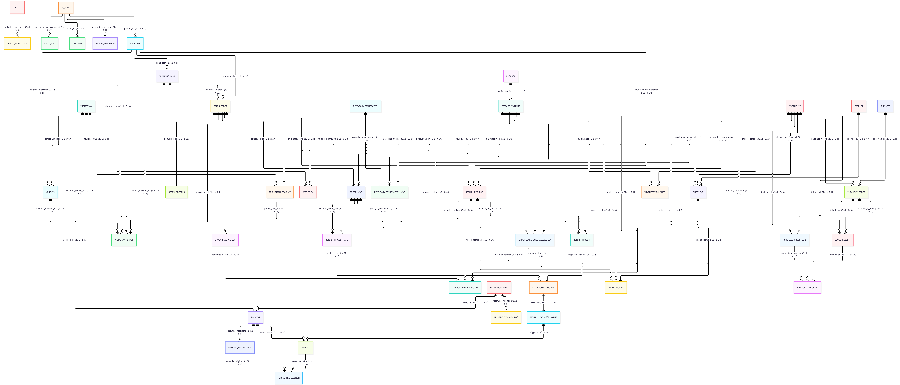
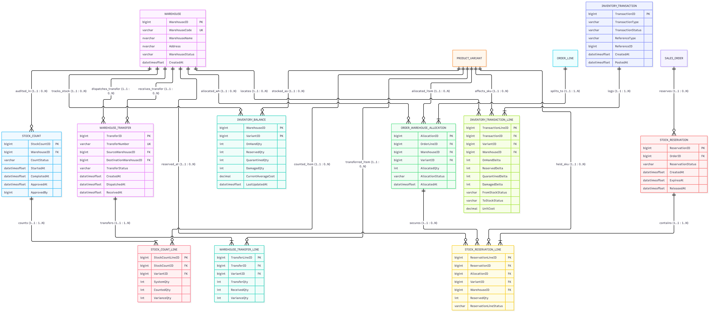
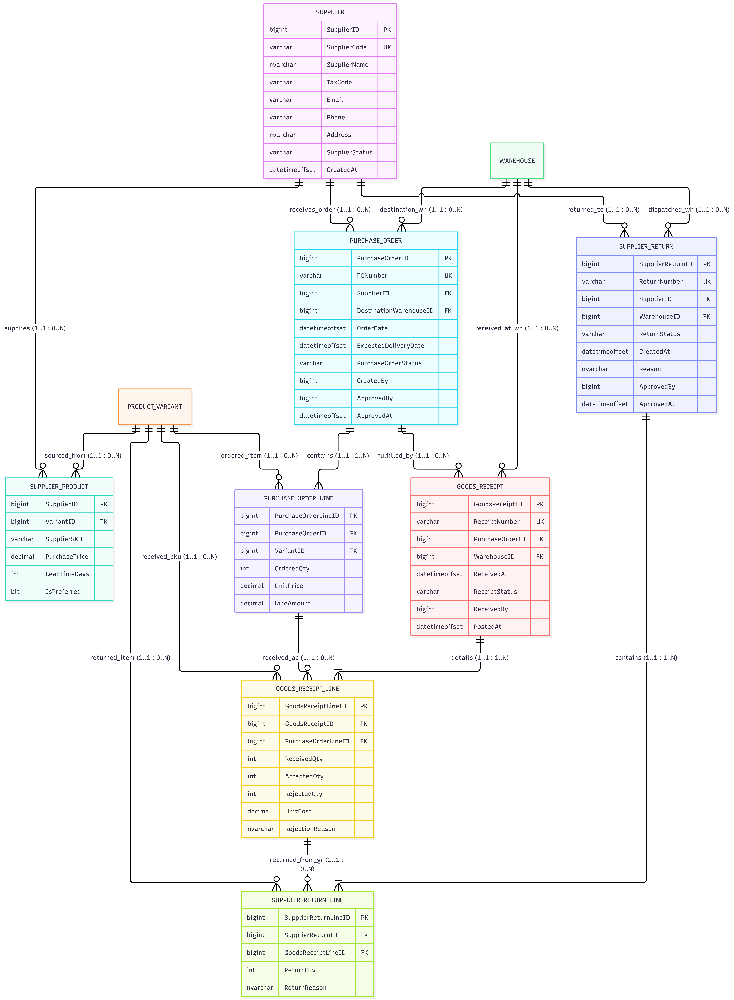
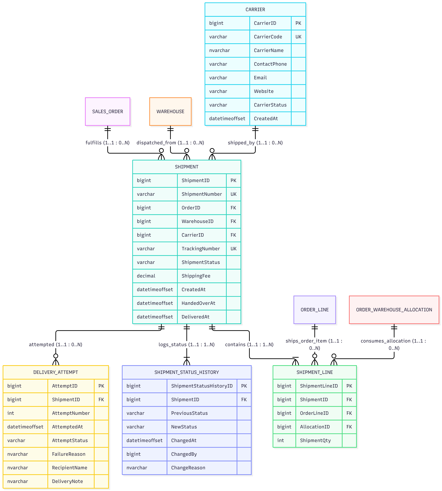

# M2.04 - MASTER CONCEPTUAL ERD DIAGRAM (SƠ ĐỒ QUAN HỆ KHÁI NIỆM TỔNG THỂ)

* **Milestone:** M2 – Conceptual Database Design
* **Phiên bản:** 1.0 – Official Release (Master Integration)
* **Hệ quản trị CSDL mục tiêu:** Microsoft SQL Server Enterprise Edition
* **Kế thừa trực tiếp:**
  * [01-Entity-Catalog.md](file:///c:/Users/ADMIN/OneDrive/Desktop/RetailCore%20%E2%80%93%20E-commerce%20Management%20System/docs/Milestones/M2-Conceptual-Design/01-Entity-Catalog.md) (70 Thực thể E01 – E70)
  * [02-Relationship-Analysis.md](file:///c:/Users/ADMIN/OneDrive/Desktop/RetailCore%20%E2%80%93%20E-commerce%20Management%20System/docs/Milestones/M2-Conceptual-Design/02-Relationship-Analysis.md) (Phân tích bản số Crow's Foot 11 Phân hệ)
  * [05-Design-Decisions.md](file:///c:/Users/ADMIN/OneDrive/Desktop/RetailCore%20%E2%80%93%20E-commerce%20Management%20System/docs/Milestones/M2-Conceptual-Design/05-Design-Decisions.md) (3 Nguyên tắc bất biến & Quyết định thiết kế)
  * Quyết định kiến trúc [11-Business-Decisions.md](file:///c:/Users/ADMIN/OneDrive/Desktop/RetailCore%20%E2%80%93%20E-commerce%20Management%20System/docs/Milestones/M1-Business-Analysis/11-Business-Decisions.md) (BD-01 đến BD-07)

---

## 1. TỔNG QUAN KIẾN TRÚC MÔ HÌNH DỮ LIỆU KHÁI NIỆM (M2 ARCHITECTURE)

Hệ thống **RetailCore – E-commerce Management System** được mô hình hóa ở tầng Quan niệm (Conceptual Design) bao gồm **70 Thực thể chuẩn hóa (E01 đến E70)** phân bổ trên **11 Phân hệ nghiệp vụ (Subject Areas)**. 

Mô hình tuân thủ triệt để phương pháp luận Crow's Foot Notation, xác định rõ bản số ($1:1$, $1:N$, $N:N$), tính tham gia bắt buộc/tùy chọn (Total/Partial Participation), bảo đảm tính toàn vẹn tham chiếu khái niệm và chuẩn bị nền tảng hoàn hảo cho bước chuyển đổi sang Mô hình Luận lý (Logical Schema) chuẩn 3NF/BCNF trên Microsoft SQL Server.

### Bản đồ 11 Phân hệ Nghiệp vụ và 70 Thực thể:
```
+----------------------------------------------------------------------------------------------------+
|                                 RETAILCORE CONCEPTUAL DOMAINS                                      |
+----------------------------------------------------------------------------------------------------+
|  01. Product Catalog (E01..E09)     | 05. Shopping (E38..E39)       | 09. Payment & Refund (E55..E59)  |
|  02. Warehouse & Inv. (E10..E20)   | 06. Sales (E40..E43)          | 10. Return & Exchange (E60..E64)|
|  03. Procurement (E21..E28)         | 07. Fulfillment (E44..E48)    | 11. Audit & Reporting (E65..E70) |
|  04. Customer & Identity (E29..E37) | 08. Promotion (E49..E54)      |                                  |
+----------------------------------------------------------------------------------------------------+
```

---

## 2. NĂM BẤT BIẾN KIẾN TRÚC BẮT BUỘC TRONG THIẾT KẾ ERD

Mọi mối quan hệ trong sơ đồ ERD tổng thể phải thỏa mãn tuyệt đối 5 bất biến kiến trúc:
1. **Phân tách 4 khái niệm Tồn kho (BD-04, WI-Q01..06):**
   * `OrderWarehouseAllocation` (E12 - Kế hoạch phân bổ kho).
   * `StockReservation` & `StockReservationLine` (E13, E14 - Khóa giữ logic có thời hạn).
   * `ShipmentLine` (E46 - Đóng gói thực tế xuất bãi).
   * `InventoryTransaction` & `InventoryTransactionLine` (E15, E16 - Sổ cái ghi sổ hai chiều Dual-Delta `OnHandDelta`/`ReservedDelta`).
2. **Độc lập 3 Máy trạng thái Giao dịch (SALES-Q02, PAY-Q08, SHIP-Q06):**
   * `SalesOrder.OrderStatus` $\ne$ `Payment.PaymentStatus` $\ne$ `Shipment.ShipmentStatus`.
3. **Nguyên tử hóa Tạo đơn & Giữ hàng (All-or-Nothing, SALES-Q01, BD-04):**
   * `ShoppingCart` chỉ chuyển `CONVERTED` thành `SalesOrder` khi `StockReservation` khóa thành công 100% tồn kho trên tất cả các kho được phân bổ.
4. **Bất biến Dữ liệu Lịch sử & Cấm Xóa cứng (Append-Only / No Hard Delete):**
   * `OrderLine` (E41) snapshot nguyên trạng SKU, tên, đơn giá và `VariantAttributesSnapshot` JSON.
   * `OrderAddress` (E42) snapshot độc lập với sổ địa chỉ `CustomerAddress` (E36).
   * Chứng từ giao dịch (`SalesOrder`, `Payment`, `Shipment`, `ReturnRequest`, `AuditLog`) tuyệt đối không xóa vật lý.
5. **Cấu trúc Khuyến mãi Hai tầng (BD-05, PROMO-Q01..08):**
   * Tối đa 1 khuyến mãi cấp sản phẩm liên kết với `OrderLine` và tối đa 1 voucher cấp đơn liên kết với `SalesOrder`. Ghi nhận lịch sử chiết khấu snapshot vào `PromotionUsage` (E53).

---

## 3. MASTER CROSS-DOMAIN BACKBONE ERD (SƠ ĐỒ TRỤC XƯƠNG SỐNG LIÊN PHÂN HỆ)

Sơ đồ biểu diễn **Trục xương sống liên kết liên miền (Cross-Domain Backbone)** kết nối các Thực thể Trung tâm (Hub Entities) đại diện cho 11 phân hệ:

> [!NOTE]
> **Tham chiếu Sơ đồ & Mã nguồn:**  
> * **Mã nguồn Mermaid:** [Cross-Domain-Backbone.md](file:///c:/Users/ADMIN/OneDrive/Desktop/RetailCore%20%E2%80%93%20E-commerce%20Management%20System/docs/Milestones/M2-Conceptual-Design/ERD/mermaid/Cross-Domain-Backbone.md)  
> * **Sơ đồ ảnh Render:** [Cross-Domain-Backbone.png](file:///c:/Users/ADMIN/OneDrive/Desktop/RetailCore%20%E2%80%93%20E-commerce%20Management%20System/docs/Milestones/M2-Conceptual-Design/ERD/images/Cross-Domain-Backbone.png)



### 3.1. Khái niệm & Triết lý Thiết kế Trục Xương sống (Cross-Domain Backbone Philosophy)

Trong hệ thống CSDL bán lẻ thương mại điện tử quy mô lớn như **RetailCore** với **11 Phân hệ (Subject Areas)** và **70 Thực thể**, nếu để tất cả các thực thể tự do kết nối chéo với nhau theo cấu trúc lưới toàn phần (Full Mesh), mô hình quan hệ sẽ rơi vào tình trạng "mớ bòng bong" (Spaghetti Architecture), phát sinh phụ thuộc vòng (Circular FK Dependencies) và gây bế tắc giao dịch (Deadlock) ở tầng CSDL quan hệ.

Trục xương sống liên miền (**Cross-Domain Backbone**) được thiết kế theo nguyên lý **Hub-and-Spoke kết hợp Clean Architecture**:
1. **Cô lập Nội miền (Internal Encapsulation):** Mỗi phân hệ chỉ công khai một số ít các **Thực thể Hạt nhân (Hub Entities)** đóng vai trò giao diện tiếp giáp (Boundary Interfaces). Toàn bộ các thực thể chi tiết phụ trợ (như cấu hình thuộc tính, lịch sử trạng thái, chi tiết nhật ký kiểm toán) được giấu kín bên trong nội bộ phân hệ.
2. **Quy hoạch Giao thông Liên miền (Standardized Cross-Domain Highway):** Mọi giao tiếp liên phân hệ bắt buộc phải đi qua trục Backbone này thông qua **40 liên kết liên miền chuẩn hóa (CR-01 đến CR-40)**.
3. **Phân định Chủ quyền Tuyệt đối (Strict Data Ownership):** Mỗi thực thể thuộc quyền kiểm soát của duy nhất một phân hệ nghiệp vụ, triệt tiêu tranh chấp thẩm quyền và đảm bảo tính toàn vẹn tham chiếu.

---

### 3.2. Danh mục Thực thể Hạt nhân (Hub Entities) trên Trục Xương sống

| Phân hệ (Subject Area) | Thực thể Hạt nhân (Hub Entities) | Vai trò trên Trục Xương sống (Backbone Role) | Các liên kết liên miền đại diện |
| :--- | :--- | :--- | :--- |
| **01. Product Catalog** | `ProductVariant` (E04) | **Hạt nhân Hàng hóa (Core SKU):** Định danh đơn vị sản phẩm thương mại cụ thể (Size, Màu). Là giao diện trung tâm kết nối kho, đơn hàng, nhà cung cấp và khuyến mãi. | CR-01 đến CR-13 |
| **02. Warehouse & Inv.** | `Warehouse` (E10), `OrderWarehouseAllocation` (E12), `StockReservation` (E13), `InventoryTransaction` (E15) | **Hạt nhân Kho vận & Tồn kho:** Quản lý kho bãi vật lý, kế hoạch định tuyến đa kho (Split Shipment), khóa giữ tồn kho tạm thời và sổ cái biến động kho hai chiều. | CR-01..06, CR-14..21, CR-30 |
| **03. Procurement** | `Supplier` (E21), `PurchaseOrder` (E23), `GoodsReceipt` (E25) | **Hạt nhân Cung ứng:** Quản lý dòng hàng hóa nhập kho từ nhà cung cấp bên ngoài vào mạng lưới kho của doanh nghiệp. | CR-07..10, CR-14..16 |
| **04. Customer & Identity** | `Account` (E29), `Customer` (E30), `Role` (E32) | **Hạt nhân Chủ thể & Định danh:** Quản lý tài khoản đăng nhập, hồ sơ khách hàng mua sắm và phân quyền nhân viên quản trị. | CR-22..26, CR-37..40 |
| **05. Shopping** | `ShoppingCart` (E38), `CartItem` (E39) | **Hạt nhân Tiền Giao dịch:** Quản lý giỏ hàng trực tuyến của khách trước khi chuyển đổi thành hợp đồng mua bán chính thức. | CR-11, CR-22, CR-27 |
| **06. Sales** | `SalesOrder` (E40), `OrderLine` (E41), `OrderAddress` (E42) | **Trái tim Hợp đồng Bán hàng:** Thực thể trung tâm tối cao kết nối khách hàng, định tuyến kho xuất bãi, nghĩa vụ thanh toán và bưu kiện vận chuyển. | CR-12, CR-20, CR-21, CR-27..35 |
| **07. Fulfillment & Ship.** | `Carrier` (E44), `Shipment` (E45), `ShipmentLine` (E46) | **Hạt nhân Giao vận Bưu kiện:** Hiện thực hóa việc đóng gói và chuyển phát hàng từ kho xuất đến tận tay khách hàng thông qua hãng vận chuyển. | CR-17, CR-28..30 |
| **08. Promotion & Voucher** | `Promotion` (E49), `Voucher` (E52), `PromotionUsage` (E53) | **Hạt nhân Khuyến mãi & Chiết khấu:** Quản lý quota ưu đãi và lưu vết sổ cái phân bổ giảm giá cho từng đơn hàng và dòng sản phẩm. | CR-13, CR-24, CR-25, CR-31, CR-32 |
| **09. Payment & Refund** | `Payment` (E56), `PaymentTransaction` (E57), `Refund` (E58) | **Hạt nhân Huyết mạch Tài chính:** Quản lý nghĩa vụ thu tiền đơn hàng ($1:1$ với SalesOrder), lịch sử giao dịch cổng thanh toán và dòng tiền hoàn trả. | CR-33, CR-36 |
| **10. Return & Exchange** | `ReturnRequest` (E60), `ReturnReceipt` (E62) | **Hạt nhân Logistics Ngược (RMA):** Tiếp nhận khiếu nại trả hàng, tiếp nhận bưu kiện tại bến nhập và kiểm định phân loại chất lượng trước khi hoàn tiền. | CR-18, CR-19, CR-26, CR-34..36 |
| **11. Audit & Reporting** | `AuditLog` (E65), `ReportExecution` (E68) | **Hạt nhân Giám sát & Báo cáo:** Theo dõi vết thao tác nhạy cảm của người dùng và kết xuất báo cáo thống kê quản trị toàn hệ thống. | CR-37..40 |

---

### 3.3. Bốn Luồng Dữ liệu Huyết mạch Xuyên Miền (The 4 Core Cross-Domain Data Flows)

Toàn bộ hoạt động vận hành của RetailCore lưu thông qua trục Backbone theo 4 luồng dữ liệu huyết mạch:

```
[Luồng 1: Dòng Hàng Nhập]  Supplier ---> PurchaseOrder ---> GoodsReceipt ---> Warehouse / InventoryBalance
                                                                                       |
[Luồng 2: Dòng Bán Hàng]   Customer ---> ShoppingCart ---> SalesOrder ---> Allocation + Reservation ---> Shipment (Carrier)
                                                                |                      |
[Luồng 3: Dòng Tiền Tệ]    Promotion / Voucher ---------> PromotionUsage               | (Xuất kho thực tế)
                                                                |                      v
                                                          Payment / Tx <--- InventoryTransaction (Dual-Delta)
                                                                |
[Luồng 4: Dòng Trả Ngược]  Customer ---> ReturnRequest ---> ReturnReceipt (KCS) ---> Restock to Warehouse
                                                                |
                                                                +-------------> Refund / RefundTx
```

#### 1. Luồng 1: Dòng Hàng hóa Nhập kho & Tồn trữ (Goods Inward & Storage Flow)
* **Các miền tham gia:** `Procurement (03)` $\longrightarrow$ `Warehouse & Inventory (02)` $\longrightarrow$ `Product Catalog (01)`.
* **Cơ chế vận hành:**
  * Doanh nghiệp phát hành đơn đặt mua hàng `PurchaseOrder` gửi tới `Supplier`, chỉ định rõ `WarehouseID` tiếp nhận và các SKU cụ thể (`PurchaseOrderLine` trỏ `ProductVariant`).
  * Khi nhà cung cấp giao hàng đến cửa kho, nhân viên kho lập biên bản `GoodsReceipt` và kiểm đếm thực tế từng dòng `GoodsReceiptLine`.
  * Khi biên bản được duyệt (`PostedAt` NOT NULL), hệ thống tự động ghi sổ cái `InventoryTransaction` loại `PO_RECEIPT_IN` và tăng số dư tồn kho vật lý `InventoryBalance.OnHandQty` tại đúng kho đó.
  * **Bảo toàn chi phí:** Đơn giá mua thực tế được snapshot cứng vào `GoodsReceiptLine.UnitCost` để phục vụ tính giá vốn bình quân gia quyền.

#### 2. Luồng 2: Dòng Đơn hàng, Phân bổ & Giao vận (Sales Order, Allocation & Dispatch Flow)
* **Các miền tham gia:** `Customer & Identity (04)` $\longrightarrow$ `Shopping (05)` $\longrightarrow$ `Sales (06)` $\longrightarrow$ `Warehouse & Inventory (02)` $\longrightarrow$ `Fulfillment & Shipping (07)`.
* **Cơ chế vận hành:**
  * Khách hàng (`Customer`) chọn SKU (`ProductVariant`) vào `CartItem` thuộc `ShoppingCart`.
  * Khi tiến hành thanh toán, hệ thống thực thi giao dịch All-or-Nothing: Giỏ hàng chuyển sang `CONVERTED`, sinh `SalesOrder` và các dòng `OrderLine`.
  * **Định tuyến kho xuất:** Thuật toán phân bổ tạo các bản ghi `OrderWarehouseAllocation`, phân rã từng dòng hàng về các kho vật lý phù hợp (xử lý đơn hàng đa kho - Split Shipment).
  * **Khóa giữ tạm thời:** Đồng thời tạo `StockReservation` và `StockReservationLine`, tạm khóa số lượng tồn kho `ReservedQty` tại các kho chỉ định trong vòng 15 phút.
  * **Đóng gói xuất bến:** Nhân viên từng kho đóng gói bưu kiện `Shipment`, lấy hàng theo đúng dòng phân bổ (`ShipmentLine.AllocationID`). Khi bưu tá (`Carrier`) nhận hàng đi giao (`ShipmentStatus = DISPATCHED`), hệ thống mới ghi `InventoryTransaction` loại `SHIPMENT_OUT` để trừ `OnHandQty` vật lý và giải phóng `ReservedQty`.

#### 3. Luồng 3: Dòng Tiền tệ & Chiết khấu Khuyến mãi (Financial Settlement & Promotion Flow)
* **Các miền tham gia:** `Promotion & Voucher (08)` $\longrightarrow$ `Sales (06)` $\longrightarrow$ `Payment & Refund (09)`.
* **Cơ chế vận hành:**
  * Các chương trình khuyến mãi (`Promotion`) và mã giảm giá (`Voucher`) được khách hàng áp dụng khi đặt hàng.
  * Hệ thống ghi nhận lịch sử tiêu thụ bất biến vào `PromotionUsage`, lưu vết rõ ràng số tiền chiết khấu phân bổ cho đơn hàng tổng (`SalesOrder`) và cho từng dòng sản phẩm chi tiết (`OrderLine`).
  * Mỗi `SalesOrder` liên kết đúng $1:1$ với duy nhất một hồ sơ nghĩa vụ tài chính `Payment`.
  * Mọi lần thanh toán (thẻ tín dụng, chuyển khoản qua Webhook cổng thanh toán VNPAY/MoMo, hoặc đối soát bưu tá COD) đều được ghi nhận thành các bản ghi `PaymentTransaction` riêng biệt để bảo toàn vết kiểm toán dòng tiền.

#### 4. Luồng 4: Dòng Đổi trả, Kiểm định & Hoàn tiền (Reverse Logistics & Refund Flow)
* **Các miền tham gia:** `Sales (06)` $\longrightarrow$ `Return & Exchange (10)` $\longrightarrow$ `Warehouse & Inventory (02)` $\longrightarrow$ `Payment & Refund (09)`.
* **Cơ chế vận hành:**
  * Khách hàng tạo yêu cầu khiếu nại trả hàng `ReturnRequest` gắn liền với `SalesOrder` gốc đã giao thành công.
  * Bưu kiện hàng trả được chuyển về kho chỉ định, lập biên bản `ReturnReceipt`.
  * Nhân viên KCS tiến hành kiểm định chất lượng từng sản phẩm và gắn trạng thái phân loại (`Disposition`):
    * `SELLABLE` (Hàng còn nguyên tem mác): Sinh `InventoryTransaction` loại `CUSTOMER_RETURN_IN`, cộng lại vào tồn kho bán `OnHandQty`.
    * `QUARANTINE` / `DISPOSED` (Hàng lỗi, hỏng hóc): Chuyển kho cách ly hoặc hủy bỏ, cấm cộng vào tồn kho bán.
  * Khi biên bản kiểm định hoàn tất, hệ thống tự động kích hoạt tạo chứng từ `Refund` bên Subject Area 09.
  * Số tiền hoàn trả được tính toán chuẩn xác dựa trên số tiền thực thu sau khi đã trừ chiết khấu voucher truy vết từ `PromotionUsage`.

---

### 3.4. Thuyết minh Chi tiết Chu trình Vận hành Khép kín từ A đến Z của một Đơn hàng (End-to-End Order Lifecycle Walkthrough)

Dưới đây là kịch bản phân tích chi tiết từng bước chuyển đổi dữ liệu và trạng thái giữa các Hub Entities qua 6 giai đoạn nghiệp vụ:

```
+-------------------------------------------------------------------------------------------------------------+
|                                  END-TO-END ORDER LIFECYCLE WALKTHROUGH                                     |
+-------------------------------------------------------------------------------------------------------------+
| Chặng 1: Mua sắm & Chốt đơn    ---> Snapshot dữ liệu (Địa chỉ, Giá, Thuộc tính SKU JSON)                    |
| Chặng 2: Định tuyến & Giữ hàng ---> Phân bổ đa kho (Allocation) + Khóa giữ 15 phút (Reservation)             |
| Chặng 3: Áp mã & Thanh toán    ---> Phân bổ chiết khấu (PromotionUsage) + Khởi tạo Payment ($1:1$)          |
| Chặng 4: Đóng gói & Xuất kho   ---> Kiện hàng Shipment + Trừ tồn vật lý (InventoryTransaction: SHIPMENT_OUT)|
| Chặng 5: Giao nhận & Đối soát  ---> Bưu tá giao (Delivered) + Bảng kê tiền mặt COD (COD_SETTLEMENT)        |
| Chặng 6: Đổi trả & Hoàn tiền   ---> Phiếu RMA -> Kiểm định KCS -> Nhập kho SELLABLE -> Hoàn tiền Refund    |
+-------------------------------------------------------------------------------------------------------------+
```

#### Chặng 1: Mua sắm & Khởi tạo Đơn hàng (Shopping to Sales Conversion)
1. Khách hàng (`Customer`, định danh bởi `Account`) chọn mua 2 mặt hàng: **1 Áo sơ mi xanh size L** và **1 Quần âu đen size 32**. Mỗi mặt hàng ứng với một mã SKU cụ thể (`ProductVariant`).
2. Mặt hàng được lưu tạm trong các dòng `CartItem` của giỏ hàng `ShoppingCart`.
3. Khi khách bấm **"Đặt hàng"**:
   * Hệ thống thực thi giao dịch nguyên tử: Chuyển `ShoppingCart.CartStatus = 'CONVERTED'`.
   * Khởi tạo bản ghi hợp đồng mua bán chính thức: `SalesOrder` (`OrderStatus = 'PENDING_PAYMENT'`) cùng 2 bản ghi `OrderLine`.
   * **Thực thi cơ chế Snapshot 3 điểm:**
     * Tạo bản ghi `OrderAddress` độc lập, sao chép toàn bộ tên người nhận, số điện thoại, địa chỉ chi tiết từ `CustomerAddress`. Thực thể này hoàn toàn không có khóa ngoại trỏ về sổ địa chỉ người dùng, giúp đơn hàng miễn nhiễm với việc khách sửa sổ địa chỉ sau này.
     * Lưu cứng đơn giá niêm yết tại thời điểm mua vào `OrderLine.UnitPrice`.
     * Lưu vết thuộc tính biến thể vào chuỗi JSON bất biến `OrderLine.VariantAttributesSnapshot` (ví dụ: `{"Size": "L", "Color": "Navy Blue"}`).

#### Chặng 2: Định tuyến Đa kho & Khóa giữ Tồn kho (Multi-Warehouse Split Allocation & Reservation)
Do mặt hàng áo sơ mi có sẵn tại **Kho Hà Nội** (`WarehouseID = 1`), nhưng quần âu chỉ còn tồn tại **Kho TP.HCM** (`WarehouseID = 2`):
1. **Phân bổ kho (`OrderWarehouseAllocation`):**
   * Dòng Áo sơ mi $\to$ phân bổ lấy từ Kho Hà Nội (`AllocationID = 101`, `WarehouseID = 1`, `AllocatedQty = 1`).
   * Dòng Quần âu $\to$ phân bổ lấy từ Kho TP.HCM (`AllocationID = 102`, `WarehouseID = 2`, `AllocatedQty = 1`).
2. **Khóa giữ tồn kho (`StockReservation` & `StockReservationLine`):**
   * Hệ thống tạo một phiếu giữ hàng `StockReservation` (`ReservationStatus = 'ACTIVE'`, `ExpiresAt = NOW() + 15 phút`).
   * Tạo 2 dòng `StockReservationLine` liên kết trực tiếp với từng `AllocationID` và `WarehouseID`.
   * **Biến động số dư:** Tồn kho vật lý `OnHandQty` tại 2 kho **giữ nguyên không đổi**. Số lượng giữ `ReservedQty` tăng lên 1 tại mỗi kho:
     $$\text{AvailableQty} = \text{OnHandQty} - \text{ReservedQty}$$
   * Khách hàng khác trên sàn sẽ thấy số lượng khả dụng bị giảm đi, triệt tiêu nguy cơ bán vượt tồn (Overselling).

#### Chặng 3: Hạch toán Khuyến mãi & Khởi tạo Nghĩa vụ Thanh toán (Promotion Stacking & Payment Inception)
1. Đơn hàng áp dụng Voucher giảm 50.000đ cho đơn từ 500.000đ:
   * Bản ghi `PromotionUsage` được tạo ra, ghi nhận mã voucher `VoucherID`, liên kết với `SalesOrder`, và phân bổ số tiền giảm 50.000đ theo tỷ trọng giá trị cho 2 dòng `OrderLine` (mỗi dòng chịu chiết khấu 25.000đ).
2. Tạo hồ sơ nghĩa vụ tài chính:
   * Bản ghi `Payment` ($1:1$ với `SalesOrder`) được sinh ra với `AmountDue = OrderSubtotal - 50.000đ + ShippingFee`, trạng thái ban đầu `PaymentStatus = 'PENDING'`.
   * Khách chọn thanh toán qua thẻ tín dụng/cổng trực tuyến: Hệ thống ghi nhận `PaymentTransaction` gửi sang cổng thanh toán. Khi nhận webhook thành công, `PaymentTransaction` cập nhật `SUCCESS`, đẩy `Payment.PaymentStatus = 'PAID'` và `SalesOrder.OrderStatus = 'CONFIRMED'`.

#### Chặng 4: Đóng gói Bưu kiện & Trừ tồn Kho Vật lý (Fulfillment Dispatch & Ledger Settlement)
Do hàng nằm ở 2 kho cách xa nhau, hệ thống tự động tách thành 2 kiện hàng giao vận (**Split Shipment**):
1. **Kiện 1 (Kho Hà Nội):** Lập `Shipment` 01 (`WarehouseID = 1`), đóng gói chiếc áo sơ mi (`ShipmentLine` trỏ `AllocationID = 101`). Giao cho bưu tá của Viettel Post (`CarrierID = 1`).
2. **Kiện 2 (Kho TP.HCM):** Lập `Shipment` 02 (`WarehouseID = 2`), đóng gói chiếc quần âu (`ShipmentLine` trỏ `AllocationID = 102`). Giao cho bưu tá của Giao Hàng Tiết Kiệm (`CarrierID = 2`).
3. **Trừ tồn kho vật lý chính thức:**
   * Khi shipper quét mã nhận hàng tại cửa kho xuất (`ShipmentStatus = 'DISPATCHED'`), thủ kho xác nhận xuất bãi.
   * Hệ thống ghi sổ cái `InventoryTransaction` loại `SHIPMENT_OUT` kèm 2 dòng `InventoryTransactionLine`:
     * Kho Hà Nội: `OnHandDelta = -1`, `ReservedDelta = -1`.
     * Kho TP.HCM: `OnHandDelta = -1`, `ReservedDelta = -1`.
   * Lúc này tồn kho vật lý `OnHandQty` mới thực sự giảm, và khóa giữ `ReservedQty` được giải phóng.

#### Chặng 5: Giao nhận & Nghiệp vụ Đối soát Thu hộ Tiền mặt COD (Post-Delivery COD Settlement)
Trong trường hợp khách hàng chọn phương thức thanh toán **COD (Trả tiền mặt khi nhận hàng)**:
1. Khi xuất kho giao hàng: `OrderStatus = 'IN_TRANSIT'`, `ShipmentStatus = 'IN_TRANSIT'`, nhưng `PaymentStatus` vẫn là `'PENDING'`.
2. Khi shipper giao thành công kiện hàng và nhận tiền mặt từ khách: `ShipmentStatus = 'DELIVERED'`, đơn hàng chuyển `OrderStatus = 'DELIVERED'`.
3. **Độc lập máy trạng thái:** Mặc dù đơn đã giao xong, nhưng `Payment.PaymentStatus` **vẫn tiếp tục giữ trạng thái `'PENDING'`** vì tiền mặt đang nằm ở tài khoản trung gian của hãng vận chuyển chưa nộp về công ty.
4. **Đối soát bưu tá:** Định kỳ 3 ngày, hãng vận chuyển chuyển khoản tiền COD và gửi bảng kê đối soát. Kế toán tải bảng kê lên hệ thống:
   * Hệ thống ghi nhận một bản ghi `PaymentTransaction` loại `COD_SETTLEMENT` kèm mã bảng kê.
   * `Payment.AmountPaid` được cập nhật đủ, lúc này `Payment.PaymentStatus` mới chính thức chuyển sang `'PAID'`.

#### Chặng 6: Xử lý Khiếu nại Đổi trả & Hoàn tiền Bảo toàn Tài chính (Reverse Logistics RMA & Pro-rated Refund)
Sau 2 ngày sử dụng, khách hàng thấy áo sơ mi bị rộng và tạo yêu cầu trả lại chiếc áo:
1. **Khởi tạo yêu cầu RMA (`ReturnRequest`):** Khách gửi yêu cầu trả 1 áo sơ mi (`ReturnRequestLine` trỏ `OrderLineID` tương ứng). CSKH duyệt `APPROVED` và chỉ định duy nhất một kho tiếp nhận là Kho Hà Nội (`WarehouseID = 1`).
2. **Tiếp nhận tại bến nhập (`ReturnReceipt`):** Shipper mang kiện hàng trả về kho Hà Nội. Thủ kho lập `ReturnReceipt` xác nhận thực nhận 1 áo.
3. **Kiểm định chất lượng (Disposition):**
   * Nhân viên KCS mở hàng kiểm tra: Tem mác nguyên vẹn, áo mới 100% $\to$ Đánh giá trạng thái `Disposition = 'SELLABLE'`.
   * Khi biên bản được chốt (`PostedAt` NOT NULL), hệ thống sinh `InventoryTransaction` loại `CUSTOMER_RETURN_IN`, cộng lại 1 chiếc vào `OnHandQty` của Kho Hà Nội để tái lưu thông.
4. **Kích hoạt Hoàn tiền Tự động & Chống Thất thoát Chiết khấu:**
   * Hệ thống tự động kích hoạt tạo chứng từ `Refund` bên Subject Area 09.
   * **Thuật toán bảo toàn tài chính:** Hệ thống truy vết ngược lại `PromotionUsage` ở Chặng 3: Chiếc áo sơ mi có giá niêm yết 300.000đ nhưng đã hưởng chiết khấu voucher 25.000đ, số tiền thực thu là 275.000đ.
   * Số tiền duyệt hoàn trả `Refund.RefundAmount` được chốt chính xác là **275.000đ**, bảo vệ doanh nghiệp khỏi gian lận voucher khi trả hàng từng phần:
     $$\text{RefundAmount} = \text{OrderLine.UnitPrice} - \text{AllocatedVoucherDiscount} = 300.000 - 25.000 = 275.000\text{ đ}$$
   * Giao dịch hoàn tiền `RefundTransaction` được kích hoạt chuyển tiền về tài khoản ngân hàng của khách. Chu trình khép kín $100\%$.

---

### 3.5. Bốn Cơ chế Bảo toàn Tính Toàn vẹn Dữ liệu trên Trục Xương sống

| Cơ chế Bảo toàn | Vấn đề Rủi ro nếu thiết kế lỏng lẻo | Giải pháp Kiến trúc trên Trục Xương sống của RetailCore |
| :--- | :--- | :--- |
| **1. Khử triệt để Vòng lặp Khóa ngoại (Zero Circular Dependency)** | Thiết kế quan hệ vòng quanh giữa Bán hàng $\to$ Phân bổ kho $\to$ Giữ hàng $\to$ Bán hàng làm SQL Server báo lỗi vòng lặp khóa ngoại hoặc gây Deadlock khi cập nhật đồng thời. | **Kiến trúc phân rã 2 cấp Header–Line song song:** `SalesOrder` quản lý chứng từ tổng, `OrderLine` quản lý dòng hàng. `OrderWarehouseAllocation` và `StockReservationLine` liên kết qua `AllocationID`. Mối quan hệ luôn đi theo luồng đơn hướng, không có bất kỳ chu trình khép kín nào. |
| **2. Tách rời 3 Máy trạng thái Giao dịch (Decoupled State Machines)** | Gộp chung trạng thái đơn hàng, thanh toán và vận chuyển làm một khiến hệ thống không thể xử lý đơn COD, đơn giao nhiều lần (Split Shipment) hoặc giao thất bại. | **3 máy trạng thái vận hành độc lập:** $\text{OrderStatus} \ne \text{PaymentStatus} \ne \text{ShipmentStatus}$. Đơn hàng có thể giao thành công trong khi thanh toán COD đang chờ đối soát; một đơn hàng có thể có nhiều kiện hàng với các tiến độ giao nhận khác nhau. |
| **3. Cơ chế Đóng băng Snapshot Lịch sử Đa tầng** | Khách sửa địa chỉ trong sổ địa chỉ cá nhân, hoặc Catalog tăng giá/đổi tên thuộc tính biến thể làm sai lệch dữ liệu kế toán và hóa đơn cũ. | **Snapshot 3 điểm trọng yếu:** `OrderAddress` là thực thể yếu snapshot độc lập không trỏ FK về `CustomerAddress`. `OrderLine` lưu cứng đơn giá bán và chuỗi JSON `VariantAttributesSnapshot` (`{"Size": "L", "Color": "Navy"}`). `GoodsReceiptLine` lưu cứng giá vốn `UnitCost`. |
| **4. Nguyên tắc Ghi sổ Kép Hai chiều (Append-Only Dual-Delta Ledger)** | Sửa trực tiếp số dư tồn kho hoặc số tiền thanh toán làm mất vết kiểm toán tài chính, không thể giải trình kế toán khi phát sinh sai lệch. | **Nguyên tắc Sổ cái Bất biến:** Mọi biến động tồn kho đều thông qua `InventoryTransactionLine` (`OnHandDelta`, `ReservedDelta`). Mọi biến động tiền đều thông qua `PaymentTransaction` và `RefundTransaction`. Cấm tuyệt đối lệnh `UPDATE` hoặc `DELETE` trên sổ cái. |

---

## 4. MA TRẬN QUAN HỆ LIÊN MIỀN (CROSS-SUBJECT-AREA RELATIONSHIPS MATRIX)

Bảng dưới đây chuẩn hóa toàn bộ các liên kết vượt biên giới Subject Area, xác định bản số Crow's Foot, tính tham gia (Participation) và quy tắc nghiệp vụ/quyết định kiến trúc chịu trách nhiệm:

| STT | Thực thể Nguồn (Miền A) | Ký hiệu Crow's Foot | Thực thể Đích (Miền B) | Bản số | Tính tham gia | Vai trò nghiệp vụ & Căn cứ kiến trúc |
| :---: | :--- | :---: | :--- | :---: | :---: | :--- |
| **CR-01** | `ProductVariant` (01) | `|| ─── }o` | `InventoryBalance` (02) | $1:0..N$ | Nguồn: Partial<br>Đích: **Total** | Một SKU có thể có số dư tồn kho tại nhiều kho vật lý. Mỗi bản ghi số dư gắn với đúng 1 SKU (WI-Q01). |
| **CR-02** | `ProductVariant` (01) | `|| ─── }o` | `OrderWarehouseAllocation` (02) | $1:0..N$ | Nguồn: Partial<br>Đích: **Total** | Phân bổ xuất kho xác định chính xác SKU cần xuất lấy từ kho vật lý (BD-03, WI-Q03). |
| **CR-03** | `ProductVariant` (01) | `|| ─── }o` | `StockReservationLine` (02) | $1:0..N$ | Nguồn: Partial<br>Đích: **Total** | Dòng khóa giữ hàng xác định rõ SKU nào đang bị phong tỏa (BD-04, WI-Q02). |
| **CR-04** | `ProductVariant` (01) | `|| ─── }o` | `InventoryTransactionLine` (02) | $1:0..N$ | Nguồn: Partial<br>Đích: **Total** | Dòng sổ cái ghi nhận mức biến động tồn kho `OnHandDelta`/`ReservedDelta` cho đúng 1 SKU (WI-Q02). |
| **CR-05** | `ProductVariant` (01) | `|| ─── }o` | `StockCountLine` (02) | $1:0..N$ | Nguồn: Partial<br>Đích: **Total** | Kiểm kê đối soát số lượng thực tế của từng SKU tại kho (WI-Q05). |
| **CR-06** | `ProductVariant` (01) | `|| ─── }o` | `WarehouseTransferLine` (02) | $1:0..N$ | Nguồn: Partial<br>Đích: **Total** | Điều chuyển hàng giữa hai kho vật lý theo từng SKU (WI-Q04). |
| **CR-07** | `ProductVariant` (01) | `|| ─── }o` | `SupplierProduct` (03) | $1:0..N$ | Nguồn: Partial<br>Đích: **Total** | SKU được cung cấp bởi danh sách các nhà cung cấp hợp lệ (PR-Q01). |
| **CR-08** | `ProductVariant` (01) | `|| ─── }o` | `PurchaseOrderLine` (03) | $1:0..N$ | Nguồn: Partial<br>Đích: **Total** | Dòng đặt mua hàng từ nhà cung cấp theo mã SKU cụ thể. |
| **CR-09** | `ProductVariant` (01) | `|| ─── }o` | `GoodsReceiptLine` (03) | $1:0..N$ | Nguồn: Partial<br>Đích: **Total** | Kiểm nhận hàng nhập kho theo từng SKU cụ thể (PR-Q03, PR-Q04). |
| **CR-10** | `ProductVariant` (01) | `|| ─── }o` | `SupplierReturnLine` (03) | $1:0..N$ | Nguồn: Partial<br>Đích: **Total** | Xuất trả hàng lỗi/kém chất lượng cho NCC theo SKU (PR-Q05). |
| **CR-11** | `ProductVariant` (01) | `|| ─── }o` | `CartItem` (05) | $1:0..N$ | Nguồn: Partial<br>Đích: **Total** | Mặt hàng SKU khách hàng chọn thêm vào giỏ mua sắm (SHOP-Q03). |
| **CR-12** | `ProductVariant` (01) | `|| ─── }o` | `OrderLine` (06) | $1:0..N$ | Nguồn: Partial<br>Đích: **Total** | SKU bán trong đơn hàng; `OrderLine` snapshot dữ liệu để độc lập với Catalog (SALES-Q05). |
| **CR-13** | `ProductVariant` (01) | `|| ─── }o` | `PromotionProduct` (08) | $1:0..N$ | Nguồn: Partial<br>Đích: **Total** | Danh sách SKU thuộc diện được chiết khấu theo chương trình khuyến mãi cấp sản phẩm (PROMO-Q01). |
| **CR-14** | `Warehouse` (02) | `|| ─── }o` | `PurchaseOrder` (03) | $1:0..N$ | Nguồn: Partial<br>Đích: **Total** | Kho vật lý được chỉ định tiếp nhận toàn bộ hàng hóa của đơn đặt mua PO (PR-Q01). |
| **CR-15** | `Warehouse` (02) | `|| ─── }o` | `GoodsReceipt` (03) | $1:0..N$ | Nguồn: Partial<br>Đích: **Total** | Kho tiếp nhận thực tế đợt giao hàng; phải khớp với kho nhận của PO (PR-Q01, PR-Q02). |
| **CR-16** | `Warehouse` (02) | `|| ─── }o` | `SupplierReturn` (03) | $1:0..N$ | Nguồn: Partial<br>Đích: **Total** | Kho vật lý xuất trả hàng cho nhà cung cấp (PR-Q05). |
| **CR-17** | `Warehouse` (02) | `|| ─── }o` | `Shipment` (07) | $1:0..N$ | Nguồn: Partial<br>Đích: **Total** | Mỗi kiện hàng giao bắt buộc chỉ xuất phát từ duy nhất 1 kho vật lý (SHIP-Q01, BD-03). |
| **CR-18** | `Warehouse` (02) | `|| ─── }o` | `ReturnRequest` (10) | $1:0..N$ | Nguồn: Partial<br>Đích: **Total** | Kho vật lý được chỉ định tiếp nhận hàng đổi trả của yêu cầu RMA (RET-Q06). |
| **CR-19** | `Warehouse` (02) | `|| ─── }o` | `ReturnReceipt` (10) | $1:0..N$ | Nguồn: Partial<br>Đích: **Total** | Kho tiếp nhận kiện hàng khách gửi trả thực tế tại bến nhập (RET-Q06). |
| **CR-20** | `OrderLine` (06) | `|| ─── }|` | `OrderWarehouseAllocation` (02) | $1:1..N$ | Nguồn: **Total**<br>Đích: **Total** | Một dòng đơn hàng bắt buộc phân bổ cho ít nhất một kho xuất hàng (Split Shipment, BD-03, WI-Q03). |
| **CR-21** | `SalesOrder` (06) | `|| ─── }o` | `StockReservation` (02) | $1:0..N$ | Nguồn: Partial<br>Đích: **Total** | Đơn hàng tạo các phiếu khóa giữ tồn kho tạm thời trước khi xuất bãi (BD-04, WI-Q02). |
| **CR-22** | `Customer` (04) | `|| ─── }o` | `ShoppingCart` (05) | $1:0..N$ | Nguồn: Partial<br>Đích: **Total** | Khách hàng sở hữu giỏ mua sắm; tối đa 1 giỏ `ACTIVE` tại một thời điểm (SHOP-Q01). |
| **CR-23** | `Customer` (04) | `|| ─── }o` | `SalesOrder` (06) | $1:0..N$ | Nguồn: Partial<br>Đích: **Total** | Khách hàng ký hợp đồng mua bán; bắt buộc đăng nhập (BD-02, cấm Guest Checkout). |
| **CR-24** | `Customer` (04) | `o| ─── }o` | `Voucher` (08) | $0..1:0..N$ | Nguồn: Partial<br>Đích: Partial | Voucher có thể cấp riêng cho khách hàng VIP (`AssignedCustomerID`) hoặc dùng chung toàn sàn (PROMO-Q03). |
| **CR-25** | `Customer` (04) | `|| ─── }o` | `PromotionTargetCustomer` (08) | $1:0..N$ | Nguồn: Partial<br>Đích: **Total** | Khách hàng thuộc danh sách thụ hưởng chương trình ưu đãi đặc quyền (PROMO-Q03). |
| **CR-26** | `Customer` (04) | `|| ─── }o` | `ReturnRequest` (10) | $1:0..N$ | Nguồn: Partial<br>Đích: **Total** | Khách hàng là chủ thể sở hữu và gửi yêu cầu đổi trả hàng (RET-Q01). |
| **CR-27** | `ShoppingCart` (05) | `|| ─── o|` | `SalesOrder` (06) | $1:0..1$ | Nguồn: Partial<br>Đích: **Total** | Giỏ hàng chuyển đổi sang đơn hàng thành công thì đóng băng `CONVERTED` (SHOP-Q05, SALES-Q01). |
| **CR-28** | `SalesOrder` (06) | `|| ─── }o` | `Shipment` (07) | $1:0..N$ | Nguồn: Partial<br>Đích: **Total** | Đơn hàng có thể phân tách thành nhiều kiện hàng xuất giao từ các kho khác nhau (BD-03, SHIP-Q01). |
| **CR-29** | `OrderLine` (06) | `|| ─── }o` | `ShipmentLine` (07) | $1:0..N$ | Nguồn: Partial<br>Đích: **Total** | Dòng đơn hàng được đóng gói trong các lô giao; tổng xuất không vượt đặt (SHIP-Q01). |
| **CR-30** | `OrderWarehouseAllocation` (02) | `|| ─── }o` | `ShipmentLine` (07) | $1:0..N$ | Nguồn: Partial<br>Đích: **Total** | Dòng lô giao hàng hiện thực hóa kế hoạch phân bổ của kho xuất (SHIP-Q01, BR-FS07). |
| **CR-31** | `SalesOrder` (06) | `|| ─── }o` | `PromotionUsage` (08) | $1:0..N$ | Nguồn: Partial<br>Đích: **Total** | Đơn hàng ghi nhận lịch sử tiêu thụ voucher cấp đơn hàng (BD-05, PROMO-Q05). |
| **CR-32** | `OrderLine` (06) | `o| ─── }o` | `PromotionUsage` (08) | $0..1:0..N$ | Nguồn: Partial<br>Đích: Partial | Dòng đơn hàng ghi nhận ưu đãi chiết khấu trực tiếp cấp sản phẩm (BD-05, PROMO-Q01). |
| **CR-33** | `SalesOrder` (06) | `|| ─── ||` | `Payment` (09) | $1:1$ | Nguồn: **Total**<br>Đích: **Total** | Mỗi đơn hàng bắt buộc có đúng 1 hồ sơ nghĩa vụ thanh toán (`Payment.OrderID` UNIQUE, PAY-Q01). |
| **CR-34** | `SalesOrder` (06) | `|| ─── }o` | `ReturnRequest` (10) | $1:0..N$ | Nguồn: Partial<br>Đích: **Total** | Đơn hàng đã giao thành công có thể phát sinh nhiều yêu cầu đổi trả từng phần (RET-Q01, RET-Q03). |
| **CR-35** | `OrderLine` (06) | `|| ─── }o` | `ReturnRequestLine` (10) | $1:0..N$ | Nguồn: Partial<br>Đích: **Total** | Dòng sản phẩm trong đơn được yêu cầu trả lại; tổng trả không vượt số lượng đã mua (RET-Q03). |
| **CR-36** | `ReturnRequest` (10) | `|| ─── }o` | `Refund` (09) | $1:0..N$ | Nguồn: Partial<br>Đích: **Total** | Yêu cầu đổi trả sau khi kho kiểm định đạt chuẩn sẽ tự động kích hoạt chứng từ hoàn tiền (RET-Q07). |
| **CR-37** | `Account` (04) | `o| ─── }o` | `AuditLog` (11) | $0..1:0..N$ | Nguồn: Partial<br>Đích: Partial | Tài khoản người dùng thực hiện thao tác nhạy cảm; sự kiện hệ thống tự động để NULL (AR-Q01). |
| **CR-38** | `Account` (04) | `|| ─── }o` | `ReportExecution` (11) | $1:0..N$ | Nguồn: Partial<br>Đích: **Total** | Tài khoản nhân viên yêu cầu xuất báo cáo hoặc thực thi truy vấn phân tích (AR-Q06). |
| **CR-39** | `Account` (04) | `o| ─── }o` | `ReportSnapshot` (11) | $0..1:0..N$ | Nguồn: Partial<br>Đích: Partial | Người dùng hoặc job hệ thống tạo bản chụp dữ liệu chốt kỳ báo cáo (AR-Q05). |
| **CR-40** | `Role` (04) | `|| ─── }o` | `ReportPermission` (11) | $1:0..N$ | Nguồn: Partial<br>Đích: **Total** | Vai trò được phân quyền truy cập, xuất file hoặc chốt snapshot báo cáo quản trị (AR-Q07). |

---

## 5. SƠ ĐỒ CHI TIẾT CÁC PHÂN HỆ VÀ ĐIỂM TIẾP GIÁP LIÊN MIỀN (DOMAIN BOUNDARIES)

Toàn bộ mã nguồn Mermaid chi tiết và sơ đồ ảnh render chất lượng cao của 11 phân hệ đã được bóc tách và quản lý tập trung trong thư mục [ERD/](file:///c:/Users/ADMIN/OneDrive/Desktop/RetailCore%20%E2%80%93%20E-commerce%20Management%20System/docs/Milestones/M2-Conceptual-Design/ERD/). Dưới đây là đặc tả ranh giới tiếp giáp liên miền (Boundary Interfaces) và liên kết tham chiếu trực tiếp:

### 5.1. Phân hệ 01: Product Catalog (E01 – E09)
* **Giao diện liên miền:** 
  * `ProductVariant` (E04) là đầu mối kết nối đến: Inventory (02), Procurement (03), Shopping (05), Sales (06), Promotion (08).
* **Tham chiếu sơ đồ:**
  * **Mã nguồn Mermaid:** [Product-Catalog.md](file:///c:/Users/ADMIN/OneDrive/Desktop/RetailCore%20%E2%80%93%20E-commerce%20Management%20System/docs/Milestones/M2-Conceptual-Design/ERD/mermaid/Product-Catalog.md)
  * **Sơ đồ ảnh Render:** [Product-Catalog.png](file:///c:/Users/ADMIN/OneDrive/Desktop/RetailCore%20%E2%80%93%20E-commerce%20Management%20System/docs/Milestones/M2-Conceptual-Design/ERD/images/Product-Catalog.png)


---

### 5.2. Phân hệ 02: Warehouse & Inventory (E10 – E20)
* **Giao diện liên miền:** 
  * `Warehouse` (E10) nhận liên kết từ PO/GR (03), Shipment (07), RMA (10).
  * `OrderWarehouseAllocation` (E12) nhận từ `OrderLine` (06) và cấp cho `ShipmentLine` (07).
  * `StockReservation` (E13) nhận từ `SalesOrder` (06).
* **Tham chiếu sơ đồ:**
  * **Mã nguồn Mermaid:** [Warehouse-Inventory.md](file:///c:/Users/ADMIN/OneDrive/Desktop/RetailCore%20%E2%80%93%20E-commerce%20Management%20System/docs/Milestones/M2-Conceptual-Design/ERD/mermaid/Warehouse-Inventory.md)
  * **Sơ đồ ảnh Render:** [Warehouse-Inventory.png](file:///c:/Users/ADMIN/OneDrive/Desktop/RetailCore%20%E2%80%93%20E-commerce%20Management%20System/docs/Milestones/M2-Conceptual-Design/ERD/images/Warehouse-Inventory.png)



---

### 5.3. Phân hệ 03: Procurement (E21 – E28)
* **Giao diện liên miền:** Nhận SKU từ Catalog (01) và chỉ định nhập/xuất kho tại Warehouse (02).
* **Tham chiếu sơ đồ:**
  * **Mã nguồn Mermaid:** [Procurement.md](file:///c:/Users/ADMIN/OneDrive/Desktop/RetailCore%20%E2%80%93%20E-commerce%20Management%20System/docs/Milestones/M2-Conceptual-Design/ERD/mermaid/Procurement.md)
  * **Sơ đồ ảnh Render:** [Procurement.png](file:///c:/Users/ADMIN/OneDrive/Desktop/RetailCore%20%E2%80%93%20E-commerce%20Management%20System/docs/Milestones/M2-Conceptual-Design/ERD/images/Procurement.png)



---

### 5.4. Phân hệ 04: Customer & Identity (E29 – E37)
* **Giao diện liên miền:** 
  * `Customer` (E30) liên kết với Shopping (05), Sales (06), Promotion (08), RMA (10).
  * `Account` (E29) và `Role` (E32) liên kết với Audit & Reporting (11).
* **Tham chiếu sơ đồ:**
  * **Mã nguồn Mermaid:** [Customer-Identity.md](file:///c:/Users/ADMIN/OneDrive/Desktop/RetailCore%20%E2%80%93%20E-commerce%20Management%20System/docs/Milestones/M2-Conceptual-Design/ERD/mermaid/Customer-Identity.md)
  * **Sơ đồ ảnh Render:** [Customer-Identity.png](file:///c:/Users/ADMIN/OneDrive/Desktop/RetailCore%20%E2%80%93%20E-commerce%20Management%20System/docs/Milestones/M2-Conceptual-Design/ERD/images/Customer-Identity.png)


---

### 5.5. Phân hệ 05: Shopping (E38 – E39)
* **Giao diện liên miền:** Nhận `CustomerID` từ (04), `VariantID` từ (01); Chuyển đổi thành `SalesOrder` (06).
* **Tham chiếu sơ đồ:**
  * **Mã nguồn Mermaid:** [Shopping.md](file:///c:/Users/ADMIN/OneDrive/Desktop/RetailCore%20%E2%80%93%20E-commerce%20Management%20System/docs/Milestones/M2-Conceptual-Design/ERD/mermaid/Shopping.md)
  * **Sơ đồ ảnh Render:** [Shopping.png](file:///c:/Users/ADMIN/OneDrive/Desktop/RetailCore%20%E2%80%93%20E-commerce%20Management%20System/docs/Milestones/M2-Conceptual-Design/ERD/images/Shopping.png)


---

### 5.6. Phân hệ 06: Sales (E40 – E43)
* **Giao diện liên miền:** 
  * Trung tâm điều phối toàn bộ chuỗi giá trị: Nhận `CartID` (05), `CustomerID` (04), `VariantID` (01).
  * Phát sinh phân bổ chia kho (02), giữ tồn kho (02), giao hàng (07), thanh toán (09), chiết khấu (08), khiếu nại RMA (10).
* **Tham chiếu sơ đồ:**
  * **Mã nguồn Mermaid:** [Sales.md](file:///c:/Users/ADMIN/OneDrive/Desktop/RetailCore%20%E2%80%93%20E-commerce%20Management%20System/docs/Milestones/M2-Conceptual-Design/ERD/mermaid/Sales.md)
  * **Sơ đồ ảnh Render:** [Sales.png](file:///c:/Users/ADMIN/OneDrive/Desktop/RetailCore%20%E2%80%93%20E-commerce%20Management%20System/docs/Milestones/M2-Conceptual-Design/ERD/images/Sales.png)


---

### 5.7. Phân hệ 07: Fulfillment & Shipping (E44 – E48)
* **Giao diện liên miền:** Nhận `OrderID` và `OrderLineID` từ (06), `WarehouseID` và `AllocationID` từ (02).
* **Tham chiếu sơ đồ:**
  * **Mã nguồn Mermaid:** [Fulfillment-Shipping.md](file:///c:/Users/ADMIN/OneDrive/Desktop/RetailCore%20%E2%80%93%20E-commerce%20Management%20System/docs/Milestones/M2-Conceptual-Design/ERD/mermaid/Fulfillment-Shipping.md)
  * **Sơ đồ ảnh Render:** [Fulfillment-Shipping.png](file:///c:/Users/ADMIN/OneDrive/Desktop/RetailCore%20%E2%80%93%20E-commerce%20Management%20System/docs/Milestones/M2-Conceptual-Design/ERD/images/Fulfillment-Shipping.png)



---

### 5.8. Phân hệ 08: Promotion & Voucher (E49 – E54)
* **Giao diện liên miền:** 
  * Chiết khấu SKU từ Catalog (01).
  * Tiêu thụ và snapshot giảm giá trên `SalesOrder` và `OrderLine` (06).
  * Chỉ định khách VIP từ Customer (04).
* **Tham chiếu sơ đồ:**
  * **Mã nguồn Mermaid:** [Promotion-Voucher.md](file:///c:/Users/ADMIN/OneDrive/Desktop/RetailCore%20%E2%80%93%20E-commerce%20Management%20System/docs/Milestones/M2-Conceptual-Design/ERD/mermaid/Promotion-Voucher.md)
  * **Sơ đồ ảnh Render:** [Promotion-Voucher.png](file:///c:/Users/ADMIN/OneDrive/Desktop/RetailCore%20%E2%80%93%20E-commerce%20Management%20System/docs/Milestones/M2-Conceptual-Design/ERD/images/Promotion-Voucher.png)


---

### 5.9. Phân hệ 09: Payment & Refund (E55 – E59)
* **Giao diện liên miền:** 
  * Liên kết $1:1$ với `SalesOrder` (06).
  * Tiếp nhận yêu cầu kích hoạt hoàn tiền từ `ReturnRequest` (10).
* **Tham chiếu sơ đồ:**
  * **Mã nguồn Mermaid:** [Payment-Refund.md](file:///c:/Users/ADMIN/OneDrive/Desktop/RetailCore%20%E2%80%93%20E-commerce%20Management%20System/docs/Milestones/M2-Conceptual-Design/ERD/mermaid/Payment-Refund.md)
  * **Sơ đồ ảnh Render:** [Payment-Refund.png](file:///c:/Users/ADMIN/OneDrive/Desktop/RetailCore%20%E2%80%93%20E-commerce%20Management%20System/docs/Milestones/M2-Conceptual-Design/ERD/images/Payment-Refund.png)


---

### 5.10. Phân hệ 10: Return & Exchange (E60 – E64)
* **Giao diện liên miền:** 
  * Tham chiếu đơn hàng gốc (`SalesOrder`, `OrderLine` từ 06).
  * Tiếp nhận tại kho hàng (`Warehouse` từ 02).
  * Kích hoạt hoàn tiền sang `Refund` (09).
* **Tham chiếu sơ đồ:**
  * **Mã nguồn Mermaid:** [Return-Exchange.md](file:///c:/Users/ADMIN/OneDrive/Desktop/RetailCore%20%E2%80%93%20E-commerce%20Management%20System/docs/Milestones/M2-Conceptual-Design/ERD/mermaid/Return-Exchange.md)
  * **Sơ đồ ảnh Render:** [Return-Exchange.png](file:///c:/Users/ADMIN/OneDrive/Desktop/RetailCore%20%E2%80%93%20E-commerce%20Management%20System/docs/Milestones/M2-Conceptual-Design/ERD/images/Return-Exchange.png)


---

### 5.11. Phân hệ 11: Audit & Reporting (E65 – E70)
* **Giao diện liên miền:** 
  * `AuditLog` (E65) ghi nhận thao tác của mọi `Account` (04).
  * `ReportExecution` (E68) ghi nhận yêu cầu chạy báo cáo của `Account` (04).
  * `ReportPermission` (E70) phân quyền truy cập báo cáo theo `Role` (04).
* **Tham chiếu sơ đồ:**
  * **Mã nguồn Mermaid:** [Audit-Reporting.md](file:///c:/Users/ADMIN/OneDrive/Desktop/RetailCore%20%E2%80%93%20E-commerce%20Management%20System/docs/Milestones/M2-Conceptual-Design/ERD/mermaid/Audit-Reporting.md)
  * **Sơ đồ ảnh Render:** [Audit-Reporting.png](file:///c:/Users/ADMIN/OneDrive/Desktop/RetailCore%20%E2%80%93%20E-commerce%20Management%20System/docs/Milestones/M2-Conceptual-Design/ERD/images/Audit-Reporting.png)


---

## 6. KIỂM TRA TÍNH TOÀN VẸN & KHÉP KÍN MÔ HÌNH (INTEGRITY CHECK)

1. **Đầy đủ 100% 70 Thực thể:** Toàn bộ 70 thực thể (E01 đến E70) đều xuất hiện trong sơ đồ và có liên kết quan hệ xác thực, không có bất kỳ thực thể nào bị cô lập (No Orphan Entities).
2. **Khép kín ranh giới nghiệp vụ:**
   * Mọi quan hệ $N:N$ đều được giải quyết thông qua Thực thể Kết hợp (Associative Entity) mang đầy đủ thuộc tính trạng thái và thời gian.
   * Tất cả các chứng từ giao dịch (SalesOrder, Payment, Shipment, GoodsReceipt, ReturnRequest, InventoryTransaction) đều có thực thể chi tiết dòng (Line/Detail) và nhật ký trạng thái (History) tương ứng.
3. **Sẵn sàng chuyển đổi M3:** Sơ đồ Conceptual ERD này là căn cứ tối hậu để chuyển dịch thành công sang Mô hình Luận lý (Logical Relational Schema) tại Milestone 3.
