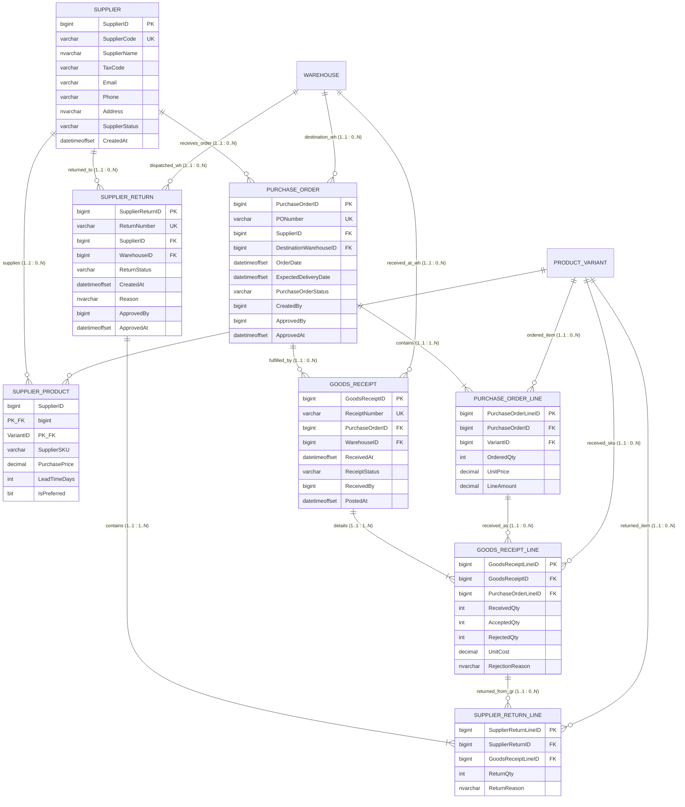
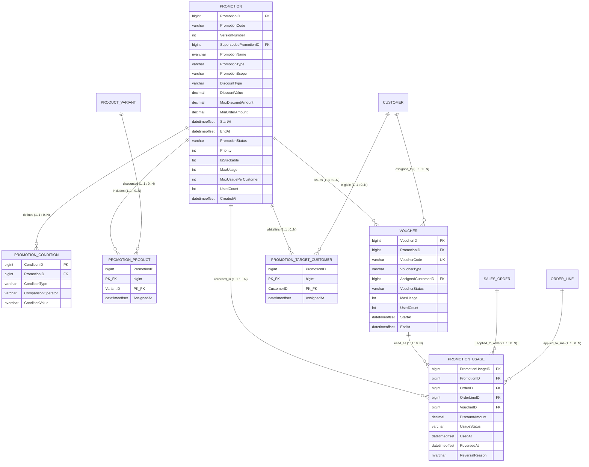
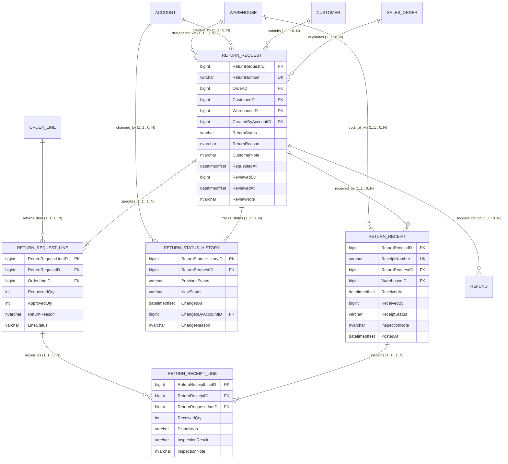
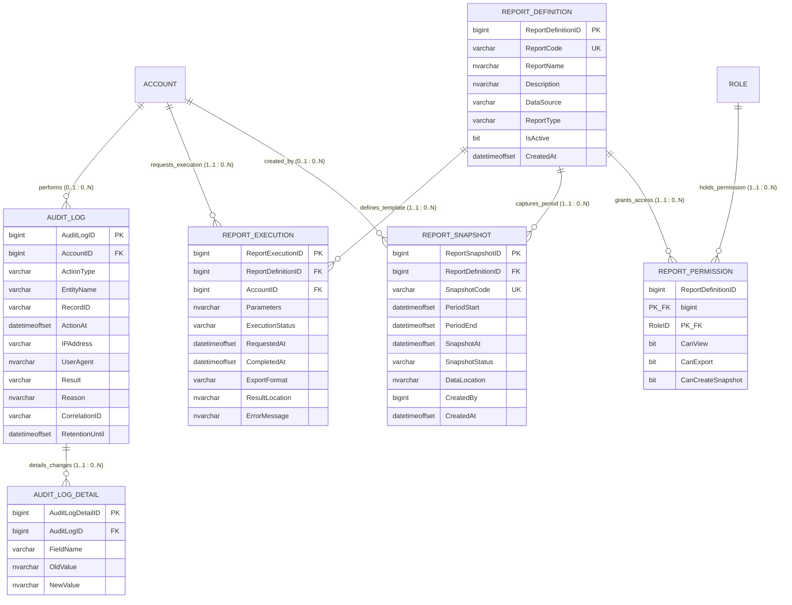

# M2.04 - MASTER CONCEPTUAL ERD DIAGRAM (SƠ ĐỒ QUAN HỆ KHÁI NIỆM TỔNG THỂ)

* **Milestone:** M2 – Conceptual Database Design
* **Phiên bản:** 1.0 – Official Release (Master Integration)
* **Hệ quản trị CSDL mục tiêu:** Microsoft SQL Server Enterprise Edition
* **Kế thừa trực tiếp:**
  * [01-Entity-Catalog.md](file:///c:/Users/ADMIN/OneDrive/Desktop/RetailCore%20%E2%80%93%20E-commerce%20Management%20System/docs/Milestones/M2-Conceptual-Design/01-Entity-Catalog.md) (70 Thực thể E01 – E70)
  * [02-Relationship-Analysis.md](file:///c:/Users/ADMIN/OneDrive/Desktop/RetailCore%20%E2%80%93%20E-commerce%20Management%20System/docs/Milestones/M2-Conceptual-Design/02-Relationship-Analysis.md) (Phân tích bản số Crow's Foot 11 Phân hệ)
  * [05-Design-Decisions.md](file:///c:/Users/ADMIN/OneDrive/Desktop/RetailCore%20%E2%80%93%20E-commerce%20Management%20System/docs/Milestones/M2-Conceptual-Design/05-Design-Decisions.md) (3 Nguyên tắc bất biến & Quyết định thiết kế)
  * Quyết định kiến trúc [11-Business-Decisions.md](file:///c:/Users/ADMIN/OneDrive/Desktop/RetailCore%20%E2%80%93%20E-commerce%20Management%20System/docs/Milestones/M1-Business-Analysis/11-Business-Decisions.md) (BD-01 đến BD-07)

---

## 1. TỔNG QUAN KIẾN TRÚC MÔ HÌNH DỮ LIỆU KHÁI NIỆM (M2 ARCHITECTURE)

Hệ thống **RetailCore – E-commerce Management System** được mô hình hóa ở tầng Quan niệm (Conceptual Design) bao gồm **70 Thực thể chuẩn hóa (E01 đến E70)** phân bổ trên **11 Phân hệ nghiệp vụ (Subject Areas)**. 

Mô hình tuân thủ triệt để phương pháp luận Crow's Foot Notation, xác định rõ bản số ($1:1$, $1:N$, $N:N$), tính tham gia bắt buộc/tùy chọn (Total/Partial Participation), bảo đảm tính toàn vẹn tham chiếu khái niệm và chuẩn bị nền tảng hoàn hảo cho bước chuyển đổi sang Mô hình Luận lý (Logical Schema) chuẩn 3NF/BCNF trên Microsoft SQL Server.

### Bản đồ 11 Phân hệ Nghiệp vụ và 70 Thực thể:
```
+----------------------------------------------------------------------------------------------------+
|                                 RETAILCORE CONCEPTUAL DOMAINS                                      |
+----------------------------------------------------------------------------------------------------+
|  01. Product Catalog (E01..E09)     | 05. Shopping (E38..E39)       | 09. Payment & Refund (E55..E59)  |
|  02. Warehouse & Inv. (E10..E20)   | 06. Sales (E40..E43)          | 10. Return & Exchange (E60..E64)|
|  03. Procurement (E21..E28)         | 07. Fulfillment (E44..E48)    | 11. Audit & Reporting (E65..E70) |
|  04. Customer & Identity (E29..E37) | 08. Promotion (E49..E54)      |                                  |
+----------------------------------------------------------------------------------------------------+
```

---

## 2. NĂM BẤT BIẾN KIẾN TRÚC BẮT BUỘC TRONG THIẾT KẾ ERD

Mọi mối quan hệ trong sơ đồ ERD tổng thể phải thỏa mãn tuyệt đối 5 bất biến kiến trúc:
1. **Phân tách 4 khái niệm Tồn kho (BD-04, WI-Q01..06):**
   * `OrderWarehouseAllocation` (E12 - Kế hoạch phân bổ kho).
   * `StockReservation` & `StockReservationLine` (E13, E14 - Khóa giữ logic có thời hạn).
   * `ShipmentLine` (E46 - Đóng gói thực tế xuất bãi).
   * `InventoryTransaction` & `InventoryTransactionLine` (E15, E16 - Sổ cái ghi sổ hai chiều Dual-Delta `OnHandDelta`/`ReservedDelta`).
2. **Độc lập 3 Máy trạng thái Giao dịch (SALES-Q02, PAY-Q08, SHIP-Q06):**
   * `SalesOrder.OrderStatus` $\ne$ `Payment.PaymentStatus` $\ne$ `Shipment.ShipmentStatus`.
3. **Nguyên tử hóa Tạo đơn & Giữ hàng (All-or-Nothing, SALES-Q01, BD-04):**
   * `ShoppingCart` chỉ chuyển `CONVERTED` thành `SalesOrder` khi `StockReservation` khóa thành công 100% tồn kho trên tất cả các kho được phân bổ.
4. **Bất biến Dữ liệu Lịch sử & Cấm Xóa cứng (Append-Only / No Hard Delete):**
   * `OrderLine` (E41) snapshot nguyên trạng SKU, tên, đơn giá và `VariantAttributesSnapshot` JSON.
   * `OrderAddress` (E42) snapshot độc lập với sổ địa chỉ `CustomerAddress` (E36).
   * Chứng từ giao dịch (`SalesOrder`, `Payment`, `Shipment`, `ReturnRequest`, `AuditLog`) tuyệt đối không xóa vật lý.
5. **Cấu trúc Khuyến mãi Hai tầng (BD-05, PROMO-Q01..08):**
   * Tối đa 1 khuyến mãi cấp sản phẩm liên kết với `OrderLine` và tối đa 1 voucher cấp đơn liên kết với `SalesOrder`. Ghi nhận lịch sử chiết khấu snapshot vào `PromotionUsage` (E53).

---

## 3. MASTER CROSS-DOMAIN BACKBONE ERD (SƠ ĐỒ TRỤC XƯƠNG SỐNG LIÊN PHÂN HỆ)

Sơ đồ Mermaid dưới đây biểu diễn **Trục xương sống liên kết liên miền (Cross-Domain Backbone)** kết nối các Thực thể Trung tâm (Hub Entities) đại diện cho 11 phân hệ:

```mermaid
erDiagram
    %% =========================================================================
    %% 1. HUB: PRODUCT CATALOG & CORE SKU
    %% =========================================================================
    PRODUCT ||--|{ PRODUCT_VARIANT : "specializes_into (1..1 : 1..N)"
    
    %% =========================================================================
    %% 2. HUB: CUSTOMER & IDENTITY
    %% =========================================================================
    ACCOUNT ||--o| CUSTOMER : "profile_of (1..1 : 0..1)"
    ACCOUNT ||--o| EMPLOYEE : "staff_of (1..1 : 0..1)"
    
    %% =========================================================================
    %% 3. CROSS-DOMAIN: SHOPPING & CART
    %% =========================================================================
    CUSTOMER ||--o{ SHOPPING_CART : "owns_cart (1..1 : 0..N)"
    SHOPPING_CART ||--o{ CART_ITEM : "contains_items (1..1 : 0..N)"
    PRODUCT_VARIANT ||--o{ CART_ITEM : "selected_in_cart (1..1 : 0..N)"
    
    %% =========================================================================
    %% 4. CROSS-DOMAIN: SALES CONVERSION & SNAPSHOT
    %% =========================================================================
    CUSTOMER ||--o{ SALES_ORDER : "places_order (1..1 : 0..N)"
    SHOPPING_CART ||--o| SALES_ORDER : "converts_to_order (1..1 : 0..1)"
    SALES_ORDER ||--|{ ORDER_LINE : "composed_of (1..1 : 1..N)"
    PRODUCT_VARIANT ||--o{ ORDER_LINE : "sold_as_sku (1..1 : 0..N)"
    SALES_ORDER ||--|| ORDER_ADDRESS : "delivered_to (1..1 : 1..1)"
    
    %% =========================================================================
    %% 5. CROSS-DOMAIN: WAREHOUSE ALLOCATION & RESERVATION (SPLIT SHIPMENT)
    %% =========================================================================
    ORDER_LINE ||--|{ ORDER_WAREHOUSE_ALLOCATION : "splits_to_warehouse (1..1 : 1..N)"
    WAREHOUSE ||--o{ ORDER_WAREHOUSE_ALLOCATION : "fulfills_allocation (1..1 : 0..N)"
    PRODUCT_VARIANT ||--o{ ORDER_WAREHOUSE_ALLOCATION : "allocated_sku (1..1 : 0..N)"
    
    SALES_ORDER ||--o{ STOCK_RESERVATION : "reserves_stock (1..1 : 0..N)"
    STOCK_RESERVATION ||--|{ STOCK_RESERVATION_LINE : "specifies_hold (1..1 : 1..N)"
    ORDER_WAREHOUSE_ALLOCATION ||--o| STOCK_RESERVATION_LINE : "locks_allocation (1..1 : 0..1)"
    WAREHOUSE ||--o{ STOCK_RESERVATION_LINE : "holds_in_wh (1..1 : 0..N)"
    
    %% Tồn kho vật lý tức thời
    WAREHOUSE ||--o{ INVENTORY_BALANCE : "stores_balance (1..1 : 0..N)"
    PRODUCT_VARIANT ||--o{ INVENTORY_BALANCE : "sku_balance (1..1 : 0..N)"
    
    %% Sổ cái biến động kho
    INVENTORY_TRANSACTION ||--|{ INVENTORY_TRANSACTION_LINE : "records_movement (1..1 : 1..N)"
    WAREHOUSE ||--o{ INVENTORY_TRANSACTION_LINE : "warehouse_impacted (1..1 : 0..N)"
    PRODUCT_VARIANT ||--o{ INVENTORY_TRANSACTION_LINE : "sku_impacted (1..1 : 0..N)"
    
    %% =========================================================================
    %% 6. CROSS-DOMAIN: FULFILLMENT & SHIPPING
    %% =========================================================================
    SALES_ORDER ||--o{ SHIPMENT : "fulfilled_through (1..1 : 0..N)"
    WAREHOUSE ||--o{ SHIPMENT : "dispatched_from_wh (1..1 : 0..N)"
    CARRIER ||--o{ SHIPMENT : "carried_by (1..1 : 0..N)"
    SHIPMENT ||--|{ SHIPMENT_LINE : "packs_items (1..1 : 1..N)"
    ORDER_LINE ||--o{ SHIPMENT_LINE : "line_dispatched (1..1 : 0..N)"
    ORDER_WAREHOUSE_ALLOCATION ||--o{ SHIPMENT_LINE : "realizes_allocation (1..1 : 0..N)"
    
    %% =========================================================================
    %% 7. CROSS-DOMAIN: PROCUREMENT & GOODS INWARD
    %% =========================================================================
    SUPPLIER ||--o{ PURCHASE_ORDER : "receives_po (1..1 : 0..N)"
    WAREHOUSE ||--o{ PURCHASE_ORDER : "destined_to_wh (1..1 : 0..N)"
    PURCHASE_ORDER ||--|{ PURCHASE_ORDER_LINE : "details_po (1..1 : 1..N)"
    PRODUCT_VARIANT ||--o{ PURCHASE_ORDER_LINE : "ordered_po_sku (1..1 : 0..N)"
    
    PURCHASE_ORDER ||--o{ GOODS_RECEIPT : "received_by_receipt (1..1 : 0..N)"
    WAREHOUSE ||--o{ GOODS_RECEIPT : "receipt_at_wh (1..1 : 0..N)"
    GOODS_RECEIPT ||--|{ GOODS_RECEIPT_LINE : "verifies_goods (1..1 : 1..N)"
    PURCHASE_ORDER_LINE ||--o{ GOODS_RECEIPT_LINE : "inward_from_po_line (1..1 : 0..N)"
    PRODUCT_VARIANT ||--o{ GOODS_RECEIPT_LINE : "received_sku (1..1 : 0..N)"
    
    %% =========================================================================
    %% 8. CROSS-DOMAIN: PROMOTIONS & VOUCHERS
    %% =========================================================================
    PROMOTION ||--o{ PROMOTION_PRODUCT : "includes_skus (1..1 : 0..N)"
    PRODUCT_VARIANT ||--o{ PROMOTION_PRODUCT : "discounted_in (1..1 : 0..N)"
    
    PROMOTION ||--o{ VOUCHER : "emits_voucher (1..1 : 0..N)"
    CUSTOMER ||--o{ VOUCHER : "assigned_customer (0..1 : 0..N)"
    
    SALES_ORDER ||--o{ PROMOTION_USAGE : "applies_voucher_usage (1..1 : 0..N)"
    ORDER_LINE ||--o{ PROMOTION_USAGE : "applies_line_promo (1..1 : 0..N)"
    PROMOTION ||--o{ PROMOTION_USAGE : "records_promo_use (1..1 : 0..N)"
    VOUCHER ||--o{ PROMOTION_USAGE : "records_voucher_use (1..1 : 0..N)"
    
    %% =========================================================================
    %% 9. CROSS-DOMAIN: PAYMENT & FINANCIAL SETTLEMENT
    %% =========================================================================
    SALES_ORDER ||--|| PAYMENT : "settled_by (1..1 : 1..1)"
    PAYMENT_METHOD ||--o{ PAYMENT : "uses_method (1..1 : 0..N)"
    PAYMENT ||--o{ PAYMENT_TRANSACTION : "executes_attempts (1..1 : 0..N)"
    PAYMENT ||--o{ REFUND : "creates_refund (1..1 : 0..N)"
    REFUND ||--o{ REFUND_TRANSACTION : "executes_refund_tx (1..1 : 0..N)"
    
    %% =========================================================================
    %% 10. CROSS-DOMAIN: RETURN & EXCHANGE (RMA)
    %% =========================================================================
    SALES_ORDER ||--o{ RETURN_REQUEST : "originates_rma (1..1 : 0..N)"
    CUSTOMER ||--o{ RETURN_REQUEST : "requested_by_customer (1..1 : 0..N)"
    WAREHOUSE ||--o{ RETURN_REQUEST : "returned_to_warehouse (1..1 : 0..N)"
    RETURN_REQUEST ||--|{ RETURN_REQUEST_LINE : "specifies_return (1..1 : 1..N)"
    ORDER_LINE ||--o{ RETURN_REQUEST_LINE : "returns_order_line (1..1 : 0..N)"
    
    RETURN_REQUEST ||--o{ RETURN_RECEIPT : "received_by_dock (1..1 : 0..N)"
    WAREHOUSE ||--o{ RETURN_RECEIPT : "dock_at_wh (1..1 : 0..N)"
    RETURN_RECEIPT ||--|{ RETURN_RECEIPT_LINE : "inspects_items (1..1 : 1..N)"
    RETURN_REQUEST_LINE ||--o{ RETURN_RECEIPT_LINE : "reconciles_rma_line (1..1 : 0..N)"
    
    RETURN_REQUEST ||--o{ REFUND : "triggers_settlement (1..1 : 0..N)"
    
    %% =========================================================================
    %% 11. CROSS-DOMAIN: AUDIT & REPORTING GOVERNANCE
    %% =========================================================================
    ACCOUNT ||--o{ AUDIT_LOG : "operated_by_account (0..1 : 0..N)"
    ACCOUNT ||--o{ REPORT_EXECUTION : "executed_by_account (1..1 : 0..N)"
    ROLE ||--o{ REPORT_PERMISSION : "granted_report_perm (1..1 : 0..N)"
```



---

## 4. MA TRẬN QUAN HỆ LIÊN MIỀN (CROSS-SUBJECT-AREA RELATIONSHIPS MATRIX)

Bảng dưới đây chuẩn hóa toàn bộ các liên kết vượt biên giới Subject Area, xác định bản số Crow's Foot, tính tham gia (Participation) và quy tắc nghiệp vụ/quyết định kiến trúc chịu trách nhiệm:

| STT | Thực thể Nguồn (Miền A) | Ký hiệu Crow's Foot | Thực thể Đích (Miền B) | Bản số | Tính tham gia | Vai trò nghiệp vụ & Căn cứ kiến trúc |
| :---: | :--- | :---: | :--- | :---: | :---: | :--- |
| **CR-01** | `ProductVariant` (01) | `|| ─── }o` | `InventoryBalance` (02) | $1:0..N$ | Nguồn: Partial<br>Đích: **Total** | Một SKU có thể có số dư tồn kho tại nhiều kho vật lý. Mỗi bản ghi số dư gắn với đúng 1 SKU (WI-Q01). |
| **CR-02** | `ProductVariant` (01) | `|| ─── }o` | `OrderWarehouseAllocation` (02) | $1:0..N$ | Nguồn: Partial<br>Đích: **Total** | Phân bổ xuất kho xác định chính xác SKU cần xuất lấy từ kho vật lý (BD-03, WI-Q03). |
| **CR-03** | `ProductVariant` (01) | `|| ─── }o` | `StockReservationLine` (02) | $1:0..N$ | Nguồn: Partial<br>Đích: **Total** | Dòng khóa giữ hàng xác định rõ SKU nào đang bị phong tỏa (BD-04, WI-Q02). |
| **CR-04** | `ProductVariant` (01) | `|| ─── }o` | `InventoryTransactionLine` (02) | $1:0..N$ | Nguồn: Partial<br>Đích: **Total** | Dòng sổ cái ghi nhận mức biến động tồn kho `OnHandDelta`/`ReservedDelta` cho đúng 1 SKU (WI-Q02). |
| **CR-05** | `ProductVariant` (01) | `|| ─── }o` | `StockCountLine` (02) | $1:0..N$ | Nguồn: Partial<br>Đích: **Total** | Kiểm kê đối soát số lượng thực tế của từng SKU tại kho (WI-Q05). |
| **CR-06** | `ProductVariant` (01) | `|| ─── }o` | `WarehouseTransferLine` (02) | $1:0..N$ | Nguồn: Partial<br>Đích: **Total** | Điều chuyển hàng giữa hai kho vật lý theo từng SKU (WI-Q04). |
| **CR-07** | `ProductVariant` (01) | `|| ─── }o` | `SupplierProduct` (03) | $1:0..N$ | Nguồn: Partial<br>Đích: **Total** | SKU được cung cấp bởi danh sách các nhà cung cấp hợp lệ (PR-Q01). |
| **CR-08** | `ProductVariant` (01) | `|| ─── }o` | `PurchaseOrderLine` (03) | $1:0..N$ | Nguồn: Partial<br>Đích: **Total** | Dòng đặt mua hàng từ nhà cung cấp theo mã SKU cụ thể. |
| **CR-09** | `ProductVariant` (01) | `|| ─── }o` | `GoodsReceiptLine` (03) | $1:0..N$ | Nguồn: Partial<br>Đích: **Total** | Kiểm nhận hàng nhập kho theo từng SKU cụ thể (PR-Q03, PR-Q04). |
| **CR-10** | `ProductVariant` (01) | `|| ─── }o` | `SupplierReturnLine` (03) | $1:0..N$ | Nguồn: Partial<br>Đích: **Total** | Xuất trả hàng lỗi/kém chất lượng cho NCC theo SKU (PR-Q05). |
| **CR-11** | `ProductVariant` (01) | `|| ─── }o` | `CartItem` (05) | $1:0..N$ | Nguồn: Partial<br>Đích: **Total** | Mặt hàng SKU khách hàng chọn thêm vào giỏ mua sắm (SHOP-Q03). |
| **CR-12** | `ProductVariant` (01) | `|| ─── }o` | `OrderLine` (06) | $1:0..N$ | Nguồn: Partial<br>Đích: **Total** | SKU bán trong đơn hàng; `OrderLine` snapshot dữ liệu để độc lập với Catalog (SALES-Q05). |
| **CR-13** | `ProductVariant` (01) | `|| ─── }o` | `PromotionProduct` (08) | $1:0..N$ | Nguồn: Partial<br>Đích: **Total** | Danh sách SKU thuộc diện được chiết khấu theo chương trình khuyến mãi cấp sản phẩm (PROMO-Q01). |
| **CR-14** | `Warehouse` (02) | `|| ─── }o` | `PurchaseOrder` (03) | $1:0..N$ | Nguồn: Partial<br>Đích: **Total** | Kho vật lý được chỉ định tiếp nhận toàn bộ hàng hóa của đơn đặt mua PO (PR-Q01). |
| **CR-15** | `Warehouse` (02) | `|| ─── }o` | `GoodsReceipt` (03) | $1:0..N$ | Nguồn: Partial<br>Đích: **Total** | Kho tiếp nhận thực tế đợt giao hàng; phải khớp với kho nhận của PO (PR-Q01, PR-Q02). |
| **CR-16** | `Warehouse` (02) | `|| ─── }o` | `SupplierReturn` (03) | $1:0..N$ | Nguồn: Partial<br>Đích: **Total** | Kho vật lý xuất trả hàng cho nhà cung cấp (PR-Q05). |
| **CR-17** | `Warehouse` (02) | `|| ─── }o` | `Shipment` (07) | $1:0..N$ | Nguồn: Partial<br>Đích: **Total** | Mỗi kiện hàng giao bắt buộc chỉ xuất phát từ duy nhất 1 kho vật lý (SHIP-Q01, BD-03). |
| **CR-18** | `Warehouse` (02) | `|| ─── }o` | `ReturnRequest` (10) | $1:0..N$ | Nguồn: Partial<br>Đích: **Total** | Kho vật lý được chỉ định tiếp nhận hàng đổi trả của yêu cầu RMA (RET-Q06). |
| **CR-19** | `Warehouse` (02) | `|| ─── }o` | `ReturnReceipt` (10) | $1:0..N$ | Nguồn: Partial<br>Đích: **Total** | Kho tiếp nhận kiện hàng khách gửi trả thực tế tại bến nhập (RET-Q06). |
| **CR-20** | `OrderLine` (06) | `|| ─── }|` | `OrderWarehouseAllocation` (02) | $1:1..N$ | Nguồn: **Total**<br>Đích: **Total** | Một dòng đơn hàng bắt buộc phân bổ cho ít nhất một kho xuất hàng (Split Shipment, BD-03, WI-Q03). |
| **CR-21** | `SalesOrder` (06) | `|| ─── }o` | `StockReservation` (02) | $1:0..N$ | Nguồn: Partial<br>Đích: **Total** | Đơn hàng tạo các phiếu khóa giữ tồn kho tạm thời trước khi xuất bãi (BD-04, WI-Q02). |
| **CR-22** | `Customer` (04) | `|| ─── }o` | `ShoppingCart` (05) | $1:0..N$ | Nguồn: Partial<br>Đích: **Total** | Khách hàng sở hữu giỏ mua sắm; tối đa 1 giỏ `ACTIVE` tại một thời điểm (SHOP-Q01). |
| **CR-23** | `Customer` (04) | `|| ─── }o` | `SalesOrder` (06) | $1:0..N$ | Nguồn: Partial<br>Đích: **Total** | Khách hàng ký hợp đồng mua bán; bắt buộc đăng nhập (BD-02, cấm Guest Checkout). |
| **CR-24** | `Customer` (04) | `o| ─── }o` | `Voucher` (08) | $0..1:0..N$ | Nguồn: Partial<br>Đích: Partial | Voucher có thể cấp riêng cho khách hàng VIP (`AssignedCustomerID`) hoặc dùng chung toàn sàn (PROMO-Q03). |
| **CR-25** | `Customer` (04) | `|| ─── }o` | `PromotionTargetCustomer` (08) | $1:0..N$ | Nguồn: Partial<br>Đích: **Total** | Khách hàng thuộc danh sách thụ hưởng chương trình ưu đãi đặc quyền (PROMO-Q03). |
| **CR-26** | `Customer` (04) | `|| ─── }o` | `ReturnRequest` (10) | $1:0..N$ | Nguồn: Partial<br>Đích: **Total** | Khách hàng là chủ thể sở hữu và gửi yêu cầu đổi trả hàng (RET-Q01). |
| **CR-27** | `ShoppingCart` (05) | `|| ─── o|` | `SalesOrder` (06) | $1:0..1$ | Nguồn: Partial<br>Đích: **Total** | Giỏ hàng chuyển đổi sang đơn hàng thành công thì đóng băng `CONVERTED` (SHOP-Q05, SALES-Q01). |
| **CR-28** | `SalesOrder` (06) | `|| ─── }o` | `Shipment` (07) | $1:0..N$ | Nguồn: Partial<br>Đích: **Total** | Đơn hàng có thể phân tách thành nhiều kiện hàng xuất giao từ các kho khác nhau (BD-03, SHIP-Q01). |
| **CR-29** | `OrderLine` (06) | `|| ─── }o` | `ShipmentLine` (07) | $1:0..N$ | Nguồn: Partial<br>Đích: **Total** | Dòng đơn hàng được đóng gói trong các lô giao; tổng xuất không vượt đặt (SHIP-Q01). |
| **CR-30** | `OrderWarehouseAllocation` (02) | `|| ─── }o` | `ShipmentLine` (07) | $1:0..N$ | Nguồn: Partial<br>Đích: **Total** | Dòng lô giao hàng hiện thực hóa kế hoạch phân bổ của kho xuất (SHIP-Q01, BR-FS07). |
| **CR-31** | `SalesOrder` (06) | `|| ─── }o` | `PromotionUsage` (08) | $1:0..N$ | Nguồn: Partial<br>Đích: **Total** | Đơn hàng ghi nhận lịch sử tiêu thụ voucher cấp đơn hàng (BD-05, PROMO-Q05). |
| **CR-32** | `OrderLine` (06) | `o| ─── }o` | `PromotionUsage` (08) | $0..1:0..N$ | Nguồn: Partial<br>Đích: Partial | Dòng đơn hàng ghi nhận ưu đãi chiết khấu trực tiếp cấp sản phẩm (BD-05, PROMO-Q01). |
| **CR-33** | `SalesOrder` (06) | `|| ─── ||` | `Payment` (09) | $1:1$ | Nguồn: **Total**<br>Đích: **Total** | Mỗi đơn hàng bắt buộc có đúng 1 hồ sơ nghĩa vụ thanh toán (`Payment.OrderID` UNIQUE, PAY-Q01). |
| **CR-34** | `SalesOrder` (06) | `|| ─── }o` | `ReturnRequest` (10) | $1:0..N$ | Nguồn: Partial<br>Đích: **Total** | Đơn hàng đã giao thành công có thể phát sinh nhiều yêu cầu đổi trả từng phần (RET-Q01, RET-Q03). |
| **CR-35** | `OrderLine` (06) | `|| ─── }o` | `ReturnRequestLine` (10) | $1:0..N$ | Nguồn: Partial<br>Đích: **Total** | Dòng sản phẩm trong đơn được yêu cầu trả lại; tổng trả không vượt số lượng đã mua (RET-Q03). |
| **CR-36** | `ReturnRequest` (10) | `|| ─── }o` | `Refund` (09) | $1:0..N$ | Nguồn: Partial<br>Đích: **Total** | Yêu cầu đổi trả sau khi kho kiểm định đạt chuẩn sẽ tự động kích hoạt chứng từ hoàn tiền (RET-Q07). |
| **CR-37** | `Account` (04) | `o| ─── }o` | `AuditLog` (11) | $0..1:0..N$ | Nguồn: Partial<br>Đích: Partial | Tài khoản người dùng thực hiện thao tác nhạy cảm; sự kiện hệ thống tự động để NULL (AR-Q01). |
| **CR-38** | `Account` (04) | `|| ─── }o` | `ReportExecution` (11) | $1:0..N$ | Nguồn: Partial<br>Đích: **Total** | Tài khoản nhân viên yêu cầu xuất báo cáo hoặc thực thi truy vấn phân tích (AR-Q06). |
| **CR-39** | `Account` (04) | `o| ─── }o` | `ReportSnapshot` (11) | $0..1:0..N$ | Nguồn: Partial<br>Đích: Partial | Người dùng hoặc job hệ thống tạo bản chụp dữ liệu chốt kỳ báo cáo (AR-Q05). |
| **CR-40** | `Role` (04) | `|| ─── }o` | `ReportPermission` (11) | $1:0..N$ | Nguồn: Partial<br>Đích: **Total** | Vai trò được phân quyền truy cập, xuất file hoặc chốt snapshot báo cáo quản trị (AR-Q07). |

---

## 5. SƠ ĐỒ CHI TIẾT CÁC PHÂN HỆ VÀ ĐIỂM TIẾP GIÁP LIÊN MIỀN (DOMAIN BOUNDARIES)

Dưới đây là sơ đồ Mermaid chuẩn hóa của từng phân hệ kèm các giao diện tiếp giáp (Boundary Interfaces) tới các phân hệ khác:

### 5.1. Phân hệ 01: Product Catalog (E01 – E09)
* **Giao diện liên miền:** 
  * `ProductVariant` (E04) là đầu mối kết nối đến: Inventory (02), Procurement (03), Shopping (05), Sales (06), Promotion (08).

```mermaid
erDiagram
    PRODUCT ||--o{ PRODUCT_CATEGORY : "classified_in (1..1 : 0..N)"
    CATEGORY ||--o{ PRODUCT_CATEGORY : "groups (1..1 : 0..N)"
    CATEGORY ||--o{ CATEGORY : "parent_of (0..1 : 0..N)"

    PRODUCT ||--|{ PRODUCT_VARIANT : "has_variants (1..1 : 1..N)"

    PRODUCT ||--o{ PRODUCT_ATTRIBUTE : "declares_attr (1..1 : 0..N)"
    ATTRIBUTE ||--o{ PRODUCT_ATTRIBUTE : "applied_to_product (1..1 : 0..N)"

    ATTRIBUTE ||--|{ ATTRIBUTE_VALUE : "provides_values (1..1 : 1..N)"

    PRODUCT_ATTRIBUTE ||--o{ PRODUCT_ATTRIBUTE_VALUE : "whitelists_val (1..1 : 0..N)"
    ATTRIBUTE_VALUE ||--o{ PRODUCT_ATTRIBUTE_VALUE : "permitted_in (1..1 : 0..N)"

    PRODUCT_VARIANT ||--o{ VARIANT_ATTRIBUTE_VALUE : "composed_by (1..1 : 0..N)"
    PRODUCT_ATTRIBUTE_VALUE ||--o{ VARIANT_ATTRIBUTE_VALUE : "selected_for_sku (1..1 : 0..N)"

    PRODUCT {
        bigint ProductID PK
        varchar ProductCode UK
        nvarchar ProductName
        nvarchar Description
        varchar Brand
        varchar ProductStatus
        datetimeoffset CreatedAt
    }
    CATEGORY {
        bigint CategoryID PK
        nvarchar CategoryName
        varchar Slug UK
        bigint ParentCategoryID FK
        varchar CategoryStatus
    }
    PRODUCT_CATEGORY {
        bigint ProductID PK_FK
        bigint CategoryID PK_FK
        bit IsPrimary
        datetimeoffset AssignedAt
    }
    PRODUCT_VARIANT {
        bigint VariantID PK
        bigint ProductID FK
        varchar SKU UK
        nvarchar VariantName
        decimal SellingPrice
        varchar VariantStatus
    }
    ATTRIBUTE {
        bigint AttributeID PK
        nvarchar AttributeName
        varchar DataType
        nvarchar AttributeDescription
    }
    ATTRIBUTE_VALUE {
        bigint AttributeValueID PK
        bigint AttributeID FK
        nvarchar Value
        nvarchar DisplayValue
    }
    PRODUCT_ATTRIBUTE {
        bigint ProductID PK_FK
        bigint AttributeID PK_FK
        varchar AttributeRole
        bit IsRequired
        int DisplayOrder
    }
    PRODUCT_ATTRIBUTE_VALUE {
        bigint ProductID PK_FK
        bigint AttributeID PK_FK
        bigint AttributeValueID PK_FK
    }
    VARIANT_ATTRIBUTE_VALUE {
        bigint VariantID PK_FK
        bigint AttributeID PK_FK
        bigint AttributeValueID FK
    }
```

---

### 5.2. Phân hệ 02: Warehouse & Inventory (E10 – E20)
* **Giao diện liên miền:** 
  * `Warehouse` (E10) nhận liên kết từ PO/GR (03), Shipment (07), RMA (10).
  * `OrderWarehouseAllocation` (E12) nhận từ `OrderLine` (06) và cấp cho `ShipmentLine` (07).
  * `StockReservation` (E13) nhận từ `SalesOrder` (06).

```mermaid
erDiagram
    WAREHOUSE ||--o{ INVENTORY_BALANCE : "tracks_stock (1..1 : 0..N)"
    PRODUCT_VARIANT ||--o{ INVENTORY_BALANCE : "stocked_as (1..1 : 0..N)"

    ORDER_LINE ||--|{ ORDER_WAREHOUSE_ALLOCATION : "splits_to (1..1 : 1..N)"
    WAREHOUSE ||--o{ ORDER_WAREHOUSE_ALLOCATION : "allocated_wh (1..1 : 0..N)"
    PRODUCT_VARIANT ||--o{ ORDER_WAREHOUSE_ALLOCATION : "allocated_item (1..1 : 0..N)"

    SALES_ORDER ||--o{ STOCK_RESERVATION : "reserves (1..1 : 0..N)"
    STOCK_RESERVATION ||--|{ STOCK_RESERVATION_LINE : "contains (1..1 : 1..N)"
    ORDER_WAREHOUSE_ALLOCATION ||--o| STOCK_RESERVATION_LINE : "secures (1..1 : 0..1)"
    WAREHOUSE ||--o{ STOCK_RESERVATION_LINE : "reserved_at (1..1 : 0..N)"
    PRODUCT_VARIANT ||--o{ STOCK_RESERVATION_LINE : "held_sku (1..1 : 0..N)"

    INVENTORY_TRANSACTION ||--|{ INVENTORY_TRANSACTION_LINE : "logs (1..1 : 1..N)"
    WAREHOUSE ||--o{ INVENTORY_TRANSACTION_LINE : "locates (1..1 : 0..N)"
    PRODUCT_VARIANT ||--o{ INVENTORY_TRANSACTION_LINE : "affects_sku (1..1 : 0..N)"

    WAREHOUSE ||--o{ STOCK_COUNT : "audited_in (1..1 : 0..N)"
    STOCK_COUNT ||--|{ STOCK_COUNT_LINE : "counts (1..1 : 1..N)"
    PRODUCT_VARIANT ||--o{ STOCK_COUNT_LINE : "counted_item (1..1 : 0..N)"

    WAREHOUSE ||--o{ WAREHOUSE_TRANSFER : "dispatches_transfer (1..1 : 0..N)"
    WAREHOUSE ||--o{ WAREHOUSE_TRANSFER : "receives_transfer (1..1 : 0..N)"
    WAREHOUSE_TRANSFER ||--|{ WAREHOUSE_TRANSFER_LINE : "transfers (1..1 : 1..N)"
    PRODUCT_VARIANT ||--o{ WAREHOUSE_TRANSFER_LINE : "transferred_item (1..1 : 0..N)"

    WAREHOUSE {
        bigint WarehouseID PK
        varchar WarehouseCode UK
        nvarchar WarehouseName
        nvarchar Address
        varchar WarehouseStatus
        datetimeoffset CreatedAt
    }
    INVENTORY_BALANCE {
        bigint WarehouseID PK_FK
        bigint VariantID PK_FK
        int OnHandQty
        int ReservedQty
        datetimeoffset LastUpdatedAt
    }
    ORDER_WAREHOUSE_ALLOCATION {
        bigint AllocationID PK
        bigint OrderLineID FK
        bigint WarehouseID FK
        bigint VariantID FK
        int AllocatedQty
        varchar AllocationStatus
        datetimeoffset AllocatedAt
    }
    STOCK_RESERVATION {
        bigint ReservationID PK
        bigint OrderID FK
        varchar ReservationStatus
        datetimeoffset CreatedAt
        datetimeoffset ExpiresAt
        datetimeoffset ReleasedAt
    }
    STOCK_RESERVATION_LINE {
        bigint ReservationLineID PK
        bigint ReservationID FK
        bigint AllocationID FK
        bigint VariantID FK
        bigint WarehouseID FK
        int ReservedQty
        varchar ReservationLineStatus
    }
    INVENTORY_TRANSACTION {
        bigint TransactionID PK
        varchar TransactionType
        varchar TransactionStatus
        varchar ReferenceType
        bigint ReferenceID
        datetimeoffset CreatedAt
        datetimeoffset PostedAt
    }
    INVENTORY_TRANSACTION_LINE {
        bigint TransactionLineID PK
        bigint TransactionID FK
        bigint VariantID FK
        bigint WarehouseID FK
        int OnHandDelta
        int ReservedDelta
    }
    STOCK_COUNT {
        bigint StockCountID PK
        bigint WarehouseID FK
        varchar CountStatus
        datetimeoffset StartedAt
        datetimeoffset CompletedAt
        datetimeoffset ApprovedAt
        bigint ApprovedBy
    }
    STOCK_COUNT_LINE {
        bigint StockCountLineID PK
        bigint StockCountID FK
        bigint VariantID FK
        int SystemQty
        int CountedQty
        int VarianceQty
    }
    WAREHOUSE_TRANSFER {
        bigint TransferID PK
        varchar TransferNumber UK
        bigint SourceWarehouseID FK
        bigint DestinationWarehouseID FK
        varchar TransferStatus
        datetimeoffset CreatedAt
        datetimeoffset DispatchedAt
        datetimeoffset ReceivedAt
    }
    WAREHOUSE_TRANSFER_LINE {
        bigint TransferLineID PK
        bigint TransferID FK
        bigint VariantID FK
        int TransferQty
        int ReceivedQty
        int VarianceQty
    }
```



---

### 5.3. Phân hệ 03: Procurement (E21 – E28)
* **Giao diện liên miền:** Nhận SKU từ Catalog (01) và chỉ định nhập/xuất kho tại Warehouse (02).



---

### 5.4. Phân hệ 04: Customer & Identity (E29 – E37)
* **Giao diện liên miền:** 
  * `Customer` (E30) liên kết với Shopping (05), Sales (06), Promotion (08), RMA (10).
  * `Account` (E29) và `Role` (E32) liên kết với Audit & Reporting (11).

```mermaid
erDiagram
    ACCOUNT ||--o| CUSTOMER : "profile_customer (1..1 : 0..1)"
    ACCOUNT ||--o| EMPLOYEE : "profile_employee (1..1 : 0..1)"

    CUSTOMER ||--o{ CUSTOMER_ADDRESS : "has_addresses (1..1 : 0..N)"

    ACCOUNT ||--o{ ACCOUNT_ROLE : "assigned (1..1 : 0..N)"
    ROLE ||--o{ ACCOUNT_ROLE : "grants (1..1 : 0..N)"

    ROLE ||--o{ ROLE_PERMISSION : "contains (1..1 : 0..N)"
    PERMISSION ||--o{ ROLE_PERMISSION : "granted_in (1..1 : 0..N)"

    ACCOUNT ||--o{ ACCOUNT_VERIFICATION : "verifies (1..1 : 0..N)"

    ACCOUNT {
        bigint AccountID PK
        varchar Email UK_Filtered
        varchar Phone UK_Filtered
        varchar PasswordHash
        varchar AccountStatus
        datetimeoffset CreatedAt
        datetimeoffset LastLoginAt
    }
    CUSTOMER {
        bigint CustomerID PK
        bigint AccountID UK_FK
        nvarchar FullName
        date DateOfBirth
        varchar Gender
        varchar CustomerStatus
        datetimeoffset CreatedAt
    }
    EMPLOYEE {
        bigint EmployeeID PK
        bigint AccountID UK_FK
        varchar EmployeeCode UK
        nvarchar FullName
        varchar Department
        varchar EmployeeStatus
        datetimeoffset CreatedAt
    }
    ROLE {
        bigint RoleID PK
        varchar RoleName UK
        nvarchar RoleDescription
    }
    PERMISSION {
        bigint PermissionID PK
        varchar PermissionCode UK
        nvarchar PermissionName
        nvarchar Description
    }
    ACCOUNT_ROLE {
        bigint AccountID PK_FK
        bigint RoleID PK_FK
        datetimeoffset AssignedAt
        bigint AssignedBy
    }
    ROLE_PERMISSION {
        bigint RoleID PK_FK
        bigint PermissionID PK_FK
    }
    CUSTOMER_ADDRESS {
        bigint AddressID PK
        bigint CustomerID FK
        nvarchar RecipientName
        varchar RecipientPhone
        nvarchar Province
        nvarchar District
        nvarchar Ward
        nvarchar StreetAddress
        bit IsDefault
        varchar AddressStatus
        datetimeoffset CreatedAt
    }
    ACCOUNT_VERIFICATION {
        bigint VerificationID PK
        bigint AccountID FK
        varchar VerificationType
        varchar VerificationTarget
        varchar VerificationStatus
        datetimeoffset CreatedAt
        datetimeoffset ExpiresAt
        datetimeoffset VerifiedAt
    }
```

---

### 5.5. Phân hệ 05: Shopping (E38 – E39)
* **Giao diện liên miền:** Nhận `CustomerID` từ (04), `VariantID` từ (01); Chuyển đổi thành `SalesOrder` (06).

```mermaid
erDiagram
    CUSTOMER ||--o{ SHOPPING_CART : "owns (1..1 : 0..N)"
    SHOPPING_CART ||--o{ CART_ITEM : "contains (1..1 : 0..N)"
    PRODUCT_VARIANT ||--o{ CART_ITEM : "references_sku (1..1 : 0..N)"

    SHOPPING_CART {
        bigint CartID PK
        bigint CustomerID FK_Filtered_UK
        varchar CartStatus
        datetimeoffset CreatedAt
        datetimeoffset UpdatedAt
        datetimeoffset LastActivityAt
    }
    CART_ITEM {
        bigint CartItemID PK
        bigint CartID FK
        bigint VariantID FK
        int Quantity
        datetimeoffset AddedAt
        datetimeoffset UpdatedAt
    }
```

---

### 5.6. Phân hệ 06: Sales (E40 – E43)
* **Giao diện liên miền:** 
  * Trung tâm điều phối toàn bộ chuỗi giá trị: Nhận `CartID` (05), `CustomerID` (04), `VariantID` (01).
  * Phát sinh phân bổ chia kho (02), giữ tồn kho (02), giao hàng (07), thanh toán (09), chiết khấu (08), khiếu nại RMA (10).

```mermaid
erDiagram
    CUSTOMER ||--o{ SALES_ORDER : "places (1..1 : 0..N)"
    SHOPPING_CART ||--o| SALES_ORDER : "converted_from (1..1 : 0..1)"

    SALES_ORDER ||--|{ ORDER_LINE : "contains (1..1 : 1..N)"
    PRODUCT_VARIANT ||--o{ ORDER_LINE : "sold_sku (1..1 : 0..N)"

    SALES_ORDER ||--|| ORDER_ADDRESS : "ships_to (1..1 : 1..1)"
    SALES_ORDER ||--|{ ORDER_STATUS_HISTORY : "tracks_status (1..1 : 1..N)"

    SALES_ORDER {
        bigint OrderID PK
        varchar OrderNumber UK
        bigint CustomerID FK
        bigint CartID UK_FK
        varchar OrderStatus
        datetimeoffset OrderDate
        decimal SubtotalAmount
        decimal DiscountAmount
        decimal ShippingFee
        decimal TotalAmount
        nvarchar CustomerNote
        datetimeoffset CreatedAt
        datetimeoffset UpdatedAt
    }
    ORDER_LINE {
        bigint OrderLineID PK
        bigint OrderID FK
        bigint VariantID FK
        varchar SKU
        nvarchar ProductName
        nvarchar VariantName
        nvarchar VariantAttributesSnapshot
        decimal UnitPrice
        int OrderedQty
        decimal LineSubtotal
    }
    ORDER_ADDRESS {
        bigint OrderAddressID PK
        bigint OrderID UK_FK
        nvarchar RecipientName
        varchar RecipientPhone
        nvarchar Province
        nvarchar District
        nvarchar Ward
        nvarchar StreetAddress
    }
    ORDER_STATUS_HISTORY {
        bigint StatusHistoryID PK
        bigint OrderID FK
        varchar PreviousStatus
        varchar NewStatus
        datetimeoffset ChangedAt
        bigint ChangedBy
        nvarchar ChangeReason
    }
```

---

### 5.7. Phân hệ 07: Fulfillment & Shipping (E44 – E48)
* **Giao diện liên miền:** Nhận `OrderID` và `OrderLineID` từ (06), `WarehouseID` và `AllocationID` từ (02).

```mermaid
erDiagram
    SALES_ORDER ||--o{ SHIPMENT : "fulfills (1..1 : 0..N)"
    WAREHOUSE ||--o{ SHIPMENT : "dispatched_from (1..1 : 0..N)"
    CARRIER ||--o{ SHIPMENT : "shipped_by (1..1 : 0..N)"

    SHIPMENT ||--|{ SHIPMENT_LINE : "contains (1..1 : 1..N)"
    ORDER_LINE ||--o{ SHIPMENT_LINE : "ships_order_item (1..1 : 0..N)"
    ORDER_WAREHOUSE_ALLOCATION ||--o{ SHIPMENT_LINE : "consumes_allocation (1..1 : 0..N)"

    SHIPMENT ||--o{ DELIVERY_ATTEMPT : "attempted (1..1 : 0..N)"
    SHIPMENT ||--|{ SHIPMENT_STATUS_HISTORY : "logs_status (1..1 : 1..N)"

    CARRIER {
        bigint CarrierID PK
        varchar CarrierCode UK
        nvarchar CarrierName
        varchar ContactPhone
        varchar Email
        varchar Website
        varchar CarrierStatus
        datetimeoffset CreatedAt
    }
    SHIPMENT {
        bigint ShipmentID PK
        varchar ShipmentNumber UK
        bigint OrderID FK
        bigint WarehouseID FK
        bigint CarrierID FK
        varchar TrackingNumber UK_Filtered
        varchar ShipmentStatus
        decimal ShippingFee
        datetimeoffset CreatedAt
        datetimeoffset HandedOverAt
        datetimeoffset DeliveredAt
    }
    SHIPMENT_LINE {
        bigint ShipmentLineID PK
        bigint ShipmentID FK
        bigint OrderLineID FK
        bigint AllocationID FK
        int ShipmentQty
    }
    DELIVERY_ATTEMPT {
        bigint AttemptID PK
        bigint ShipmentID FK
        int AttemptNumber
        datetimeoffset AttemptedAt
        varchar AttemptStatus
        nvarchar FailureReason
        nvarchar RecipientName
        nvarchar DeliveryNote
    }
    SHIPMENT_STATUS_HISTORY {
        bigint ShipmentStatusHistoryID PK
        bigint ShipmentID FK
        varchar PreviousStatus
        varchar NewStatus
        datetimeoffset ChangedAt
        bigint ChangedBy
        nvarchar ChangeReason
    }
```

---

### 5.8. Phân hệ 08: Promotion & Voucher (E49 – E54)
* **Giao diện liên miền:** 
  * Chiết khấu SKU từ Catalog (01).
  * Tiêu thụ và snapshot giảm giá trên `SalesOrder` và `OrderLine` (06).
  * Chỉ định khách VIP từ Customer (04).



---

### 5.9. Phân hệ 09: Payment & Refund (E55 – E59)
* **Giao diện liên miền:** 
  * Liên kết $1:1$ với `SalesOrder` (06).
  * Tiếp nhận yêu cầu kích hoạt hoàn tiền từ `ReturnRequest` (10).

```mermaid
erDiagram
    SALES_ORDER ||--|| PAYMENT : "settled_by (1..1 : 1..1)"
    PAYMENT_METHOD ||--o{ PAYMENT : "uses_method (1..1 : 0..N)"

    PAYMENT ||--o{ PAYMENT_TRANSACTION : "executes_attempts (1..1 : 0..N)"
    PAYMENT ||--o{ REFUND : "has_refunds (1..1 : 0..N)"
    RETURN_REQUEST ||--o{ REFUND : "triggered_by_rma (1..1 : 0..N)"
    REFUND ||--o{ REFUND_TRANSACTION : "executes_payout (1..1 : 0..N)"

    PAYMENT_METHOD {
        bigint PaymentMethodID PK
        varchar MethodCode UK
        nvarchar MethodName
        varchar MethodType
        varchar MethodStatus
        datetimeoffset CreatedAt
    }
    PAYMENT {
        bigint PaymentID PK
        bigint OrderID UK_FK
        bigint PaymentMethodID FK
        varchar PaymentStatus
        decimal AmountDue
        decimal AmountPaid
        decimal AmountRefunded
        datetimeoffset CreatedAt
        datetimeoffset PaidAt
    }
    PAYMENT_TRANSACTION {
        bigint PaymentTransactionID PK
        bigint PaymentID FK
        varchar TransactionReference UK
        varchar GatewayTransactionID
        varchar TransactionType
        varchar TransactionStatus
        decimal Amount
        decimal TransactionFee
        datetimeoffset InitiatedAt
        datetimeoffset CompletedAt
        varchar GatewayResponseCode
        nvarchar GatewayResponseMessage
        nvarchar GatewayResponseData
    }
    REFUND {
        bigint RefundID PK
        bigint PaymentID FK
        bigint ReturnRequestID FK
        varchar RefundReference UK
        decimal RefundAmount
        nvarchar RefundReason
        varchar RefundStatus
        datetimeoffset RequestedAt
        bigint RequestedBy
        bigint ApprovedBy
        datetimeoffset ApprovedAt
    }
    REFUND_TRANSACTION {
        bigint RefundTransactionID PK
        bigint RefundID FK
        varchar TransactionReference UK
        varchar GatewayTransactionID
        varchar RefundMethod
        varchar TransactionStatus
        decimal Amount
        decimal TransactionFee
        datetimeoffset InitiatedAt
        datetimeoffset CompletedAt
        varchar GatewayResponseCode
        nvarchar GatewayResponseMessage
    }
```

---

### 5.10. Phân hệ 10: Return & Exchange (E60 – E64)
* **Giao diện liên miền:** 
  * Tham chiếu đơn hàng gốc (`SalesOrder`, `OrderLine` từ 06).
  * Tiếp nhận tại kho hàng (`Warehouse` từ 02).
  * Kích hoạt hoàn tiền sang `Refund` (09).



---

### 5.11. Phân hệ 11: Audit & Reporting (E65 – E70)
* **Giao diện liên miền:** 
  * `AuditLog` (E65) ghi nhận thao tác của mọi `Account` (04).
  * `ReportExecution` (E68) ghi nhận yêu cầu chạy báo cáo của `Account` (04).
  * `ReportPermission` (E70) phân quyền truy cập báo cáo theo `Role` (04).



---

## 6. KIỂM TRA TÍNH TOÀN VẸN & KHÉP KÍN MÔ HÌNH (INTEGRITY CHECK)

1. **Đầy đủ 100% 70 Thực thể:** Toàn bộ 70 thực thể (E01 đến E70) đều xuất hiện trong sơ đồ và có liên kết quan hệ xác thực, không có bất kỳ thực thể nào bị cô lập (No Orphan Entities).
2. **Khép kín ranh giới nghiệp vụ:**
   * Mọi quan hệ $N:N$ đều được giải quyết thông qua Thực thể Kết hợp (Associative Entity) mang đầy đủ thuộc tính trạng thái và thời gian.
   * Tất cả các chứng từ giao dịch (SalesOrder, Payment, Shipment, GoodsReceipt, ReturnRequest, InventoryTransaction) đều có thực thể chi tiết dòng (Line/Detail) và nhật ký trạng thái (History) tương ứng.
3. **Sẵn sàng chuyển đổi M3:** Sơ đồ Conceptual ERD này là căn cứ tối hậu để chuyển dịch thành công sang Mô hình Luận lý (Logical Relational Schema) tại Milestone 3.

