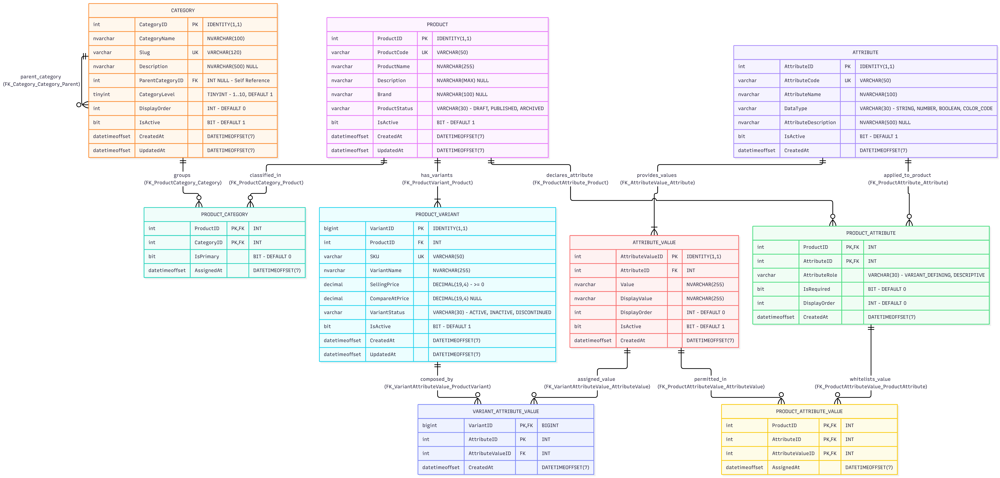

# M3.01.02 - ENTITY-TO-RELATION MAPPING: SUBJECT AREA 01 (PRODUCT CATALOG)
## ĐẶC TẢ ÁNH XẠ THỰC THỂ SANG BẢNG QUAN HỆ: PHÂN HỆ PRODUCT CATALOG

* **Dự án:** RetailCore Enterprise E-Commerce Management System
* **Cơ sở dữ liệu mục tiêu:** Microsoft SQL Server 2022+ Enterprise Edition
* **Cột mốc:** Milestone 3 (Logical Database Design) – Công đoạn M3.01
* **Phiên bản:** v1.0 – Official Relational Mapping Baseline
* **Phân hệ:** `Subject Area 01 – Product Catalog` (E01 đến E09)

## 1. TỔNG QUAN PHÂN HỆ PRODUCT CATALOG (SA01)

Phân hệ **Product Catalog** là hạt nhân quản lý toàn bộ danh mục sản phẩm thương mại, cấu trúc phân cấp danh mục, từ điển thuộc tính động và định danh biến thể sản phẩm (SKU) có thể bán và lưu kho. 

### Ma trận chuyển đổi 9 thực thể sang 9 quan hệ:
| Mã Thực thể | Tên Thực thể Quan niệm | Loại hình Thực thể (Conceptual) | Tên Bảng Quan hệ (Relational Table) | Khóa Chính (Primary Key) | Khóa Tự nhiên / Ứng viên (Candidate Key) |
| :---: | :--- | :--- | :--- | :--- | :--- |
| **E01** | `Product` | Strong Entity | `Product` | `ProductID (INT IDENTITY)` | `ProductCode (VARCHAR(50))` |
| **E02** | `Category` | Strong Entity (Cây đệ quy) | `Category` | `CategoryID (INT IDENTITY)` | `Slug (VARCHAR(120))` |
| **E03** | `ProductCategory` | Associative Entity ($N:N$) | `ProductCategory` | `(ProductID, CategoryID)` | `(ProductID) WHERE IsPrimary = 1` |
| **E04** | `ProductVariant` | Core SKU Entity | `ProductVariant` | `VariantID (BIGINT IDENTITY)` | `SKU (VARCHAR(50))` |
| **E05** | `Attribute` | Strong Entity | `Attribute` | `AttributeID (INT IDENTITY)` | `AttributeCode (VARCHAR(50))` |
| **E06** | `AttributeValue` | Weak Entity | `AttributeValue` | `AttributeValueID (INT IDENTITY)` | `(AttributeID, Value)` |
| **E07** | `ProductAttribute` | Associative Entity ($N:N$) | `ProductAttribute` | `(ProductID, AttributeID)` | — |
| **E08** | `ProductAttributeValue` | Associative Entity (Whitelist) | `ProductAttributeValue` | `(ProductID, AttributeID, AttributeValueID)` | — |
| **E09** | `VariantAttributeValue` | Associative Entity (SKU Spec) | `VariantAttributeValue` | `(VariantID, AttributeID)` | — |

---

## 2. SƠ ĐỒ LƯỢC ĐỒ QUAN HỆ LOGIC (LOGICAL RELATIONAL ERD)



---

## 3. ĐẶC TẢ CHI TIẾT LƯỢC ĐỒ 9 BẢNG QUAN HỆ

### 3.1. Bảng `Category` (E02 - Danh mục Sản phẩm Đa tầng)
* **Ý nghĩa:** Đại diện cho cây phân loại hàng hóa đa cấp (đồ nam $\to$ áo $\to$ áo sơ mi).
* **Đặc tính:** Strong Entity với cấu trúc đệ quy (Adjacency List).
* **Khóa chính:** `CategoryID INT IDENTITY(1,1)` (Surrogate Key Clustered).

#### Column Definitions:
| Tên Cột (Column Name) | Kiểu Dữ liệu SQL Server | Nullable | Giá trị Mặc định | Ý nghĩa & Mô tả Nghiệp vụ |
| :--- | :--- | :---: | :--- | :--- |
| `CategoryID` | `INT IDENTITY(1,1)` | **NO** | Auto increment | Khóa chính surrogate định danh danh mục |
| `CategoryName` | `NVARCHAR(100)` | **NO** | — | Tên hiển thị của danh mục (hỗ trợ Unicode tiếng Việt) |
| `Slug` | `VARCHAR(120)` | **NO** | — | Chuỗi URL thân thiện chuẩn SEO, viết liền không dấu |
| `Description` | `NVARCHAR(500)` | YES | `NULL` | Mô tả tóm tắt nội dung danh mục |
| `ParentCategoryID` | `INT` | YES | `NULL` | Khóa ngoại đệ quy trỏ danh mục cha. Gốc mang giá trị `NULL` |
| `CategoryLevel` | `TINYINT` | **NO** | `1` | Cấp độ sâu phân tầng: 1 (Root), 2 (Sub-level 1), 3 (Sub-level 2) |
| `DisplayOrder` | `INT` | **NO** | `0` | Thứ tự ưu tiên hiển thị trên thanh điều hướng (Menu/Navbar) |
| `IsActive` | `BIT` | **NO** | `1` | Cờ trạng thái hoạt động: 1 (Active), 0 (Inactive / Ẩn) |
| `CreatedAt` | `DATETIMEOFFSET(7)` | **NO** | `SYSDATETIMEOFFSET()` | Thời điểm tạo bản ghi hệ thống kèm múi giờ |
| `UpdatedAt` | `DATETIMEOFFSET(7)` | **NO** | `SYSDATETIMEOFFSET()` | Thời điểm cập nhật bản ghi lần cuối |

#### Constraints:
* `PK_Category`: `PRIMARY KEY CLUSTERED (CategoryID)`
* `UQ_Category_Slug`: `UNIQUE NONCLUSTERED (Slug)`
* `FK_Category_Category_Parent`: `FOREIGN KEY (ParentCategoryID) REFERENCES Category(CategoryID) ON DELETE NO ACTION`
* `CK_Category_NoSelfParent`: `CHECK (ParentCategoryID IS NULL OR ParentCategoryID <> CategoryID)` (Chống vòng lặp tự trỏ chính mình)
* `CK_Category_CategoryLevel`: `CHECK (CategoryLevel >= 1 AND CategoryLevel <= 10)` (Giới hạn tối đa 10 cấp phân tầng)
* `DF_Category_CategoryLevel`: `DEFAULT (1) FOR CategoryLevel`
* `DF_Category_DisplayOrder`: `DEFAULT (0) FOR DisplayOrder`
* `DF_Category_IsActive`: `DEFAULT (1) FOR IsActive`
* `DF_Category_CreatedAt`: `DEFAULT (SYSDATETIMEOFFSET()) FOR CreatedAt`
* `DF_Category_UpdatedAt`: `DEFAULT (SYSDATETIMEOFFSET()) FOR UpdatedAt`

---

### 3.2. Bảng `Product` (E01 - Sản phẩm Thương mại)
* **Ý nghĩa:** Đại diện cho sản phẩm ở cấp độ thương mại chung, chứa thông tin nhận diện thương hiệu, bài viết mô tả tổng quan.
* **Đặc tính:** Strong Entity. Quản lý vòng đời trạng thái (`DRAFT`, `PUBLISHED`, `ARCHIVED`).
* **Khóa chính:** `ProductID INT IDENTITY(1,1)` (Surrogate Key Clustered).

#### Column Definitions:
| Tên Cột (Column Name) | Kiểu Dữ liệu SQL Server | Nullable | Giá trị Mặc định | Ý nghĩa & Mô tả Nghiệp vụ |
| :--- | :--- | :---: | :--- | :--- |
| `ProductID` | `INT IDENTITY(1,1)` | **NO** | Auto increment | Khóa chính surrogate định danh sản phẩm |
| `ProductCode` | `VARCHAR(50)` | **NO** | — | Mã sản phẩm tự nhiên của doanh nghiệp (ví dụ: `PRD-NK-001`) |
| `ProductName` | `NVARCHAR(255)` | **NO** | — | Tên gọi thương mại chính thức của sản phẩm |
| `Description` | `NVARCHAR(MAX)` | YES | `NULL` | Bài viết giới thiệu chi tiết, hướng dẫn sử dụng, thông số kỹ thuật |
| `Brand` | `NVARCHAR(100)` | YES | `NULL` | Tên thương hiệu/nhãn hàng sản xuất |
| `ProductStatus` | `VARCHAR(30)` | **NO** | `'DRAFT'` | Trạng thái hiển thị: `'DRAFT'`, `'PUBLISHED'`, `'ARCHIVED'` |
| `IsActive` | `BIT` | **NO** | `1` | Cờ xóa mềm: 1 (Active), 0 (Inactive / Xóa mềm) |
| `CreatedAt` | `DATETIMEOFFSET(7)` | **NO** | `SYSDATETIMEOFFSET()` | Thời điểm tạo sản phẩm trong hệ thống |
| `UpdatedAt` | `DATETIMEOFFSET(7)` | **NO** | `SYSDATETIMEOFFSET()` | Thời điểm chỉnh sửa thông tin lần cuối |

#### Constraints:
* `PK_Product`: `PRIMARY KEY CLUSTERED (ProductID)`
* `UQ_Product_ProductCode`: `UNIQUE NONCLUSTERED (ProductCode)`
* `CK_Product_ProductStatus`: `CHECK (ProductStatus IN ('DRAFT', 'PUBLISHED', 'ARCHIVED'))`
* `DF_Product_ProductStatus`: `DEFAULT ('DRAFT') FOR ProductStatus`
* `DF_Product_IsActive`: `DEFAULT (1) FOR IsActive`
* `DF_Product_CreatedAt`: `DEFAULT (SYSDATETIMEOFFSET()) FOR CreatedAt`
* `DF_Product_UpdatedAt`: `DEFAULT (SYSDATETIMEOFFSET()) FOR UpdatedAt`

---

### 3.3. Bảng `ProductCategory` (E03 - Liên kết Sản phẩm & Danh mục)
* **Ý nghĩa:** Giải quyết quan hệ nhiều - nhiều ($N:N$) giữa sản phẩm và danh mục. Mang cờ xác định danh mục chính `IsPrimary` theo **BD-01**.
* **Đặc tính:** Associative Entity (Pure Junction with Attribute).
* **Khóa chính:** `(ProductID, CategoryID)` (Composite Clustered Primary Key).

#### Column Definitions:
| Tên Cột (Column Name) | Kiểu Dữ liệu SQL Server | Nullable | Giá trị Mặc định | Ý nghĩa & Mô tả Nghiệp vụ |
| :--- | :--- | :---: | :--- | :--- |
| `ProductID` | `INT` | **NO** | — | Khóa ngoại trỏ về `Product.ProductID` |
| `CategoryID` | `INT` | **NO** | — | Khóa ngoại trỏ về `Category.CategoryID` |
| `IsPrimary` | `BIT` | **NO** | `0` | Cờ danh mục chính: 1 (Là danh mục chính duy nhất), 0 (Danh mục phụ) |
| `AssignedAt` | `DATETIMEOFFSET(7)` | **NO** | `SYSDATETIMEOFFSET()` | Thời điểm gán sản phẩm vào danh mục |

#### Constraints & Filtered Index:
* `PK_ProductCategory`: `PRIMARY KEY CLUSTERED (ProductID, CategoryID)`
* `FK_ProductCategory_Product`: `FOREIGN KEY (ProductID) REFERENCES Product(ProductID) ON DELETE NO ACTION`
* `FK_ProductCategory_Category`: `FOREIGN KEY (CategoryID) REFERENCES Category(CategoryID) ON DELETE NO ACTION`
* `DF_ProductCategory_IsPrimary`: `DEFAULT (0) FOR IsPrimary`
* `DF_ProductCategory_AssignedAt`: `DEFAULT (SYSDATETIMEOFFSET()) FOR AssignedAt`
* **Cưỡng chế BD-01 bằng Filtered Unique Index:**
  ```sql
  CREATE UNIQUE NONCLUSTERED INDEX UX_ProductCategory_Primary 
  ON ProductCategory(ProductID) 
  WHERE IsPrimary = 1;
  ```
  *(Ràng buộc toán học: Bảo đảm mỗi `ProductID` chỉ được tồn tại tối đa đúng 1 dòng có `IsPrimary = 1`. Ngăn chặn hoàn toàn lỗi gán 2 danh mục chính).*

---

### 3.4. Bảng `ProductVariant` (E04 - Hạt nhân Biến thể Bán & Tồn kho SKU)
* **Ý nghĩa:** Là thực thể giao dịch trung tâm (Core SKU Entity) biểu diễn một phiên bản cụ thể có thể bán, áp giá và lưu trữ trong kho (ví dụ: Áo thun trắng size XL).
* **Đặc tính:** Core SKU Entity. Chịu tải tham chiếu khóa ngoại từ toàn bộ các phân hệ Kho (E11), Đơn hàng (E41), Mua hàng (E24, E26), Khuyến mãi (E51).
* **Khóa chính:** `VariantID BIGINT IDENTITY(1,1)` (Surrogate Key Clustered).

#### Column Definitions:
| Tên Cột (Column Name) | Kiểu Dữ liệu SQL Server | Nullable | Giá trị Mặc định | Ý nghĩa & Mô tả Nghiệp vụ |
| :--- | :--- | :---: | :--- | :--- |
| `VariantID` | `BIGINT IDENTITY(1,1)` | **NO** | Auto increment | Khóa chính surrogate mở rộng cho giao dịch khối lượng lớn |
| `ProductID` | `INT` | **NO** | — | Khóa ngoại trỏ về dòng sản phẩm cha `Product.ProductID` |
| `SKU` | `VARCHAR(50)` | **NO** | — | Mã tự nhiên quản lý tồn kho duy nhất toàn hệ thống (Stock Keeping Unit) |
| `VariantName` | `NVARCHAR(255)` | **NO** | — | Tên gọi cụ thể của biến thể (ví dụ: "Áo Thun Cổ Tròn - Trắng / XL") |
| `SellingPrice` | `DECIMAL(19,4)` | **NO** | — | Giá bán lẻ hiện hành niêm yết của biến thể (chuẩn tiền tệ) |
| `CompareAtPrice` | `DECIMAL(19,4)` | YES | `NULL` | Giá niêm yết gốc (dùng để hiển thị gạch giá khi khuyến mãi) |
| `VariantStatus` | `VARCHAR(30)` | **NO** | `'ACTIVE'` | Trạng thái: `'ACTIVE'`, `'INACTIVE'`, `'DISCONTINUED'` |
| `IsActive` | `BIT` | **NO** | `1` | Cờ xóa mềm: 1 (Kinh doanh bình thường), 0 (Ngừng bán) |
| `CreatedAt` | `DATETIMEOFFSET(7)` | **NO** | `SYSDATETIMEOFFSET()` | Thời điểm tạo biến thể |
| `UpdatedAt` | `DATETIMEOFFSET(7)` | **NO** | `SYSDATETIMEOFFSET()` | Thời điểm cập nhật giá hoặc trạng thái |

#### Constraints:
* `PK_ProductVariant`: `PRIMARY KEY CLUSTERED (VariantID)`
* `UQ_ProductVariant_SKU`: `UNIQUE NONCLUSTERED (SKU)`
* `FK_ProductVariant_Product`: `FOREIGN KEY (ProductID) REFERENCES Product(ProductID) ON DELETE NO ACTION`
* `CK_ProductVariant_SellingPrice`: `CHECK (SellingPrice >= 0)`
* `CK_ProductVariant_CompareAtPrice`: `CHECK (CompareAtPrice IS NULL OR CompareAtPrice >= SellingPrice)`
* `CK_ProductVariant_VariantStatus`: `CHECK (VariantStatus IN ('ACTIVE', 'INACTIVE', 'DISCONTINUED'))`
* `DF_ProductVariant_VariantStatus`: `DEFAULT ('ACTIVE') FOR VariantStatus`
* `DF_ProductVariant_IsActive`: `DEFAULT (1) FOR IsActive`
* `DF_ProductVariant_CreatedAt`: `DEFAULT (SYSDATETIMEOFFSET()) FOR CreatedAt`
* `DF_ProductVariant_UpdatedAt`: `DEFAULT (SYSDATETIMEOFFSET()) FOR UpdatedAt`

---

### 3.5. Bảng `Attribute` (E05 - Từ điển Thuộc tính Toàn cục)
* **Ý nghĩa:** Từ điển định nghĩa các loại thuộc tính dùng chung toàn sàn (Size, Color, Material, Dung lượng RAM).
* **Đặc tính:** Strong Entity (Catalog Master).
* **Khóa chính:** `AttributeID INT IDENTITY(1,1)` (Surrogate Key Clustered).

#### Column Definitions:
| Tên Cột (Column Name) | Kiểu Dữ liệu SQL Server | Nullable | Giá trị Mặc định | Ý nghĩa & Mô tả Nghiệp vụ |
| :--- | :--- | :---: | :--- | :--- |
| `AttributeID` | `INT IDENTITY(1,1)` | **NO** | Auto increment | Khóa chính surrogate định danh thuộc tính |
| `AttributeCode` | `VARCHAR(50)` | **NO** | — | Mã thuộc tính viết hoa không dấu (ví dụ: `COLOR`, `SIZE`, `STORAGE`) |
| `AttributeName` | `NVARCHAR(100)` | **NO** | — | Tên hiển thị của thuộc tính (ví dụ: "Màu sắc", "Kích cỡ") |
| `DataType` | `VARCHAR(30)` | **NO** | `'STRING'` | Kiểu dữ liệu giá trị: `'STRING'`, `'NUMBER'`, `'BOOLEAN'`, `'COLOR_CODE'` |
| `AttributeDescription`| `NVARCHAR(500)` | YES | `NULL` | Hướng dẫn định dạng hoặc ghi chú sử dụng |
| `IsActive` | `BIT` | **NO** | `1` | Cờ trạng thái: 1 (Đang sử dụng), 0 (Khóa không cho gán mới) |
| `CreatedAt` | `DATETIMEOFFSET(7)` | **NO** | `SYSDATETIMEOFFSET()` | Thời điểm tạo thuộc tính |

#### Constraints:
* `PK_Attribute`: `PRIMARY KEY CLUSTERED (AttributeID)`
* `UQ_Attribute_AttributeCode`: `UNIQUE NONCLUSTERED (AttributeCode)`
* `CK_Attribute_DataType`: `CHECK (DataType IN ('STRING', 'NUMBER', 'BOOLEAN', 'COLOR_CODE'))`
* `DF_Attribute_DataType`: `DEFAULT ('STRING') FOR DataType`
* `DF_Attribute_IsActive`: `DEFAULT (1) FOR IsActive`
* `DF_Attribute_CreatedAt`: `DEFAULT (SYSDATETIMEOFFSET()) FOR CreatedAt`

---

### 3.6. Bảng `AttributeValue` (E06 - Từ điển Giá trị Thuộc tính)
* **Ý nghĩa:** Danh mục các giá trị chuẩn hóa thuộc về một `Attribute` (ví dụ: Color có Đỏ, Xanh, Vàng; Size có S, M, L, XL).
* **Đặc tính:** Weak Entity phụ thuộc toàn phần vào `Attribute`.
* **Khóa chính:** `AttributeValueID INT IDENTITY(1,1)` (Surrogate Key Clustered).

#### Column Definitions:
| Tên Cột (Column Name) | Kiểu Dữ liệu SQL Server | Nullable | Giá trị Mặc định | Ý nghĩa & Mô tả Nghiệp vụ |
| :--- | :--- | :---: | :--- | :--- |
| `AttributeValueID` | `INT IDENTITY(1,1)` | **NO** | Auto increment | Khóa chính surrogate định danh giá trị thuộc tính |
| `AttributeID` | `INT` | **NO** | — | Khóa ngoại trỏ về `Attribute.AttributeID` |
| `Value` | `NVARCHAR(255)` | **NO** | — | Giá trị chuẩn kỹ thuật (ví dụ: `#FFFFFF`, `XL`, `256GB`) |
| `DisplayValue` | `NVARCHAR(255)` | **NO** | — | Tên gọi thân thiện hiển thị cho khách (ví dụ: "Trắng Tinh", "Size XL") |
| `DisplayOrder` | `INT` | **NO** | `0` | Thứ tự sắp xếp trên bộ lọc tìm kiếm (ví dụ: S $\to$ M $\to$ L $\to$ XL) |
| `IsActive` | `BIT` | **NO** | `1` | Trạng thái kích hoạt: 1 (Kích hoạt), 0 (Khóa) |
| `CreatedAt` | `DATETIMEOFFSET(7)` | **NO** | `SYSDATETIMEOFFSET()` | Thời điểm tạo giá trị |

#### Constraints:
* `PK_AttributeValue`: `PRIMARY KEY CLUSTERED (AttributeValueID)`
* `UQ_AttributeValue_Attribute_Value`: `UNIQUE NONCLUSTERED (AttributeID, Value)`
* `FK_AttributeValue_Attribute`: `FOREIGN KEY (AttributeID) REFERENCES Attribute(AttributeID) ON DELETE NO ACTION`
* `DF_AttributeValue_DisplayOrder`: `DEFAULT (0) FOR DisplayOrder`
* `DF_AttributeValue_IsActive`: `DEFAULT (1) FOR IsActive`
* `DF_AttributeValue_CreatedAt`: `DEFAULT (SYSDATETIMEOFFSET()) FOR CreatedAt`

---

### 3.7. Bảng `ProductAttribute` (E07 - Khai báo Thuộc tính Áp dụng cho Sản phẩm)
* **Ý nghĩa:** Cấu hình thuộc tính nào được phép áp dụng cho sản phẩm và phân định rõ vai trò cấu thành SKU hay mô tả chung theo **BD-06**.
* **Đặc tính:** Associative Entity ($N:N$ giữa `Product` và `Attribute`).
* **Khóa chính:** `(ProductID, AttributeID)` (Composite Clustered Primary Key).

#### Column Definitions:
| Tên Cột (Column Name) | Kiểu Dữ liệu SQL Server | Nullable | Giá trị Mặc định | Ý nghĩa & Mô tả Nghiệp vụ |
| :--- | :--- | :---: | :--- | :--- |
| `ProductID` | `INT` | **NO** | — | Khóa ngoại trỏ về `Product.ProductID` |
| `AttributeID` | `INT` | **NO** | — | Khóa ngoại trỏ về `Attribute.AttributeID` |
| `AttributeRole` | `VARCHAR(30)` | **NO** | — | Vai trò thuộc tính: `'VARIANT_DEFINING'` hoặc `'DESCRIPTIVE'` |
| `IsRequired` | `BIT` | **NO** | `0` | Bắt buộc phải chọn giá trị khi tạo SKU (1: Bắt buộc, 0: Tùy chọn) |
| `DisplayOrder` | `INT` | **NO** | `0` | Thứ tự hiển thị thuộc tính trên trang chi tiết sản phẩm |
| `CreatedAt` | `DATETIMEOFFSET(7)` | **NO** | `SYSDATETIMEOFFSET()` | Thời điểm cấu hình thuộc tính cho sản phẩm |

#### Constraints:
* `PK_ProductAttribute`: `PRIMARY KEY CLUSTERED (ProductID, AttributeID)`
* `FK_ProductAttribute_Product`: `FOREIGN KEY (ProductID) REFERENCES Product(ProductID) ON DELETE NO ACTION`
* `FK_ProductAttribute_Attribute`: `FOREIGN KEY (AttributeID) REFERENCES Attribute(AttributeID) ON DELETE NO ACTION`
* `CK_ProductAttribute_Role`: `CHECK (AttributeRole IN ('VARIANT_DEFINING', 'DESCRIPTIVE'))`
* `DF_ProductAttribute_IsRequired`: `DEFAULT (0) FOR IsRequired`
* `DF_ProductAttribute_DisplayOrder`: `DEFAULT (0) FOR DisplayOrder`
* `DF_ProductAttribute_CreatedAt`: `DEFAULT (SYSDATETIMEOFFSET()) FOR CreatedAt`

---

### 3.8. Bảng `ProductAttributeValue` (E08 - Whitelist Giá trị Thuộc tính Cho phép)
* **Ý nghĩa:** Tập hợp giá trị cụ thể được phép chọn cho sản phẩm (Whitelist). Ngăn chặn việc nhân viên chọn bừa các giá trị không có thật của sản phẩm đó.
* **Đặc tính:** Associative Entity ($N:N$ lọc giá trị).
* **Khóa chính:** `(ProductID, AttributeID, AttributeValueID)` (Composite Clustered Primary Key).

#### Column Definitions:
| Tên Cột (Column Name) | Kiểu Dữ liệu SQL Server | Nullable | Giá trị Mặc định | Ý nghĩa & Mô tả Nghiệp vụ |
| :--- | :--- | :---: | :--- | :--- |
| `ProductID` | `INT` | **NO** | — | Khóa ngoại kết hợp trỏ `ProductAttribute` |
| `AttributeID` | `INT` | **NO** | — | Khóa ngoại kết hợp trỏ `ProductAttribute` |
| `AttributeValueID` | `INT` | **NO** | — | Khóa ngoại trỏ về `AttributeValue.AttributeValueID` |
| `AssignedAt` | `DATETIMEOFFSET(7)` | **NO** | `SYSDATETIMEOFFSET()` | Thời điểm đưa giá trị vào whitelist của sản phẩm |

#### Constraints:
* `PK_ProductAttributeValue`: `PRIMARY KEY CLUSTERED (ProductID, AttributeID, AttributeValueID)`
* `FK_ProductAttributeValue_ProductAttribute`: `FOREIGN KEY (ProductID, AttributeID) REFERENCES ProductAttribute(ProductID, AttributeID) ON DELETE NO ACTION`
* `FK_ProductAttributeValue_AttributeValue`: `FOREIGN KEY (AttributeValueID) REFERENCES AttributeValue(AttributeValueID) ON DELETE NO ACTION`
* `DF_ProductAttributeValue_AssignedAt`: `DEFAULT (SYSDATETIMEOFFSET()) FOR AssignedAt`

---

### 3.9. Bảng `VariantAttributeValue` (E09 - Giá trị Thuộc tính Cấu thành SKU)
* **Ý nghĩa:** Xác định chính xác tổ hợp giá trị tạo nên một biến thể SKU cụ thể (ví dụ: SKU `AT-TR-XL` có `AttributeID = COLOR` mang giá trị `Trắng` và `AttributeID = SIZE` mang giá trị `XL`).
* **Đặc tính:** Associative Entity (SKU Specification).
* **Khóa chính:** `(VariantID, AttributeID)` (Composite Clustered Primary Key).

#### Column Definitions:
| Tên Cột (Column Name) | Kiểu Dữ liệu SQL Server | Nullable | Giá trị Mặc định | Ý nghĩa & Mô tả Nghiệp vụ |
| :--- | :--- | :---: | :--- | :--- |
| `VariantID` | `BIGINT` | **NO** | — | Khóa ngoại trỏ về biến thể `ProductVariant.VariantID` |
| `AttributeID` | `INT` | **NO** | — | Khóa ngoại trỏ về thuộc tính `Attribute.AttributeID` |
| `AttributeValueID` | `INT` | **NO** | — | Khóa ngoại trỏ về giá trị được chọn `AttributeValue.AttributeValueID` |
| `CreatedAt` | `DATETIMEOFFSET(7)` | **NO** | `SYSDATETIMEOFFSET()` | Thời điểm cấu thành biến thể |

#### Constraints:
* `PK_VariantAttributeValue`: `PRIMARY KEY CLUSTERED (VariantID, AttributeID)`
* `FK_VariantAttributeValue_ProductVariant`: `FOREIGN KEY (VariantID) REFERENCES ProductVariant(VariantID) ON DELETE NO ACTION`
* `FK_VariantAttributeValue_AttributeValue`: `FOREIGN KEY (AttributeValueID) REFERENCES AttributeValue(AttributeValueID) ON DELETE NO ACTION`
* `DF_VariantAttributeValue_CreatedAt`: `DEFAULT (SYSDATETIMEOFFSET()) FOR CreatedAt`

> [!IMPORTANT]
> **Ràng buộc Toàn vẹn Toán học & Nghiệp vụ Sống còn (Invariants):**
> 1. **Tính Duy nhất của Giá trị trên Thuộc tính:** Khóa chính `(VariantID, AttributeID)` bảo đảm mỗi biến thể chỉ có duy nhất **một** giá trị cho mỗi loại thuộc tính (ví dụ: chiếc áo không thể vừa có Size L vừa có Size XL).
> 2. **Chỉ thuộc tính `VARIANT_DEFINING`:** Mọi `AttributeID` tham gia vào bảng `VariantAttributeValue` bắt buộc phải được khai báo với `AttributeRole = 'VARIANT_DEFINING'` trong `ProductAttribute` của sản phẩm sở hữu biến thể đó.
> 3. **Cấm Trùng lặp Biến thể trong cùng Sản phẩm (BR-PR12):** Không được phép tồn tại hai `VariantID` thuộc cùng một `ProductID` có tập hợp các cặp `(AttributeID, AttributeValueID)` giống hệt nhau. Ràng buộc này được bảo vệ ở tầng Stored Procedure và Trigger kiểm tra toàn vẹn trước khi ghi sổ.

---

## 4. MA TRẬN LIÊN KẾT LIÊN VÙNG NGHIỆP VỤ (CROSS-DOMAIN RELATIONS)

Phân hệ `Product Catalog` giữ vai trò cung cấp dữ liệu Master Data và Hạt nhân SKU cho toàn bộ các phân hệ phụ thuộc trong RetailCore:

| Bảng Nguồn (SA01) | Cột Nguồn | Bảng Đích Phụ thuộc | Phân hệ Đích (Target SA) | Cột Khóa Ngoại | Mục đích Nghiệp vụ & Ràng buộc |
| :--- | :--- | :--- | :--- | :--- | :--- |
| `ProductVariant` | `VariantID` | `InventoryBalance` (E11) | **SA02** (Inventory) | `VariantID` | Theo dõi số dư tồn kho tức thời theo từng kho vật lý |
| `ProductVariant` | `VariantID` | `OrderWarehouseAllocation` (E12) | **SA02** (Inventory) | `VariantID` | Phân bổ xuất kho cho dòng đơn hàng (Split Shipment) |
| `ProductVariant` | `VariantID` | `StockReservationLine` (E14) | **SA02** (Inventory) | `VariantID` | Khóa giữ tồn kho tạm thời (15 phút) khi checkout |
| `ProductVariant` | `VariantID` | `InventoryTransactionLine` (E16) | **SA02** (Inventory) | `VariantID` | Ghi sổ cái biến động kho hai chiều theo SKU |
| `ProductVariant` | `VariantID` | `SupplierProduct` (E22) | **SA03** (Procurement) | `VariantID` | Giá tham chiếu và Lead Time mua hàng từ nhà cung cấp |
| `ProductVariant` | `VariantID` | `PurchaseOrderLine` (E24) | **SA03** (Procurement) | `VariantID` | Đặt mua hàng hóa từ nhà cung cấp theo PO |
| `ProductVariant` | `VariantID` | `GoodsReceiptLine` (E26) | **SA03** (Procurement) | `VariantID` | Kiểm nhận hàng thực tế nhập kho |
| `ProductVariant` | `VariantID` | `CartItem` (E39) | **SA05** (Shopping) | `VariantID` | Thêm SKU vào giỏ hàng mua sắm |
| `ProductVariant` | `VariantID` | `OrderLine` (E41) | **SA06** (Sales) | `VariantID` | Ghi nhận SKU được bán trong hợp đồng đơn hàng |
| `ProductVariant` | `VariantID` | `PromotionProduct` (E51) | **SA08** (Promotion) | `VariantID` | Áp dụng khuyến mãi giảm giá cấp sản phẩm theo SKU |

---

## 5. CAPACITY SIZING PREVIEW - SA01

Dựa trên chỉ tiêu thiết kế hệ thống cho doanh nghiệp bán lẻ đa kênh:
* Số lượng Sản phẩm (`Product`): **50.000 sản phẩm**
* Trung bình mỗi sản phẩm có **4 biến thể SKU** $\implies$ **200.000 ProductVariants**
* Danh mục phân cấp (`Category`): **500 danh mục**
* Thuộc tính (`Attribute`): **100 thuộc tính**, mỗi thuộc tính trung bình **20 giá trị** $\implies$ **2.000 AttributeValues**
* Whitelist (`ProductAttributeValue`): Trung bình 6 giá trị/sản phẩm $\implies$ **300.000 dòng**
* Đặc tả SKU (`VariantAttributeValue`): Trung bình 2 thuộc tính định nghĩa/SKU $\implies$ **400.000 dòng**

### Tính toán kích thước dòng và dung lượng dữ liệu:
| Tên Bảng | Ước tính Kích thước Dòng (Row Size) | Số lượng Dòng Dự phóng (Row Count) | Dung lượng Dữ liệu (Data Space) | Dung lượng Chỉ mục (Index Space) | Tổng Dung lượng Dự kiến (Total Size) |
| :--- | :---: | :---: | :---: | :---: | :---: |
| `Category` | ~450 bytes | 500 | ~0.25 MB | ~0.15 MB | **~0.4 MB** |
| `Product` | ~1.500 bytes (kèm text) | 50.000 | ~75.0 MB | ~15.0 MB | **~90.0 MB** |
| `ProductCategory` | ~25 bytes | 100.000 | ~2.5 MB | ~3.5 MB | **~6.0 MB** |
| `ProductVariant` | ~380 bytes | 200.000 | ~76.0 MB | ~25.0 MB | **~101.0 MB** |
| `Attribute` | ~250 bytes | 100 | ~0.03 MB | ~0.02 MB | **~0.05 MB** |
| `AttributeValue` | ~300 bytes | 2.000 | ~0.6 MB | ~0.4 MB | **~1.0 MB** |
| `ProductAttribute` | ~45 bytes | 150.000 | ~6.8 MB | ~5.2 MB | **~12.0 MB** |
| `ProductAttributeValue` | ~30 bytes | 300.000 | ~9.0 MB | ~8.0 MB | **~17.0 MB** |
| `VariantAttributeValue` | ~35 bytes | 400.000 | ~14.0 MB | ~12.0 MB | **~26.0 MB** |
| **TỔNG CỘNG SA01** | — | — | **~184.2 MB** | **~69.3 MB** | **~253.5 MB** |

> [!TIP]
> Toàn bộ dữ liệu của phân hệ Product Catalog nằm gọn trong khoảng **~250 MB**, hoàn toàn có thể được cache tối ưu trong SQL Server Buffer Pool (RAM) để đáp ứng hàng nghìn lượt đọc danh mục và SKU mỗi giây với độ trễ dưới 2ms!

---

## 6. VALIDATION CHECKLIST

| Mã Quy tắc / Quyết định | Nội dung Quy tắc | Cách thức Triển khai trong Schema Logic | Trạng thái Nghiệm thu |
| :---: | :--- | :--- | :---: |
| **BD-01** | Sản phẩm thuộc nhiều danh mục, khi Published bắt buộc có đúng 1 danh mục chính | Bảng `ProductCategory` với cờ `IsPrimary` + `UNIQUE FILTERED INDEX (ProductID) WHERE IsPrimary = 1` | **ĐẠT (VERIFIED)** |
| **BD-06** | Thuộc tính động 2 lớp: `VARIANT_DEFINING` (cấu thành SKU) và `DESCRIPTIVE` (mô tả) | Cột `AttributeRole` trong `ProductAttribute` kèm `CHECK (AttributeRole IN ('VARIANT_DEFINING', 'DESCRIPTIVE'))` | **ĐẠT (VERIFIED)** |
| **BR-PR01** | Mã sản phẩm `ProductCode` là duy nhất toàn sàn | Ràng buộc `UQ_Product_ProductCode` trên bảng `Product` | **ĐẠT (VERIFIED)** |
| **BR-PR02** | Mã `SKU` là duy nhất toàn sàn trên tất cả biến thể | Ràng buộc `UQ_ProductVariant_SKU` trên bảng `ProductVariant` | **ĐẠT (VERIFIED)** |
| **BR-PR04** | Giá bán lẻ `SellingPrice` không được âm | Ràng buộc `CK_ProductVariant_SellingPrice (SellingPrice >= 0)` | **ĐẠT (VERIFIED)** |
| **BR-PR05** | Cây danh mục không chứa vòng lặp tự tham chiếu | Ràng buộc `CK_Category_NoSelfParent` và kiểm soát đệ quy tầng SP | **ĐẠT (VERIFIED)** |
| **BR-PR12** | Cấm 2 biến thể trong cùng 1 sản phẩm có cùng tổ hợp thuộc tính | `PK (VariantID, AttributeID)` trên `VariantAttributeValue` + Stored Procedure Check | **ĐẠT (VERIFIED)** |
| **CORR-10** | Snapshot thuộc tính biến thể bất biến khi đặt hàng | Định danh cấu trúc thuộc tính (`attributeId`, `attributeName`, `valueId`, `valueDisplay`) chuẩn bị cho `OrderLine` | **ĐẠT (VERIFIED)** |

