# BÁO CÁO TIẾN ĐỘ DỰ ÁN RETAILCORE & THUYẾT MINH KIẾN TRÚC PRE-M3 (PHIÊN BẢN v2.0)
## PROJECT PROGRESS REPORT & ARCHITECTURAL BASELINE FOR MILESTONE 3 - CONDITIONAL GATE REVIEW

* **Hệ thống Quản trị:** RetailCore Enterprise E-Commerce Management System
* **Cơ sở dữ liệu Mục tiêu:** Microsoft SQL Server Enterprise Edition
* **Quy mô Dự phóng:** 1.000.000 đơn hàng/năm, 10.000.000 biến động kho/năm, tính sẵn sàng 99.99%
* **Phiên bản Báo cáo:** v2.0 (Cập nhật và hoàn thiện theo Đánh giá Kiến trúc Chuyên sâu ngày 20/11/2026)
* **Trạng thái Cổng M2:** **CONDITIONAL APPROVAL FOR M3 (Nghiệm thu Chuyển giao Có Điều kiện)**
* **Phê duyệt:** Lead Enterprise Database Engineer & Solution Architect

---

## 1. TỔNG QUAN ĐIỀU HÀNH & ĐÁNH GIÁ CỔNG M2 (EXECUTIVE SUMMARY & GATE REVIEW)

### 1.1. Tinh thần Quản trị Kiến trúc và Nguyên tắc Chuyển giao
Phiên bản báo cáo **v2.0** được điều chỉnh toàn diện nhằm phản ánh trung thực, khách quan hiện trạng kỹ thuật của hệ thống RetailCore. Thay vì đưa ra các khẳng định mang tính tuyệt đối như *"100% Zero Defect"* hay xem Milestone 2 (M2 - Conceptual Design) là một thiết kế đóng băng bất khả biến, đội ngũ kỹ thuật xác lập nguyên tắc quản trị kiến trúc xuyên suốt:
1. **M2 Baseline là nền tảng quan niệm vững chắc nhưng mở:** M2 đóng vai trò xác lập ranh giới nghiệp vụ (bounded contexts), định danh thực thể cốt lõi và các mối quan hệ nghiệp vụ liên miền. 
2. **Milestone 3 (M3 - Logical Database Design) là giai đoạn kiểm chứng và phát hiện:** Quá trình chuyển từ mô hình khái niệm sang mô hình quan hệ toán học (Candidate Keys, Functional Dependencies, 3NF/BCNF, Physical Data Types, Declarative Constraints) sẽ tiếp tục thử thách, kiểm chứng và hoàn thiện các quyết định của M2.
3. **Chấp thuận Cổng có Điều kiện (Conditional Gate Approval):** Dự án được phép bắt đầu ngay công đoạn **M3.01 (Relational Schema Mapping)**; đồng thời giữ tính linh hoạt và mở đối với các công đoạn **M3.02 (Normalization)**, **M3.03 (Data Types & Sizing)**, và **M3.04 (Constraints DDL & SPs)** cho đến khi các quy tắc chi tiết về kiểm toán, đối soát COD đa kiện và phân bổ dòng giao hàng được chốt hạ hoàn toàn.

---

### 1.2. Bảng theo dõi tiến độ tổng thể các Cột mốc (Milestone Scorecard)

| Cột mốc (Milestone) | Trọng số | Trạng thái Hiện tại | Kết quả Nghiệm thu Kỹ thuật | Ghi chú Quản trị Cổng |
| :--- | :---: | :---: | :--- | :--- |
| **M1: Phân tích Nghiệp vụ & Yêu cầu** *(Business Analysis)* | 20% | **HOÀN THÀNH (100%)** | • 10 Phân hệ nghiệp vụ cốt lõi.<br>• 112 Quy tắc nghiệp vụ (BR) được mã hóa.<br>• Từ điển dữ liệu nghiệp vụ chuẩn hóa. | Đã ký nghiệm thu Baseline M1. |
| **M2: Thiết kế Cơ sở Dữ liệu Mức Quan niệm** *(Conceptual Design)* | 30% | **NGHIỆM THU CÓ ĐIỀU KIỆN (Conditional Approval)** | • 72 Thực thể quan niệm (E01 – E72) chuẩn hóa.<br>• 11 Vùng nghiệp vụ (Subject Areas).<br>• 12 Lược đồ Mermaid ERD chuẩn hóa cú pháp (`PK`, `FK`, `UK`).<br>• 10 Quyết định kiến trúc xử lý lỗi gốc (P0–P2). | Phê duyệt bắt đầu M3.01; mở các hạng mục truy vết đa kiện và đối soát chi tiết tại M3. |
| **M3: Thiết kế Cơ sở Dữ liệu Mức Logic** *(Logical Design)* | 25% | **KHỞI ĐỘNG (Starting M3.01)** | • Ánh xạ Lược đồ Quan hệ (Schema Mapping).<br>• Chuẩn hóa dữ liệu toán học (3NF / BCNF Evaluation).<br>• Định cỡ dữ liệu vật lý SQL Server & Sizing.<br>• Đặc tả Ràng buộc DDL & Stored Procedures giao dịch. | Triển khai từ M3.01 ngay sau báo cáo này. |
| **M4: Thiết kế Vật lý & Tối ưu Hiệu năng** *(Physical & Performance)* | 15% | **CHỜ THỰC HIỆN (Pending)** | • Partitioning Scheme (theo quý/năm).<br>• Chỉ mục chuyên sâu (Filtered, Columnstore, Covering).<br>• Kế hoạch sao lưu phục hồi (HA/DR, Availability Groups). | Triển khai sau khi M3 được nghiệm thu. |
| **M5: DDL Triển khai & Kiểm thử Toàn diện** *(Implementation & Testing)* | 10% | **CHỜ THỰC HIỆN (Pending)** | • Script T-SQL tạo Schema hoàn chỉnh.<br>• Bộ dữ liệu Seed/Mock 1.000.000 dòng kiểm thử tải.<br>• Kiểm thử tự động tính toàn vẹn (Stress test / Concurrency). | Giai đoạn bàn giao cuối cùng. |

---

## 2. PHÂN LOẠI QUẢN TRỊ KIẾN TRÚC PRE-M3 (GOVERNANCE TAXONOMY)

Để đảm bảo tính minh bạch tuyệt đối trước khi bước vào chi tiết kỹ thuật, toàn bộ các nội dung kiến trúc được phân loại theo 4 nhóm chuẩn mực:

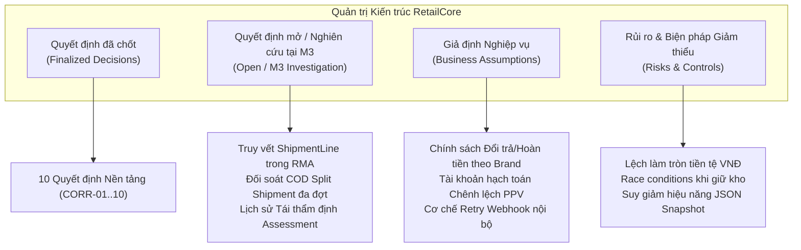

### 2.1. Nhóm 1: Các Quyết định Kiến trúc Đã Chốt (Finalized Decisions)
1. **Tách biệt Đánh giá Giám định và Tồn kho:** Sử dụng `ReturnLineAssessment` (E72) làm thực thể trung gian phân định trách nhiệm lỗi và điều kiện hoàn tiền, tách khỏi vị trí vật lý trong kho.
2. **Mô hình Số dư Tồn kho & 5 CHECK Constraints:** Khống chế toán học nghiêm ngặt trên `InventoryBalance` (E11) với:
   $$\text{AvailableQty} = \text{OnHandQty} - \text{ReservedQty} - \text{QuarantinedQty} - \text{DamagedQty} \ge 0$$
3. **Chuẩn hóa Chất lượng Tồn kho & Ghi sổ Biến động:** Thống nhất 3 trạng thái chất lượng (`SELLABLE`, `QUARANTINED`, `DAMAGED`) và nghiệp vụ xuất hủy phế phẩm (`SCRAP_OUT`). Mọi biến động số dư phải ghi sổ giao dịch kép qua `InventoryTransactionLine` (E16) với tính nguyên tử (atomic) tuyệt đối.
4. **Thuật toán Phân bổ Giảm giá LRM:** Áp dụng phương pháp Số dư Lớn nhất (Largest Remainder Method - Hare-Niemeyer) để phân bổ chiết khấu nguyên đồng VND, triệt tiêu hoàn toàn sai số phân số.
5. **Công thức Hoàn tiền Nguyên số Tích luỹ $F(q)$:** Sử dụng hàm nguyên xác định số tiền hoàn lũy tiến theo số lượng, đảm bảo khi hoàn tất cả số lượng thì số tiền hoàn đúng bằng tổng chiết khấu thực nhận.
6. **Thực thi Quan hệ Bắt buộc 1:1 qua Stored Procedure:** Phối hợp `UNIQUE FK` tại DDL và Transactional SPs (`BEGIN TRANSACTION ... COMMIT`) để đảm bảo cả hai đầu thực thể đều bắt buộc tham gia ($\ge 1$ và $\le 1$). Triển khai Table-Per-Type (TPT) cho cấu trúc `Account` $\to$ `Customer` / `Employee`.
7. **Độc lập Ba Máy Trạng thái:** Phân định độc lập tuyệt đối giữa $\text{OrderStatus} \ne \text{PaymentStatus} \ne \text{ShipmentStatus}$.
8. **Phân định Mốc Đóng hồ sơ Đơn hàng:** Tách biệt rõ `DeliveredAt` (hoàn tất giao vận), `ReturnEligibleUntil` (hạn đổi trả), và `ClosedAt` (đóng hồ sơ tài chính/lưu trữ).
9. **Định giá Xuất trả NCC theo WAC:** Xuất trả NCC ghi giảm tồn kho theo giá vốn bình quân di động hiện hành `CurrentAverageCost`.
10. **Quản lý Giữ hàng $1 : 0..N$ qua Filtered Unique Index:** Cho phép giữ hàng phân đoạn hoặc giải phóng từng phần, khống chế một dòng giữ hàng duy nhất ở trạng thái `ACTIVE`.

### 2.2. Nhóm 2: Quyết định Mở / Chuyển tiếp Nghiên cứu Chuyên sâu tại M3 (Open / M3 Items)
1. **Cơ chế Truy vết Dòng giao hàng trong Đơn đổi trả (Split Shipment Traceability):** Trong đơn hàng chia nhiều kiện giao lệch ngày, một `OrderLine` có thể nằm ở nhiều `ShipmentLine`. M3 sẽ thiết kế liên kết trực tiếp `ShipmentLineID` hoặc thực thể phân bổ `ReturnShipmentAllocation` để xác thực chính xác hạn đổi trả từng kiện.
2. **Mô hình Lịch sử Giám định (Assessment Audit Trail):** Thiết kế cấu trúc phiên bản hóa (`IsCurrent`, `AssessmentStatus`: DRAFT, SUBMITTED, FINAL, SUPERSEDED) cho E72 để hỗ trợ quy trình tái thẩm định, kiểm định từ phòng thí nghiệm/hãng và kiểm toán viên.
3. **Mô hình Đối soát COD Đa kiện Đa đợt:** Thiết kế bảng giao dịch COD cấp kiện hàng/giao dịch (`CODCollection`, `CODRemittance`, `CODReconciliation`) để thay thế cột trạng thái đơn lẻ `Payment.CarrierSettlementStatus` khi xử lý đơn hàng Split Shipment.
4. **Khung Chuẩn hóa 3NF/BCNF Thực tế:** Không ép buộc 100% bảng phải đạt BCNF; M3 sẽ phân tích từng bảng theo Candidate Keys $\to$ FDs $\to$ 3NF $\to$ BCNF test, đánh giá tính bảo toàn phụ thuộc hàm (Dependency Preservation) và ghi nhận rõ các đánh đổi phi chuẩn hóa có chủ đích.
5. **Thống nhất Kiểu Dữ liệu Tiền tệ VNĐ:** Lựa chọn `DECIMAL(19,0)` hoặc `BIGINT` cho các trường tiền tệ giao dịch nguyên số đồng; và `DECIMAL(19,4)` cho đơn giá, tỷ lệ chiết khấu, giá vốn bình quân WAC.

### 2.3. Nhóm 3: Giả định Nghiệp vụ Cần Làm rõ Cấp Chính sách (Business Assumptions)
1. **Chính sách Hoàn phí Vận chuyển & Tỷ lệ Bồi hoàn:** Tỷ lệ hoàn tiền (100% hay một phần) và việc có hoàn phí giao hàng hay không thuộc phạm vi **Chính sách Khách hàng / Bảo hành (Policy Engine)**, không mặc định gắn cứng vào lỗi của Nhà cung cấp (VENDOR) hay Hãng vận chuyển (CARRIER).
2. **Tài khoản Hạch toán Chênh lệch Giá vốn:** Khoản chênh lệch $CostVariance = SupplierRefundAmount - InventoryValueDecrease$ được lưu vết kỹ thuật; tài khoản ghi nhận cụ thể (Chi phí tài chính, Chênh lệch giá mua PPV, hay Giảm trừ giá vốn hàng bán COGS) do chính sách kế toán doanh nghiệp quy định.
3. **Cơ chế Retry Webhook Cổng Thanh toán:** Phân định rạch ròi giữa việc Tiếp nhận Webhook (`RECEIVED`, trả HTTP 200) và Xử lý Nghiệp vụ (`PROCESSED` / `FAILED`). Các webhook xử lý thất bại phải được phép tái xử lý (idempotent replay) qua background worker thay vì bỏ qua vô điều kiện.

### 2.4. Nhóm 4: Rủi ro Kỹ thuật & Biện pháp Giảm thiểu (Risks & Controls)
1. **Rủi ro Sai số Làm tròn:** Triệt tiêu hoàn toàn nhờ việc kết hợp LRM, công thức tích luỹ nguyên $F(q)$ và kiểu dữ liệu `DECIMAL(19,0)`.
2. **Rủi ro Tranh chấp Ghi sổ Tồn kho:** Kiểm soát qua Transaction Isolation Level `SNAPSHOT` hoặc `READ COMMITTED SNAPSHOT (RCSI)` kết hợp locking cục bộ theo `(WarehouseID, ProductVariantID)`.
3. **Rủi ro Hiệu năng JSON Snapshot:** Không quét trực tiếp `OPENJSON` trên bảng giao dịch lớn; thiết kế Persisted Computed Columns + Index cho các thuộc tính cần tra cứu và trích xuất bảng phân tích chuẩn hóa cho báo cáo BI.

---

## 3. KIẾN TRÚC CÁC LUỒNG NGHIỆP VỤ HUYẾT MẠCH & BẢN ĐỒ THỰC THỂ HẠT NHÂN (END-TO-END SYSTEM FLOWS & ENTITY MAPPING)

Toàn bộ hệ thống RetailCore được vận hành thông qua **8 Luồng nghiệp vụ huyết mạch** kết nối 72 thực thể quan niệm trên 11 Subject Areas. Dưới đây là phân tích chi tiết từng luồng, làm rõ sự tương tác dữ liệu, vai trò và ý nghĩa của từng thực thể tham gia.

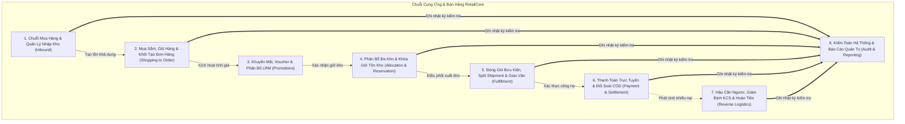

---

### 3.1. Luồng 1: Chuỗi Mua Hàng & Quản Lý Nhập Kho (Inbound Procurement & Inventory Storing Flow)

#### 1. Mục tiêu & Hành trình nghiệp vụ:
Đảm bảo hàng hóa từ các Nhà cung cấp được mua vào theo đúng hợp đồng thương mại, được kiểm đếm ngoại quan tại cửa kho (KCS), cập nhật tức thời vào sổ cái tồn kho vật lý và tính toán giá vốn bình quân di động (Moving Weighted Average Cost - WAC).

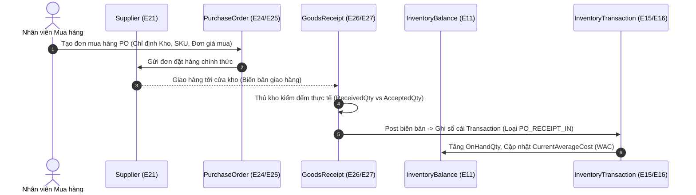

#### 2. Bảng Tra cứu Thực thể Tham gia & Ý nghĩa Chi tiết:

| Mã | Tên Thực thể | Phân loại | Vai trò & Ý nghĩa Nghiệp vụ trong Luồng | Thuộc tính Trọng yếu |
| :---: | :--- | :--- | :--- | :--- |
| **E21** | `Supplier` | Strong Entity | Đại diện cho đối tác cung ứng hàng hóa, theo dõi công nợ và xếp hạng đối tác. | `SupplierID`, `SupplierCode`, `SupplierName`, `TaxCode` |
| **E22** | `SupplierContact` | Weak Entity | Đầu mối liên hệ trực tiếp phụ trách các đơn hàng mua. | `ContactID`, `SupplierID`, `ContactName`, `Phone`, `Email` |
| **E23** | `PurchaseAgreement` | Document Entity | Thỏa thuận khung hoặc hợp đồng nguyên tắc quy định giá mua cố định và kỳ hạn. | `AgreementID`, `SupplierID`, `StartDate`, `EndDate`, `Terms` |
| **E24** | `PurchaseOrder` | Strong / Document | Hồ sơ đơn mua hàng chính thức gửi NCC (PO Header). Quản lý trạng thái mua. | `PurchaseOrderID`, `PONumber`, `SupplierID`, `WarehouseID`, `POStatus` |
| **E25** | `PurchaseOrderLine` | Weak / Detail | Chi tiết từng SKU cần mua, số lượng đặt hàng và đơn giá cam kết mua. | `POLineID`, `PurchaseOrderID`, `VariantID`, `OrderedQty`, `UnitPrice` |
| **E26** | `GoodsReceipt` | Strong / Document | Biên bản tiếp nhận hàng hóa tại bến nhập kho (GRN Header). | `ReceiptID`, `ReceiptNumber`, `PurchaseOrderID`, `WarehouseID`, `PostedAt` |
| **E27** | `GoodsReceiptLine` | Weak / Detail | Chi tiết số lượng thực nhận, số lượng đạt chuẩn (Accepted) và số lượng từ chối. | `ReceiptLineID`, `ReceiptID`, `POLineID`, `ReceivedQty`, `AcceptedQty`, `UnitCost` |
| **E28** | `SupplierReturn` | Strong / Document | Phiếu xuất trả hàng cho nhà cung cấp khi hàng lỗi phát hiện sau nhập kho. | `ReturnID`, `SupplierID`, `WarehouseID`, `CostVariance`, `ReturnStatus` |
| **E10** | `Warehouse` | Strong Entity | Kho hàng vật lý tiếp nhận lưu trữ hàng hóa. | `WarehouseID`, `WarehouseCode`, `WarehouseName` |
| **E11** | `InventoryBalance` | Associative Entity | Bảng số dư tức thời của SKU tại kho. Tăng `OnHandQty` và cập nhật WAC. | `WarehouseID`, `VariantID`, `OnHandQty`, `CurrentAverageCost` |
| **E15** | `InventoryTransaction` | Document Entity | Chứng từ sổ cái biến động kho loại `PO_RECEIPT_IN` hoặc `SUPPLIER_RETURN_OUT`. | `TransactionID`, `TransactionType`, `ReferenceID`, `PostedAt` |
| **E16** | `InventoryTransactionLine` | Weak Entity | Dòng biến động số dư: `OnHandDelta > 0`, ghi nhận giá mua thực tế vào `UnitCost`. | `TransactionLineID`, `TransactionID`, `VariantID`, `OnHandDelta`, `UnitCost` |

#### 3. Bất biến Kiến trúc & Nguyên tắc Chốt:
* **Tính toán WAC tức thời:** Khi biên bản `GoodsReceipt` được chốt (`PostedAt` NOT NULL), giá vốn bình quân di động mới của tồn kho thương phẩm được tính theo công thức:
  $$\text{WAC}_{\text{mới}} = \frac{(\text{OnHandQty}_{\text{cũ}} \times \text{WAC}_{\text{cũ}}) + (\text{AcceptedQty} \times \text{UnitCost}_{\text{PO}})}{\text{OnHandQty}_{\text{cũ}} + \text{AcceptedQty}}$$
* **Xuất trả NCC (SupplierReturn):** Giảm tồn kho theo `CurrentAverageCost` hiện hành, chênh lệch so với giá PO được tính vào `CostVariance` để phục vụ phòng Kế toán hạch toán.

---

### 3.2. Luồng 2: Trải Nghiệm Mua Sắm, Chuyển Đổi Giỏ Hàng & Khởi Tạo Đơn Hàng (Shopping, Cart Conversion & Order Inception Flow)

#### 1. Mục tiêu & Hành trình nghiệp vụ:
Chuyển hóa nhu cầu mua sắm từ Giỏ hàng trực tuyến thành một Hợp đồng mua bán chính thức (`SalesOrder`). Toàn bộ thông tin thời điểm mua được đóng băng bất biến qua **Cơ chế Snapshot 3 Điểm** nhằm bảo vệ hệ thống trước sự biến động dữ liệu sau này.

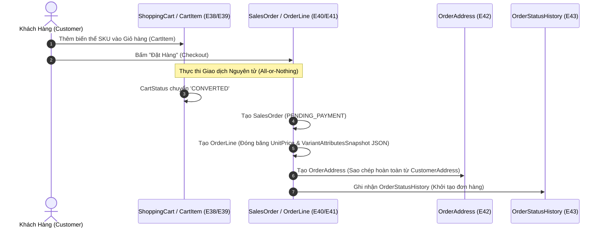

#### 2. Bảng Tra cứu Thực thể Tham gia & Ý nghĩa Chi tiết:

| Mã | Tên Thực thể | Phân loại | Vai trò & Ý nghĩa Nghiệp vụ trong Luồng | Thuộc tính Trọng yếu |
| :---: | :--- | :--- | :--- | :--- |
| **E29** | `Account` | Strong Entity | Tài khoản định danh đăng nhập dùng chung (TPT Base). | `AccountID`, `Username`, `Email`, `AccountType` |
| **E30** | `Customer` | Subtype Entity | Hồ sơ khách hàng thương mại, lưu cấp độ trung thành (Loyalty Tier). | `AccountID (PK_FK)`, `CustomerCode`, `LoyaltyTierID` |
| **E32** | `CustomerAddress` | Weak Entity | Sổ địa chỉ cá nhân của khách hàng (có thể bị sửa hoặc xóa bất kỳ lúc nào). | `AddressID`, `CustomerID`, `RecipientName`, `StreetAddress` |
| **E01** | `Product` | Strong Entity | Thông tin chung của sản phẩm thương mại. | `ProductID`, `ProductName`, `Brand` |
| **E04** | `ProductVariant` | Core SKU Entity | Biến thể vật lý cụ thể (màu, size) mang mã SKU duy nhất để bán. | `VariantID`, `ProductID`, `SKU`, `SellingPrice` |
| **E38** | `ShoppingCart` | Strong Entity | Giỏ hàng trực tuyến lưu trạng thái mua sắm của khách. | `CartID`, `CustomerID`, `CartStatus` (ACTIVE / CONVERTED) |
| **E39** | `CartItem` | Weak Entity | Dòng hàng trong giỏ, lưu số lượng tạm chọn của từng SKU. | `CartItemID`, `CartID`, `VariantID`, `Quantity` |
| **E40** | `SalesOrder` | Strong / Document | Hợp đồng mua bán chính thức giữa Khách hàng và RetailCore (Header). | `OrderID`, `OrderNumber`, `CustomerID`, `OrderStatus`, `TotalAmount` |
| **E41** | `OrderLine` | Weak / Detail | Chi tiết từng mặt hàng được chốt mua, lưu snapshot giá và thuộc tính. | `OrderLineID`, `OrderID`, `VariantID`, `UnitPrice`, `VariantAttributesSnapshot` |
| **E42** | `OrderAddress` | Snapshot Entity | Bản sao bất biến địa chỉ giao hàng, độc lập hoàn toàn với `CustomerAddress`. | `OrderAddressID`, `OrderID`, `RecipientName`, `RecipientPhone`, `StreetAddress` |
| **E43** | `OrderStatusHistory` | Audit Entity | Nhật ký vết lưu chuyển trạng thái của đơn hàng phục vụ kiểm soát SLA. | `StatusHistoryID`, `OrderID`, `PreviousStatus`, `NewStatus`, `ChangedAt` |

#### 3. Bất biến Kiến trúc & Nguyên tắc Chốt:
* **Cơ chế Snapshot 3 Điểm:**
  1. `OrderAddress` không có Foreign Key trỏ về `CustomerAddress`. Khi khách hàng sửa sổ địa chỉ cá nhân, địa chỉ đơn hàng đã đặt hoàn toàn không bị ảnh hưởng.
  2. `OrderLine.UnitPrice` lưu cứng giá bán tại thời điểm bấm đặt hàng. Mọi thay đổi giá niêm yết trong danh mục sau đó không làm thay đổi giá trị đơn hàng.
  3. `OrderLine.VariantAttributesSnapshot` lưu trữ mảng JSON chuẩn hoá (`attributeId`, `valueCode`, `displayValue`), đảm bảo 5 năm sau danh mục có xóa thuộc tính thì đơn hàng vẫn xem lại đúng thuộc tính lúc mua.

---

### 3.3. Luồng 3: Áp Mã Khuyến Mãi, Xếp Chồng Voucher & Phân Bổ Chiết Khấu LRM (Promotion Stacking & Discount Allocation Flow)

#### 1. Mục tiêu & Hành trình nghiệp vụ:
Xác thực tính hợp lệ của mã giảm giá (`Voucher`) và chương trình khuyến mãi (`Promotion`). Phân bổ chiết khấu tổng đơn về từng dòng hàng bằng **Thuật toán Số dư Lớn nhất (Largest Remainder Method - LRM)** để đảm bảo số tiền giảm giá và thanh toán ròng là các số nguyên đồng VNĐ chính xác tuyệt đối.

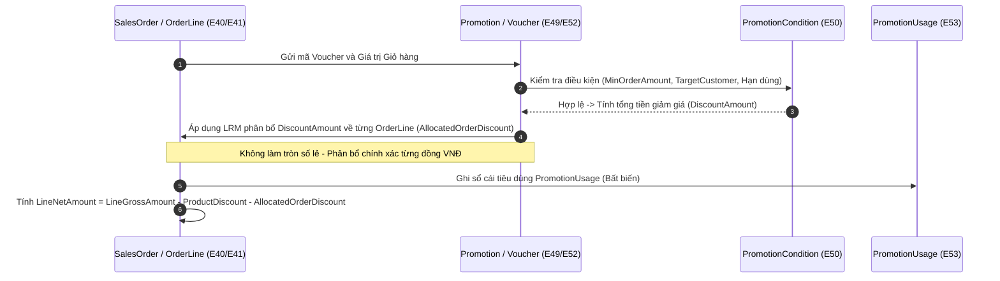

#### 2. Bảng Tra cứu Thực thể Tham gia & Ý nghĩa Chi tiết:

| Mã | Tên Thực thể | Phân loại | Vai trò & Ý nghĩa Nghiệp vụ trong Luồng | Thuộc tính Trọng yếu |
| :---: | :--- | :--- | :--- | :--- |
| **E49** | `Promotion` | Strong / Document | Định nghĩa chương trình ưu đãi tổng thể (Header, có quản lý phiên bản). | `PromotionID`, `PromotionCode`, `DiscountType`, `DiscountValue`, `MaxDiscountAmount` |
| **E50** | `PromotionCondition` | Weak Entity | Các quy tắc điều kiện đơn hàng/khách hàng phải thỏa mãn để được hưởng ưu đãi. | `ConditionID`, `PromotionID`, `ConditionType`, `ComparisonOperator`, `ConditionValue` |
| **E51** | `PromotionProduct` | Associative Entity | Danh sách các SKU thuộc diện được áp dụng ưu đãi cấp sản phẩm. | `PromotionID`, `VariantID` |
| **E52** | `Voucher` | Document Entity | Mã phiếu giảm giá cụ thể mà khách hàng nhập khi checkout (Public hoặc Cá nhân). | `VoucherID`, `PromotionID`, `VoucherCode`, `MaxUsage`, `UsedCount`, `EndAt` |
| **E53** | `PromotionUsage` | Associative / Ledger | Sổ cái ghi nhận lịch sử áp dụng khuyến mại bất biến vào đơn hàng. | `PromotionUsageID`, `PromotionID`, `OrderID`, `OrderLineID`, `VoucherID`, `DiscountAmount` |
| **E54** | `PromotionTargetCustomer` | Associative Entity | Phân quyền chương trình ưu đãi dành riêng cho nhóm khách hàng thân thiết/VIP. | `PromotionID`, `CustomerID` |
| **E41** | `OrderLine` | Detail Entity | Tiếp nhận giá trị chiết khấu phân bổ vào trường `AllocatedOrderDiscount`. | `AllocatedOrderDiscount`, `LineNetAmount`, `LineGrossAmount` |

#### 3. Bất biến Kiến trúc & Nguyên tắc Chốt:
* **Triệt tiêu Sai số Làm tròn (LRM):** Thuật toán Hare-Niemeyer phân chia phần nguyên đồng trước, phần dư phân số được ưu tiên cộng 1 đồng cho các dòng có phần dư lớn nhất. Tổng chiết khấu phân bổ luôn bằng đúng 100% chiết khấu đơn:
  $$\sum_{i=1}^N \text{AllocatedOrderDiscount}_i = \text{DiscountAmount}_{\text{Order}}$$
* **Tính toán Giá trị Ròng:** Mỗi dòng `OrderLine` xác định chính xác số tiền thực thu `LineNetAmount` làm căn cứ pháp lý và tài chính cho việc hoàn tiền sau này.

---

### 3.4. Luồng 4: Phân Bổ Đa Kho & Khóa Giữ Tồn Kho 15 Phút (Multi-Warehouse Allocation & Stock Reservation Flow)

#### 1. Mục tiêu & Hành trình nghiệp vụ:
Đối với đơn hàng có nhiều mặt hàng nằm rải rác ở nhiều kho vật lý khác nhau, hệ thống tự động định tuyến xuất hàng (`OrderWarehouseAllocation`) và khóa giữ tạm thời tồn kho khả dụng (`StockReservation`) trong thời gian 15 phút để khách hoàn tất thanh toán, ngăn chặn triệt để tình trạng bán vượt tồn (Overselling).

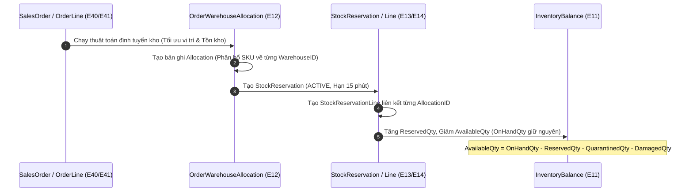

#### 2. Bảng Tra cứu Thực thể Tham gia & Ý nghĩa Chi tiết:

| Mã | Tên Thực thể | Phân loại | Vai trò & Ý nghĩa Nghiệp vụ trong Luồng | Thuộc tính Trọng yếu |
| :---: | :--- | :--- | :--- | :--- |
| **E12** | `OrderWarehouseAllocation` | Associative Entity | Bản ghi định tuyến: Quyết định lấy bao nhiêu sản phẩm của dòng đơn từ kho nào. | `AllocationID`, `OrderLineID`, `WarehouseID`, `VariantID`, `AllocatedQty`, `AllocationStatus` |
| **E13** | `StockReservation` | Document Entity | Phiếu khóa giữ hàng tạm thời gắn liền với đơn hàng (Header, quản lý thời gian hết hạn). | `ReservationID`, `OrderID`, `ReservationStatus`, `CreatedAt`, `ExpiresAt`, `ReleasedAt` |
| **E14** | `StockReservationLine` | Weak Entity | Chi tiết số lượng SKU cụ thể bị khóa tại từng kho (Line). | `ReservationLineID`, `ReservationID`, `AllocationID`, `WarehouseID`, `ReservedQty` |
| **E11** | `InventoryBalance` | Associative Entity | Bảng số dư kho: Tiếp nhận biến động tăng `ReservedQty`. | `WarehouseID`, `VariantID`, `ReservedQty`, `OnHandQty` |

#### 3. Bất biến Kiến trúc & Nguyên tắc Chốt:
* **Tách rời Quyết định Định tuyến khỏi Giữ hàng:** `OrderWarehouseAllocation` lưu quyết định logistics (kho nào xuất); trong khi `StockReservationLine` là công cụ khóa giữ tồn kho kỹ thuật. Một phân bổ có thể có nhiều đợt giữ hàng ($1 : 0..N$) nếu khách hàng thanh toán trễ và yêu cầu tái giữ hàng (Re-allocation).
* **Bảo toàn Tồn kho Vật lý:** Thao tác khóa giữ kho **tuyệt đối không làm thay đổi `OnHandQty`**. Chỉ có `ReservedQty` tăng lên, dẫn đến `AvailableQty` giảm tức thời.

---

### 3.5. Luồng 5: Đóng Gói Bưu Kiện, Phân Tách Kiện Hàng & Giao Vận (Fulfillment, Split Shipment & Carrier Dispatch Flow)

#### 1. Mục tiêu & Hành trình nghiệp vụ:
Thực thi đóng gói bưu phẩm tại từng kho hàng theo đúng phân bổ. Nếu đơn hàng lấy từ nhiều kho, hệ thống tự động tách thành nhiều kiện độc lập (**Split Shipment**). Khi đơn vị vận chuyển tiếp nhận kiện (`DISPATCHED`), hệ thống mới chính thức xuất sổ trừ tồn kho vật lý và cập nhật tracking.

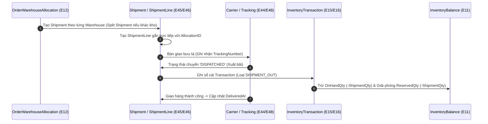

#### 2. Bảng Tra cứu Thực thể Tham gia & Ý nghĩa Chi tiết:

| Mã | Tên Thực thể | Phân loại | Vai trò & Ý nghĩa Nghiệp vụ trong Luồng | Thuộc tính Trọng yếu |
| :---: | :--- | :--- | :--- | :--- |
| **E44** | `Carrier` | Strong Entity | Đối tác giao vận (GHTK, GHN, Viettel Post, Shopee Xpress...). | `CarrierID`, `CarrierCode`, `CarrierName`, `ContactPhone` |
| **E45** | `Shipment` | Strong / Document | Kiện hàng giao vận thực tế được đóng gói từ một kho xuất phát (Header). | `ShipmentID`, `ShipmentNumber`, `OrderID`, `WarehouseID`, `CarrierID`, `TrackingNumber`, `ShipmentStatus`, `DeliveredAt` |
| **E46** | `ShipmentLine` | Associative / Detail | Chi tiết số lượng mặt hàng nằm trong kiện hàng, gắn liền với phân bổ kho. | `ShipmentLineID`, `ShipmentID`, `OrderLineID`, `AllocationID`, `ShipmentQty` |
| **E47** | `DeliveryAttempt` | Weak Entity | Ghi nhận các lần bưu tá phát hàng thực tế (lần 1, 2, 3 kèm nguyên nhân nếu thất bại). | `AttemptID`, `ShipmentID`, `AttemptNumber`, `AttemptStatus`, `FailureReason` |
| **E48** | `ShipmentStatusHistory` | Audit Entity | Nhật ký vết chuyển đổi trạng thái của kiện hàng phục vụ đối soát SLA giao vận. | `ShipmentStatusHistoryID`, `ShipmentID`, `PreviousStatus`, `NewStatus`, `ChangedAt` |
| **E15** | `InventoryTransaction` | Document Entity | Chứng từ xuất kho loại `SHIPMENT_OUT`. | `TransactionID`, `TransactionType`, `ReferenceID`, `PostedAt` |
| **E16** | `InventoryTransactionLine` | Weak Entity | Dòng biến động kép: `OnHandDelta = -Qty`, `ReservedDelta = -Qty`. | `TransactionLineID`, `TransactionID`, `VariantID`, `OnHandDelta`, `ReservedDelta` |

#### 3. Bất biến Kiến trúc & Nguyên tắc Chốt:
* **Ghi sổ Kép Xuất Kho (Atomic Dual-Delta):** Chỉ khi bưu phẩm chính thức rời khỏi cửa kho, hệ thống mới ghi sổ:
  $$\text{OnHandDelta} = -\text{ShipmentQty}, \quad \text{ReservedDelta} = -\text{ShipmentQty}$$
  Thao tác này đồng thời giảm tồn kho vật lý và giải phóng khóa giữ hàng trong cùng một Database Transaction.
* **Độc lập Mốc Giao theo Kiện:** Trong Split Shipment, mỗi `Shipment` có thời điểm giao thành công `DeliveredAt` hoàn toàn độc lập, làm căn cứ tính thời hạn đổi trả riêng cho kiện hàng đó.

---

### 3.6. Luồng 6: Thanh Toán Trực Tuyến, Xử Lý Webhook & Đối Soát COD Hai Chặng (Payment Settlement, Webhook Idempotency & COD Flow)

#### 1. Mục tiêu & Hành trình nghiệp vụ:
Quản lý nghĩa vụ tài chính của đơn hàng thông qua mô hình trạng thái hai tầng. Hỗ trợ thanh toán trực tuyến với bộ đệm Webhook chống xử lý trùng lặp (Idempotent), đồng thời vận hành đối soát COD hai chặng độc lập bảo vệ doanh thu bưu cục thu hộ.

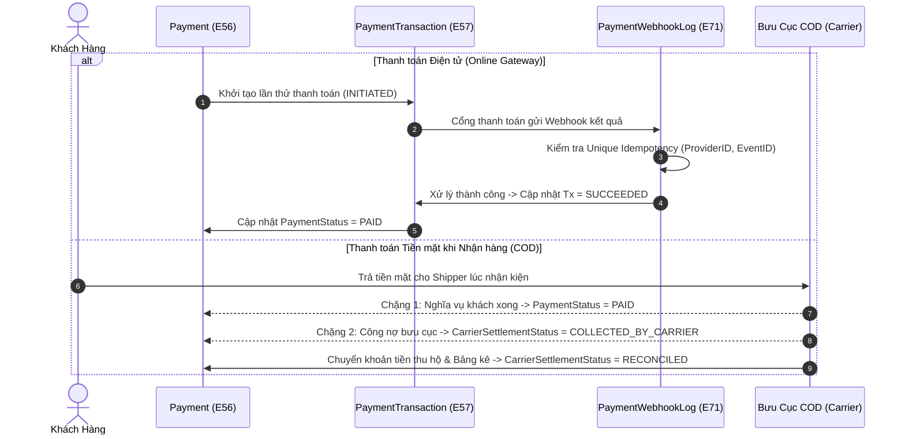

#### 2. Bảng Tra cứu Thực thể Tham gia & Ý nghĩa Chi tiết:

| Mã | Tên Thực thể | Phân loại | Vai trò & Ý nghĩa Nghiệp vụ trong Luồng | Thuộc tính Trọng yếu |
| :---: | :--- | :--- | :--- | :--- |
| **E55** | `PaymentMethod` | Strong Entity | Danh mục phương thức thanh toán: COD, VNPAY, MOMO, ZALOPAY, CREDIT_CARD. | `PaymentMethodID`, `MethodCode`, `MethodName`, `MethodType` |
| **E56** | `Payment` | Strong / Document | Hồ sơ nghĩa vụ tài chính tổng thể của đơn hàng ($1:1$ với `SalesOrder`). | `PaymentID`, `OrderID`, `PaymentMethodID`, `PaymentStatus`, `CarrierSettlementStatus`, `AmountDue`, `AmountPaid` |
| **E57** | `PaymentTransaction` | Weak / Event | Nhật ký từng lần thử thu tiền qua cổng thanh toán (hỗ trợ thử lại nhiều lần). | `PaymentTransactionID`, `PaymentID`, `GatewayTransactionID`, `TransactionStatus`, `Amount` |
| **E71** | `PaymentWebhookLog` | Support / Audit | Bộ đệm raw payload webhook từ cổng thanh toán, ngăn chặn tấn công Replay. | `WebhookLogID`, `PaymentMethodID`, `MerchantAccountID`, `ProviderEventID`, `ProcessingStatus` |

#### 3. Bất biến Kiến trúc & Nguyên tắc Chốt:
* **Mô hình Trạng thái Hai Tầng:** `Payment` đại diện cho nghĩa vụ tài chính tổng thể; trong khi `PaymentTransaction` đại diện cho từng nỗ lực thanh toán. Một giao dịch thử nghiệm thất bại không được làm hủy toàn bộ hồ sơ `Payment` nếu khách hàng vẫn có quyền đổi thẻ hoặc chọn phương thức khác.
* **Đối soát COD Hai Chặng (Two-Sided COD):** 
  * Ngay khi bưu tá giao hàng và nhận tiền mặt: Nghĩa vụ của khách hàng hoàn tất 100% (`Payment.PaymentStatus = 'PAID'`).
  * Trách nhiệm nợ chuyển sang hãng vận chuyển: Quản lý độc lập qua `CarrierSettlementStatus` từ `COLLECTED_BY_CARRIER` đến khi tiền về tài khoản ngân hàng và khớp bảng kê đối soát (`RECONCILED`).

---

### 3.7. Luồng 7: Hậu Cần Ngược, Giám Định Lỗi & Hoàn Tiền Bảo Toàn Tài Chính (Reverse Logistics, Assessment & Refund Flow)

#### 1. Mục tiêu & Hành trình nghiệp vụ:
Xử lý khiếu nại đổi trả hàng (RMA) sau bán hàng. Tiếp nhận bưu phẩm hoàn trả tại kho, thực hiện giám định độc lập lỗi KCS thông qua `ReturnLineAssessment` (E72) và hoàn trả tiền chính xác theo công thức lũy tiến số nguyên $F(q)$.

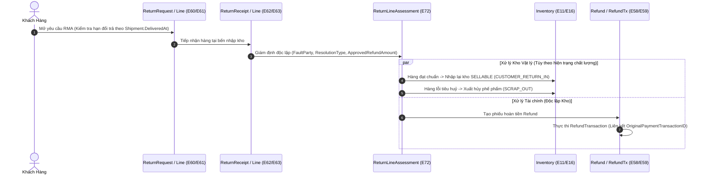

#### 2. Bảng Tra cứu Thực thể Tham gia & Ý nghĩa Chi tiết:

| Mã | Tên Thực thể | Phân loại | Vai trò & Ý nghĩa Nghiệp vụ trong Luồng | Thuộc tính Trọng yếu |
| :---: | :--- | :--- | :--- | :--- |
| **E60** | `ReturnRequest` | Strong / Document | Yêu cầu đổi trả hàng chính thức do khách hoặc CSKH lập (RMA Header). | `ReturnRequestID`, `ReturnNumber`, `OrderID`, `CustomerID`, `WarehouseID`, `ReturnStatus` |
| **E61** | `ReturnRequestLine` | Weak / Detail | Chi tiết từng SKU và số lượng yêu cầu trả, gắn với dòng đơn hàng gốc. | `ReturnRequestLineID`, `ReturnRequestID`, `OrderLineID`, `RequestedQty`, `ApprovedQty` |
| **E62** | `ReturnReceipt` | Strong / Document | Biên bản tiếp nhận bưu kiện hoàn trả thực tế tại kho được chỉ định. | `ReturnReceiptID`, `ReceiptNumber`, `ReturnRequestID`, `WarehouseID`, `PostedAt` |
| **E63** | `ReturnReceiptLine` | Weak / Detail | Chi tiết số lượng thực tế mở gói tiếp nhận tại bến nhập kho. | `ReturnReceiptLineID`, `ReturnReceiptID`, `ReturnRequestLineID`, `ReceivedQty` |
| **E64** | `ReturnStatusHistory` | Audit Entity | Nhật ký vết chuyển đổi trạng thái của yêu cầu đổi trả phục vụ đối soát SLA. | `ReturnStatusHistoryID`, `ReturnRequestID`, `PreviousStatus`, `NewStatus`, `ChangedAt` |
| **E72** | `ReturnLineAssessment` | Assessment Entity | Bản ghi thẩm định trách nhiệm lỗi, điều kiện hoàn tiền và lưu vết Audit Trail. | `AssessmentID`, `ReturnReceiptLineID`, `AssessedQty`, `FaultParty`, `ResolutionType`, `ApprovedRefundAmount`, `IsCurrent` |
| **E58** | `Refund` | Strong / Document | Hồ sơ phê duyệt lệnh hoàn tiền gắn với hồ sơ thanh toán thực thu ban đầu. | `RefundID`, `PaymentID`, `RefundReference`, `RefundAmount`, `RefundStatus` |
| **E59** | `RefundTransaction` | Weak / Event | Giao dịch thực thi chuyển tiền hoàn qua cổng, liên kết giao dịch gốc. | `RefundTransactionID`, `RefundID`, `OriginalPaymentTransactionID`, `Amount`, `TransactionStatus` |

#### 3. Bất biến Kiến trúc & Nguyên tắc Chốt:
* **Tách Biệt Quyền Hoàn Tiền khỏi Định Đoạt Kho:** `ReturnLineAssessment` (E72) cho phép khách hàng được bồi hoàn 100% nếu lỗi thuộc về Nhà sản xuất hoặc Đơn vị vận chuyển dù hàng hóa bị biến dạng và phải tiêu hủy tại chỗ (`SCRAP_OUT`).
* **Công thức Hoàn tiền Tích luỹ Nguyên số $F(q)$:** Triệt tiêu hoàn toàn sai số phân số khi khách trả hàng lẻ từng đợt, đảm bảo số tiền hoàn tích lũy bằng đúng số tiền ròng thực trả.
* **Kiểm soát Ngân quỹ Hoàn tiền:** Mọi `RefundTransaction` bắt buộc trỏ về `OriginalPaymentTransactionID` thành công và được kiểm soát không hoàn vượt quá số tiền thực thu.

---

### 3.8. Luồng 8: Quản Trị Hệ Thống, Kiểm Toán Vết & Báo Cáo Doanh Nghiệp (System Audit & Enterprise Reporting Flow)

#### 1. Mục tiêu & Hành trình nghiệp vụ:
Ghi vết bất biến toàn bộ các thao tác nghiệp vụ nhạy cảm (thay đổi giá, can thiệp tồn kho, điều chỉnh hoàn tiền) để đáp ứng chuẩn mực kiểm toán SOX/ISO. Cung cấp cơ chế đóng băng dữ liệu báo cáo tài chính/quản trị (`ReportSnapshot`) theo kỳ kế toán cố định, giảm tải truy vấn trực tiếp lên cơ sở dữ liệu giao dịch OLTP.

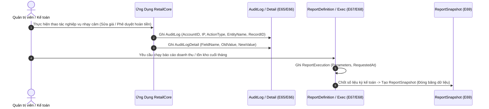

#### 2. Bảng Tra cứu Thực thể Tham gia & Ý nghĩa Chi tiết:

| Mã | Tên Thực thể | Phân loại | Vai trò & Ý nghĩa Nghiệp vụ trong Luồng | Thuộc tính Trọng yếu |
| :---: | :--- | :--- | :--- | :--- |
| **E65** | `AuditLog` | Audit Entity | Nhật ký ghi nhận các thao tác nghiệp vụ và sự kiện an ninh quan trọng (Header). | `AuditLogID`, `AccountID`, `ActionType`, `EntityName`, `RecordID`, `ActionAt`, `IPAddress` |
| **E66** | `AuditLogDetail` | Weak / Detail | Chi tiết các thuộc tính bị thay đổi (giá trị trước và sau khi chỉnh sửa). | `AuditLogDetailID`, `AuditLogID`, `FieldName`, `OldValue`, `NewValue` |
| **E67** | `ReportDefinition` | Catalog Entity | Danh mục định nghĩa các mẫu báo cáo quản trị và nghiệp vụ trong hệ thống. | `ReportDefinitionID`, `ReportCode`, `ReportName`, `DataSource`, `ReportType` |
| **E68** | `ReportExecution` | Event Entity | Nhật ký theo dõi mỗi lần người dùng kích hoạt chạy hoặc tải xuất báo cáo. | `ReportExecutionID`, `ReportDefinitionID`, `AccountID`, `ExecutionStatus`, `CompletedAt` |
| **E69** | `ReportSnapshot` | Document / Snapshot | Ảnh chụp dữ liệu báo cáo được chốt cố định theo kỳ kế toán, bảo đảm bất biến. | `ReportSnapshotID`, `ReportDefinitionID`, `SnapshotCode`, `PeriodStart`, `PeriodEnd`, `DataLocation` |
| **E70** | `ReportPermission` | Associative Entity | Phân quyền chi tiết cho phép nhóm vai trò (`Role`) được xem hoặc xuất báo cáo. | `ReportDefinitionID`, `RoleID`, `CanView`, `CanExport`, `CanCreateSnapshot` |

#### 3. Bất biến Kiến trúc & Nguyên tắc Chốt:
* **Ghi vết Kiểm toán Bất biến (Tamper-evident Audit):** Bản ghi `AuditLog` và `AuditLogDetail` chỉ cho phép quyền `INSERT`. Không một tài khoản người dùng ứng dụng nào có quyền `UPDATE` hoặc `DELETE` trên bảng audit.
* **Đóng băng Ảnh chụp Báo cáo (Report Freezing):** Số liệu báo cáo tài chính cuối tháng được chốt vào `ReportSnapshot`. Các truy vấn phân tích của ban giám đốc sẽ đọc từ snapshot này, ngăn chặn nguy cơ các giao dịch mới phát sinh làm sai lệch số liệu của kỳ kế toán đã khóa sổ.

---

## 4. THUYẾT MINH CHI TIẾT 10 PHƯƠNG ÁN KIẾN TRÚC (ĐÃ CHUẨN HOÁ THEO REVIEW v2.0)

---

### Phương án 1 (P0): Mô hình Giám định `ReturnLineAssessment` (E72) & Lịch sử Đánh giá (Audit Trail)

#### 1. Bối cảnh & Điểm cần chuẩn hoá:
Trong thiết kế ban đầu, việc hoàn tiền bị ràng buộc cứng vào việc hàng đã nhập lại kho hay chưa (`Restocked`). Khi hàng bị hư hỏng do vận chuyển hoặc lỗi sản xuất nghiêm trọng phải tiêu hủy tại chỗ (`SCRAP_OUT`), nếu không có cơ chế phân tách, hệ thống sẽ chặn hoàn tiền hoặc ép buộc nhập hàng ảo vào kho.
Bên cạnh đó, việc giám định thực tế thường trải qua nhiều giai đoạn: duyệt một phần, chờ kiểm tra từ hãng, từ chối, hoặc đổi hàng thay vì hoàn tiền.

#### 2. Quyết định kiến trúc chuẩn hoá:
* Tách độc lập quyết định tài chính khỏi định đoạt kho hàng bằng thực thể trung gian **`ReturnLineAssessment` (E72)**.
* **Tách bạch Thuộc tính Trách nhiệm và Hướng Xử lý:**
  * `FaultParty`: VENDOR, CARRIER, CUSTOMER, NO_FAULT, SHARED.
  * `ResolutionType`: REFUND, EXCHANGE, REPAIR, NO_ACTION.
  * `RefundEligibilityStatus`: PENDING, APPROVED, PARTIALLY_APPROVED, REJECTED.
  * `ApprovedRefundAmount`: Số tiền hàng được duyệt hoàn.
  * `ShippingRefundAmount`: Phí vận chuyển được duyệt hoàn (theo chính sách).
* **Loại bỏ quy tắc cứng 100%:** Trách nhiệm của VENDOR/CARRIER không mặc định sinh ra quyền hoàn tiền 100% kèm phí ship ở tầng DDL; đây là tham số cấu hình của Policy Engine.
* **Mô hình Lịch sử Đánh giá (Audit Trail):** E72 hỗ trợ lưu vết phiên bản (`AssessmentVersion`, `IsCurrent`, `AssessmentStatus`: DRAFT, SUBMITTED, FINAL, SUPERSEDED). Khi cần tái thẩm định, bản ghi cũ chuyển `IsCurrent = 0` và bản ghi mới ghi nhận kết quả điều chỉnh.
* **Bộ ràng buộc toán học:**
  $$\sum \text{AssessedQty} \le \text{ReceivedQty}$$
  $$\text{ApprovedRefundQty} \le \text{AssessedEligibleQty}$$
  $$\text{ApprovedRefundAmount} \le \text{AllocatedNetAmount}(\text{ApprovedRefundQty})$$

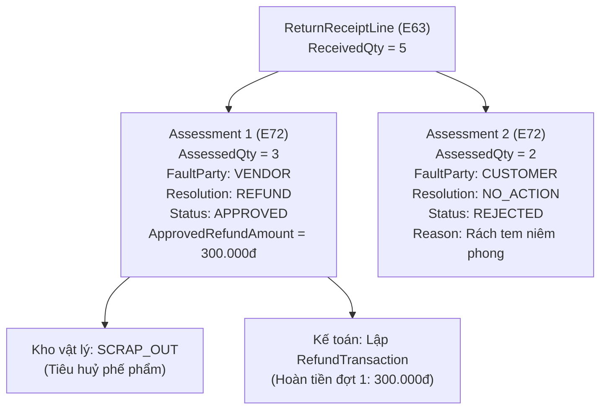

---

### Phương án 2 (P0): Quản lý Tồn kho Cách ly & Hư hỏng - Chuẩn hoá Ngữ nghĩa & Ghi sổ Biến động

#### 1. Bối cảnh & Chuẩn hoá Ngữ nghĩa:
Tồn kho vật lý trong kho bao gồm nhiều trạng thái chất lượng khác nhau. Cần tránh nhập nhằng giữa **Trạng thái chất lượng tồn kho** và **Loại giao dịch xuất kho**.
* **Chuẩn hóa Chất lượng Tồn kho:**
  * `SELLABLE`: Hàng thương phẩm đạt chuẩn, sẵn sàng kinh doanh.
  * `QUARANTINED`: Hàng cách ly chờ kiểm tra, thẩm định chất lượng hoặc tranh chấp.
  * `DAMAGED`: Hàng xác định hư hỏng, lỗi, không thể bán thương mại.
* **Chuẩn hóa Nghiệp vụ Xuất hủy:**
  * `SCRAP_OUT` là **Loại nghiệp vụ giao dịch (Transaction Type)** ghi nhận việc đưa hàng phế phẩm ra khỏi kho để tiêu hủy. Hàng sau khi `SCRAP_OUT` đã rời khỏi kho nên **KHÔNG** tồn tại trạng thái tồn kho vật lý mang tên "DISPOSED".

#### 2. Cấu trúc Số dư & Bộ 5 Declarative CHECK Constraints trên `InventoryBalance` (E11):
Tất cả các đại lượng trong bảng số dư phải thỏa mãn hệ tiên đề:
1. `OnHandQty >= 0` (Tổng tồn kho vật lý không âm).
2. `ReservedQty >= 0` (Số lượng giữ hàng cho đơn chưa xuất không âm).
3. `QuarantinedQty >= 0` (Số lượng cách ly kiểm định không âm).
4. `DamagedQty >= 0` (Số lượng hư hại xác định không âm).
5. `OnHandQty >= (ReservedQty + QuarantinedQty + DamagedQty)` (Tổng các trạng thái thành phần không được vượt quá tổng tồn kho vật lý).

Công thức Khả dụng Thương mại (Available to Promise):
$$\text{AvailableQty} = \text{OnHandQty} - \text{ReservedQty} - \text{QuarantinedQty} - \text{DamagedQty} \ge 0$$

#### 3. Nguyên tắc Ghi sổ Biến động Kép trên `InventoryTransactionLine` (E16):
Mọi thay đổi số dư kho bắt buộc phải gắn liền với một bản ghi `InventoryTransactionLine`. Giao dịch ghi sổ và cập nhật `InventoryBalance` phải được thực thi trong cùng một Database Transaction nguyên tử:
* **Chuyển trạng thái nội bộ (VD: Chuyển 5 sản phẩm từ QUARANTINED sang DAMAGED):** Không làm thay đổi tổng tồn kho vật lý `OnHand`.
  $$\text{OnHandDelta} = 0, \quad \text{QuarantinedDelta} = -5, \quad \text{DamagedDelta} = +5$$
* **Xuất hủy phế phẩm (SCRAP_OUT 5 sản phẩm DAMAGED):** Giảm trực tiếp tồn kho vật lý và giảm trạng thái nguồn tương ứng.
  $$\text{OnHandDelta} = -5, \quad \text{DamagedDelta} = -5, \quad \text{QuarantinedDelta} = 0$$

---

### Phương án 3 (P0): Thuật toán Phân bổ Chiết khấu Đơn hàng LRM & Công thức Hoàn tiền Nguyên số VND

#### 1. Bối cảnh & Thống nhất Kiểu Dữ liệu Tiền tệ:
Khi khách hàng áp mã giảm giá tổng đơn (Order-level Discount), khoản chiết khấu phải được phân bổ về từng dòng hàng (`OrderLine`) để phục vụ tính giá vốn, thuế và hoàn tiền.
Do đơn vị tiền tệ giao dịch của RetailCore là Việt Nam Đồng (VND) - loại tiền tệ không có phần thập phân lẻ, việc chia tỷ lệ rất dễ phát sinh phần dư (ví dụ: 100.000đ chia cho 3 sản phẩm = 33.333,333...đ).
* **Quy chuẩn Kiểu dữ liệu Tiền tệ:**
  * Toàn bộ các trường tiền tệ giao dịch nghiệp vụ (`LineGrossAmount`, `LineNetAmount`, `AllocatedOrderDiscount`, `ApprovedRefundAmount`, `TotalAmount`) sử dụng kiểu **`DECIMAL(19,0)`** (hoặc `BIGINT`).
  * Các trường đơn giá trung gian, tỷ lệ chiết khấu, giá vốn bình quân di động (`UnitPrice`, `CurrentAverageCost`) sử dụng kiểu **`DECIMAL(19,4)`** để bảo toàn độ chính xác trong các phép tính toán học.

#### 2. Thuật toán Largest Remainder Method (Hare-Niemeyer):
Phân bổ giá trị giảm giá tổng $D$ cho $N$ dòng đơn hàng dựa trên tỷ trọng giá trị dòng $G_i$:
1. Tính phần giảm giá cơ sở nguyên (Base Integer Discount):
   $$B_i = \left\lfloor \frac{G_i \times D}{\sum_{j=1}^N G_j} \right\rfloor$$
2. Tính phần dư phân số (Fractional Remainder):
   $$R_i = \left(\frac{G_i \times D}{\sum_{j=1}^N G_j}\right) - B_i$$
3. Tính tổng số tiền đồng nguyên còn thiếu:
   $$K = D - \sum_{i=1}^N B_i$$
4. Sắp xếp các dòng theo $R_i$ giảm dần; cộng thêm $1$ VNĐ vào $B_i$ cho $K$ dòng đầu tiên.
5. **Đảm bảo tuyệt đối:** $\sum_{i=1}^N \text{AllocatedDiscount}_i = D$ chính xác 100%, không lệch dù chỉ 1 đồng.

#### 3. Công thức Hoàn tiền Tích luỹ Nguyên số $F(q)$ cho Hoàn tiền Từng phần:
Khi dòng đơn hàng có số lượng $Q$, tổng số tiền thực trả sau phân bổ là $A$ (`LineNetAmount`). Khách hàng trả lại $q$ món ($1 \le q \le Q$).
Số tiền hoàn lũy tiến cho $q$ món được tính bằng hàm nguyên đơn điệu:
$$F(q) = \left\lfloor \frac{A}{Q} \right\rfloor \cdot q + \min\left(q,\; A \pmod Q\right)$$

Số tiền duyệt hoàn cho lần trả thứ $k$ với số lượng $\Delta q_k = q_k - q_{k-1}$:
$$\Delta \text{Refund}_k = F(q_k) - F(q_{k-1})$$

**Chứng minh tính toàn vẹn:**
* Khi $q = 0 \implies F(0) = 0$.
* Khi $q = Q \implies F(Q) = \lfloor A/Q \rfloor \cdot Q + (A \pmod Q) = A$ (Hoàn đúng 100% số tiền thực trả khi trả đủ hàng, không thất thoát ngân quỹ).

---

### Phương án 4 (P1): Ràng buộc Bắt buộc 1:1 qua Stored Procedure Giao dịch & Kế thừa Table-Per-Type (TPT)

#### 1. Giới hạn Kỹ thuật của DDL trong Ràng buộc Bắt buộc 1:1:
Trong chuẩn SQL, một quan hệ 1:1 tùy chọn ở một đầu có thể khống chế bằng `FOREIGN KEY ... UNIQUE`. Tuy nhiên, DDL thuần túy **chỉ khống chế cận trên $\le 1$, không thể khống chế cận dưới $\ge 1$** (tính bắt buộc). Nếu không có cơ chế transactional, dòng cha có thể tồn tại vĩnh viễn mà không có dòng con tương ứng (Orphan Parent).

#### 2. Giải pháp Kiến trúc Phối hợp DDL và Stored Procedure:
* **Tầng DDL:** Khai báo khóa ngoại kèm ràng buộc duy nhất để chặn việc gán trùng lặp:
  `Customer (AccountID PK_FK REFERENCES Account(AccountID) UNIQUE)`
* **Tầng Xử lý Giao dịch:** Bắt buộc toàn bộ thao tác tạo mới thực thể 1:1 phải thông qua **Stored Procedure nghiệp vụ nguyên tử**:
  ```sql
  BEGIN TRANSACTION;
      -- 1. Tạo bản ghi Account (Parent)
      INSERT INTO Account (AccountID, Username, Email, AccountType, CreatedAt)
      VALUES (@AccountID, @Username, @Email, 'CUSTOMER', SYSDATETIMEOFFSET());

      -- 2. Tạo bản ghi Customer (Child subtype) bắt buộc trong cùng Transaction
      INSERT INTO Customer (AccountID, CustomerCode, LoyaltyTierID)
      VALUES (@AccountID, @CustomerCode, @LoyaltyTierID);
  COMMIT TRANSACTION;
  ```
* **Kế thừa Table-Per-Type (TPT):** Phân định `Account` làm bảng cha lưu thông tin xác thực dùng chung; `Customer` và `Employee` kế thừa thông qua `AccountID` vừa là Primary Key vừa là Foreign Key (`PK_FK`). Thuộc tính `AccountType` đóng vai trò Type Discriminator.

---

### Phương án 5 (P1): Quản lý Webhook, Idempotency & Hai Tầng Trạng thái Thanh toán

#### 1. Mở rộng Phạm vi Định danh `PaymentWebhookLog` (E71):
Để hỗ trợ môi trường đa tài khoản cổng thanh toán (Multi-Merchant Accounts) và tách biệt môi trường Sandbox/Production, phạm vi Unique Index được mở rộng:
$$\text{UNIQUE}(\text{ProviderID},\; \text{MerchantAccountID},\; \text{ProviderEventID},\; \text{Environment})$$

#### 2. Tách biệt Webhook Receipt và Webhook Processing:
* **Webhook Receipt:** Tiếp nhận raw payload, lưu log thô và phản hồi HTTP 200 ngay lập tức cho đối tác (tránh timeout và hạn chế retry không cần thiết).
* **Webhook Processing:** Thực thi nghiệp vụ cập nhật trạng thái đơn hàng. Bổ sung trạng thái xử lý: `PENDING`, `PROCESSED`, `FAILED`.
* **Cơ chế Retry/Replay Idempotent:** Khi webhook trước đó xử lý `FAILED` và đối tác gửi lại cùng `ProviderEventID`, hệ thống **không bỏ qua vô điều kiện**, mà kích hoạt luồng tái xử lý có kiểm soát.
* **Phân biệt với Client Idempotency:** Webhook Idempotency giải quyết gửi lặp từ cổng thanh toán; trong khi Client Idempotency (`IdempotencyKey` gửi từ Web/App Checkout) giải quyết bài toán người dùng double-click thanh toán.

#### 3. Mô hình Trạng thái Hai Tầng (Payment vs PaymentTransaction):
* **`Payment` (Hồ sơ nghĩa vụ thanh toán tổng thể của đơn hàng):**
  `PENDING` $\to$ `AUTHORIZED` $\to$ `PAID` $\to$ `PARTIALLY_REFUNDED` $\to$ `REFUNDED` $\to$ `EXPIRED` $\to$ `CANCELLED`.
* **`PaymentTransaction` (Từng lần thử thanh toán cụ thể):**
  `INITIATED` $\to$ `PENDING` $\to$ `SUCCEEDED` / `FAILED` / `EXPIRED` / `CANCELLED`.
* Một giao dịch thử nghiệm thất bại (`PaymentTransaction.Status = 'FAILED'`) không làm hủy toàn bộ nghĩa vụ thanh toán `Payment` nếu khách hàng còn thời gian chọn phương thức thanh toán khác.

#### 4. Khóa Ngoại Tự Tham chiếu Hoàn tiền (`OriginalPaymentTransactionID`):
Mỗi bản ghi giao dịch hoàn tiền (`TransactionType = 'REFUND'`) bắt buộc phải lưu `OriginalPaymentTransactionID` trỏ về giao dịch thu tiền gốc với các quy tắc:
* Giao dịch gốc phải có trạng thái `SUCCEEDED`.
* Giao dịch hoàn phải thuộc cùng hồ sơ `Payment` cha.
* Ràng buộc kiểm soát ngân quỹ:
  $$\sum \text{RefundTransaction.Amount} \le \text{OriginalPaymentTransaction.Amount} - \sum \text{PriorRefunds}$$

---

### Phương án 6 (P1): Ba Máy Trạng thái Tách biệt & Phân định Mốc Đóng Đơn hàng

#### 1. Độc lập Ba Máy Trạng thái:
Tách rời hoàn toàn các chiều vận hành:
$$\text{OrderStatus (Thương mại)} \ne \text{PaymentStatus (Tài chính)} \ne \text{ShipmentStatus (Hậu cần)}$$

#### 2. Phân định Ba Mốc Thời gian trên `SalesOrder`:
Để tránh mâu thuẫn giữa thời điểm giao vận thành công và thời điểm hết hạn đổi trả, `SalesOrder` quản lý 3 mốc thời gian độc lập:
1. **`DeliveredAt`:** Thời điểm hoàn tất giao hàng (được cập nhật bằng thời điểm giao thành công của kiện hàng cuối cùng). Trạng thái vận hành giao hàng chuyển sang `DELIVERED`.
2. **`ReturnEligibleUntil`:** Hạn cuối cùng khách hàng được quyền mở yêu cầu đổi trả (RMA) theo chính sách (xác định bằng $\max(\text{Shipment.DeliveredAt} + \text{PolicyDays})$).
3. **`ClosedAt`:** Thời điểm chính thức đóng hồ sơ đơn hàng. Chuyển `OrderStatus = 'CLOSED'` sau khi:
   * Thời gian hiện tại $> \text{ReturnEligibleUntil}$; VÀ
   * Không có yêu cầu RMA nào đang trong trạng thái xử lý dang dở.

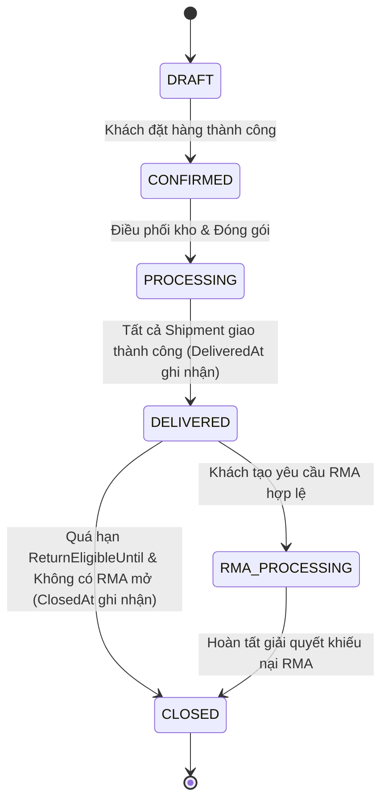

---

### Phương án 7 (P1): Mô hình Đối soát COD Đa Chặng & Hỗ trợ Split Shipment

#### 1. Bản chất Nghiệp vụ COD Hai Chặng:
* **Chặng 1 (Quan hệ Khách hàng - RetailCore):** Khách hàng thanh toán tiền mặt cho Shipper lúc nhận hàng. Về mặt thương mại, nghĩa vụ nợ của khách hàng đã hoàn tất ngay tại thời điểm giao kiện: `PaymentStatus` ghi nhận thanh toán thành công cho phần giá trị kiện hàng đó.
* **Chặng 2 (Quan hệ Hãng Vận chuyển - RetailCore):** Tiền COD nằm tại tài khoản tạm giữ của hãng vận chuyển. Hãng vận chuyển có nghĩa vụ chuyển tiền về tài khoản ngân hàng của RetailCore kèm theo Bảng kê đối soát (Reconciliation Sheet).

#### 2. Khắc phục Giới hạn Đơn cột đối với Đơn hàng Split Shipment:
Trong đơn hàng chia thành nhiều kiện hàng (`Shipment A`, `Shipment B`):
* `Shipment A` có thể được giao và hãng đã chuyển tiền đối soát ngày 05/10.
* `Shipment B` giao chậm hơn và đang chờ hãng đối soát ngày 12/10.
Do đó, một cột duy nhất `Payment.CarrierSettlementStatus` không thể phản ánh chính xác trạng thái nếu không làm méo mó dòng tiền.
* **Định hướng M3:** Bổ sung thực thể hoặc mở rộng theo dõi COD ở cấp **Giao dịch / Kiện hàng**:
  * `CODCollection`: Số tiền Shipper thực thu của khách theo từng kiện `Shipment`.
  * `CODRemittance`: Bản ghi tiền về theo từng đợt chuyển khoản của nhà vận chuyển.
  * `CODReconciliation`: Kết quả đối soát chênh lệch bảng kê (khớp đúng, thiếu hụt cước, hay giữ lại đền bù).

---

### Phương án 8 (P2): Giá vốn Bình quân Di động (WAC) khi Xuất trả NCC & Định giá Tồn kho Độc lập

#### 1. Nguyên lý Định giá khi Xuất trả Nhà Cung cấp (Supplier Return):
Khi xuất trả hàng lỗi hoặc tồn kho cho Nhà cung cấp, kế toán kho bắt buộc phải ghi giảm giá trị tồn kho theo **Giá vốn Bình quân Di động hiện hành (`CurrentAverageCost`)**, tuyệt đối không ghi giảm theo giá mua trên đơn PO gốc (tránh làm sai lệch tổng giá trị sổ sách của lượng tồn còn lại trong kho).

#### 2. Công thức Hạch toán Chênh lệch (Cost Variance):
Khoản chênh lệch giữa giá trị nhà cung cấp hoàn lại (thường theo giá mua PO) và giá trị giảm tồn kho WAC:
$$\text{InventoryValueDecrease} = \text{ReturnedQty} \times \text{CurrentAverageCost}$$
$$\text{SupplierRefundAmount} = \text{ReturnedQty} \times \text{POLine.UnitPrice}$$
$$\text{CostVariance} = \text{SupplierRefundAmount} - \text{InventoryValueDecrease}$$

* **Tính độc lập kế toán:** Bảng dữ liệu lưu trữ các cấu phần giá trị `InventoryValueDecrease`, `SupplierRefundAmount` và `CostVariance`. Việc định khoản vào tài khoản cụ thể (Chênh lệch giá mua PPV, Giảm giá vốn hàng bán, hay Thu nhập khác) do Business Rules của phân hệ kế toán đảm trách, không ép cứng vào cấu trúc schema.
* **Định giá Tồn kho theo Trạng thái Chất lượng:** `CurrentAverageCost` phản ánh giá vốn bình quân trên toàn bộ lượng tồn vật lý `OnHand`. Hàng `QUARANTINED` hay `DAMAGED` vẫn mang giá trị sổ sách kế toán cho đến khi có quyết định xử lý bằng chứng từ xuất hủy `SCRAP_OUT` (chuyển sang tài khoản chi phí tổn thất hàng hỏng).
* **Hàng Khách Trả Lại:** Khôi phục theo giá vốn xuất kho ban đầu (Original COGS) của đơn hàng đó nếu truy vết được; trường hợp không thể truy vết mới nhập theo WAC hiện hành.

---

### Phương án 9 (P2): Chuẩn hoá JSON Snapshot Biến thể & Chuẩn mực Lập chỉ mục SQL Server

#### 1. Cấu trúc JSON Snapshot Chuẩn hóa:
Để bảo đảm tính bất biến khi thuộc tính sản phẩm trong danh mục thay đổi sau 5-10 năm, `OrderLine.VariantAttributesSnapshot` lưu trữ mảng JSON cấu trúc chặt chẽ:
```json
[
  {
    "attributeId": 101,
    "attributeCode": "COLOR",
    "attributeName": "Màu sắc",
    "valueId": 502,
    "valueCode": "NAVY_BLUE",
    "displayValue": "Xanh Navy"
  },
  {
    "attributeId": 102,
    "attributeCode": "SIZE",
    "attributeName": "Kích cỡ",
    "valueId": 604,
    "valueCode": "XL",
    "displayValue": "XL"
  }
]
```

#### 2. Chuẩn mực Kỹ thuật về Truy vấn & Indexing trên SQL Server:
* Các hàm nội tạo của SQL Server như `JSON_VALUE`, `JSON_QUERY`, `OPENJSON` cung cấp khả năng phân tích cú pháp JSON linh hoạt, nhưng **không tự động làm cho câu truy vấn đạt hiệu năng cao**.
* **Nguyên tắc Indexing JSON trên SQL Server:** Nếu có nhu cầu lọc hoặc tìm kiếm thường xuyên trên một thuộc tính JSON cụ thể, hệ thống sẽ sử dụng **Persisted Computed Column** kết hợp B-Tree Index:
  ```sql
  -- Ví dụ mẫu thiết kế tại M3:
  ALTER TABLE OrderLine ADD ColorCode AS CAST(JSON_VALUE(VariantAttributesSnapshot, '$[0].valueCode') AS VARCHAR(50)) PERSISTED;
  CREATE NONCLUSTERED INDEX IX_OrderLine_ColorCode ON OrderLine(ColorCode);
  ```
* **Phân định Phân tích và Giao dịch:** Báo cáo phân tích chuyên sâu (BI/OLAP) sẽ đọc từ các bảng dữ liệu trích xuất (Star Schema / Fact-Dimension), không quét trực tiếp JSON trên bảng giao dịch `OrderLine`.

---

### Phương án 10 (P0/P2): Return Window Tính theo Từng Kiện hàng (Split Shipment) & Truy vết ShipmentLine

#### 1. Chốt Phương án Hạn Đổi trả theo Từng Kiện hàng:
Trong đơn hàng phân tách kiện (Split Shipment), mỗi kiện hàng có lộ trình và thời điểm giao thực tế khác nhau. Do đó, thời hạn đổi trả được tính độc lập cho từng kiện dựa trên **`Shipment.DeliveredAt`**.
$$\text{ShipmentReturnWindowCutoff} = \text{Shipment.DeliveredAt} + \text{ReturnWindowDays}$$

#### 2. Giải bài toán Truy vết Dòng Đơn hàng Phân bổ nhiều Kiện:
* **Vấn đề thực tế:** Một `OrderLine` có số lượng 5 sản phẩm. `Shipment A` giao 2 sản phẩm ngày 01/10; `Shipment B` giao 3 sản phẩm ngày 05/10. Ngày 12/10 khách gửi RMA trả 2 sản phẩm (với chính sách đổi trả 7 ngày thì hàng của Shipment A đã hết hạn, hàng của Shipment B vẫn còn hạn).
* **Giải pháp Kiến trúc M3:** Đơn đổi trả không thể chỉ liên kết mù quáng với `OrderLine`. M3 sẽ bổ sung liên kết truy vết dòng giao hàng:
  * Cách 1: Bổ sung `ShipmentLineID` vào `ReturnRequestLine`.
  * Cách 2: Bổ sung thực thể phân bổ `ReturnShipmentAllocation` liên kết `ReturnRequestLineID` và `ShipmentLineID` kèm số lượng tương ứng.
  * Cơ chế này đảm bảo xác thực chính xác sản phẩm khách trả thuộc kiện hàng nào và còn trong thời hạn đổi trả hợp lệ hay không.

#### 3. Vòng đời Giữ hàng $1 : 0..N$ qua Filtered Unique Index:
Một `OrderLine` có thể trải qua nhiều lần giữ hàng (do tách kho, hủy giữ hàng một phần để re-allocate sang kho khác). Hệ thống khống chế một dòng duy nhất đang hoạt động bằng Filtered Unique Index:
```sql
CREATE UNIQUE NONCLUSTERED INDEX UX_InventoryReservation_ActiveLine
ON InventoryReservation(OrderLineID)
WHERE ReservationStatus = 'ACTIVE';
```

---

## 5. LỘ TRÌNH ĐIỀU CHỈNH MILESTONE 3 (LOGICAL DATABASE DESIGN)

Trước những phản hồi chuyên môn xác đáng, mục tiêu và phương pháp luận triển khai Milestone 3 được điều chỉnh theo hướng tiếp cận học thuật và kỹ thuật thực chứng:

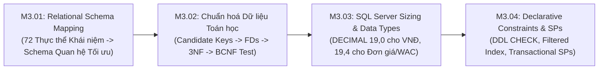

### Bước 1 (M3.01) – Relational Schema Mapping (Ánh xạ Lược đồ Quan hệ)
* **Mục tiêu:** Chuyển đổi toàn diện 72 thực thể quan niệm thành Lược đồ Quan hệ (Relational Schema) tương thích hoàn hảo với SQL Server.
* **Không ép buộc cứng số lượng:** Số lượng bảng vật lý không bắt buộc phải đúng bằng 72. Hệ thống sẽ giải trình rõ lý do cho từng trường hợp:
  * Ánh xạ 1:1 độc lập thành bảng riêng.
  * Tách bảng phục vụ lưu vết lịch sử (Audit Trail / Versions).
  * Gộp thực thể nếu các phụ thuộc hàm và quan hệ cho phép mà không làm phát sinh dị thường dữ liệu.
  * Lưu trữ cấu trúc JSON snapshot đối với dữ liệu lịch sử mang tính đóng băng.

### Bước 2 (M3.02) – Chuẩn hóa Dữ liệu Toán học (3NF & BCNF Evaluation)
* **Quy trình chuẩn hóa 6 bước nghiêm ngặt:**
  1. Xác định toàn bộ Khóa ứng viên (Candidate Keys) của từng quan hệ.
  2. Xác định tập Phụ thuộc hàm đầy đủ (Full Functional Dependencies - FDs).
  3. Kiểm tra và chứng minh 1NF, 2NF và 3NF.
  4. Kiểm tra điều kiện Boyce-Codd Normal Form (BCNF): Với mọi phụ thuộc hàm $X \to Y$, $X$ bắt buộc phải là Superkey.
  5. Đánh giá tính Bảo toàn Phụ thuộc hàm (Dependency Preservation) và Nối không mất mát thông tin (Lossless Join) khi phân rã.
  6. Trường hợp giữ lại thiết kế 3NF không đạt BCNF hoặc phi chuẩn hóa có chủ đích (Aggregates, Denormalized Snapshots), bắt buộc phải lập biên bản đánh đổi kỹ thuật (Technical Trade-off Justification).

### Bước 3 (M3.03) – Định kiểu Dữ liệu SQL Server & Ước tính Dung lượng (Sizing)
* **Chuẩn hóa Kiểu Tiền tệ & Định lượng:**
  * Tiền tệ giao dịch VNĐ: `DECIMAL(19,0)` hoặc `BIGINT`.
  * Đơn giá chi tiết, Tỷ lệ chiết khấu, Giá vốn bình quân: `DECIMAL(19,4)`.
  * Khóa chính (Surrogate Keys): `BIGINT IDENTITY(1,1)` cho các bảng giao dịch lớn; `INT` cho danh mục trung bình; `TINYINT` cho bảng trạng thái/loại.
  * Chuỗi văn bản Unicode: `NVARCHAR` có giới hạn độ dài xác định (`NVARCHAR(50)`, `NVARCHAR(255)`, `NVARCHAR(500)`), tránh sử dụng tràn lan `NVARCHAR(MAX)`.
  * Thời gian toàn cầu: `DATETIMEOFFSET(7)` để lưu trữ chính xác múi giờ Việt Nam (+07:00) và đồng bộ hệ thống.
* **Tính toán Dung lượng 3 năm (Capacity Planning):** Tính kích thước dòng trung bình (Row Size), dung lượng bảng (Data Space), dung lượng chỉ mục (Index Space) dựa trên tải 1.000.000 đơn hàng/năm.

### Bước 4 (M3.04) – Đặc tả Chi tiết Ràng buộc Kỹ thuật & Stored Procedures
* Đặc tả đầy đủ mã nguồn DDL cho toàn bộ các ràng buộc khai báo: `PRIMARY KEY`, `FOREIGN KEY` (kèm hành vi `ON DELETE NO ACTION`), `CHECK Constraints`, `DEFAULT Constraints`.
* Đặc tả các chỉ mục có lọc (`Filtered Indexes`) giải quyết các bài toán trạng thái duy nhất.
* Đặc tả chữ ký và luồng thực thi của các Stored Procedures giao dịch cốt lõi: Đặt hàng, Giữ kho, Nhập/Xuất kho, Ghi nhận Webhook, Giám định đổi trả.

---

## 6. GATE CHECKLIST KIỂM CHỨNG & QUYẾT ĐỊNH CỦA LEAD DATABASE ENGINEER

### 6.1. Bảng Tiêu chí Kiểm chứng Cổng Chuyển giao (Gate Verification Checklist)

| STT | Tiêu chí Kiểm chứng Kiến trúc | Kết quả Đánh giá | Bằng chứng / Cơ sở Kỹ thuật | Trạng thái Chuyển tiếp M3 |
| :---: | :--- | :---: | :--- | :--- |
| **01** | **Bảo tồn Ranh giới 72 Thực thể** | **ĐẠT (Passed)** | 72 thực thể (E01-E72) bao phủ 11 phân hệ, không bỏ sót nghiệp vụ cốt lõi. | Cho phép chuyển sang M3.01 Schema Mapping. |
| **02** | **Đồng bộ Sơ đồ Mermaid ERD** | **ĐẠT (Passed)** | 12 file Mermaid đã loại bỏ toàn bộ hậu tố lỗi, chuẩn hóa cú pháp thuần `PK`, `FK`, `UK`. | Sơ đồ sẵn sàng làm tài liệu trực quan cho M3. |
| **03** | **Độc lập Giám định vs Kho (P0-01)** | **ĐẠT (Passed)** | `ReturnLineAssessment` (E72) tách hoàn tiền khỏi nhập kho; tách bạch `FaultParty` và `ResolutionType`. | Hoàn thiện cấu trúc Audit Trail tại M3.01. |
| **04** | **Toán học Tồn kho & 5 CHECK (P0-02)** | **ĐẠT (Passed)** | Công thức $AvailableQty \ge 0$; chuẩn hóa Quality Status (`SELLABLE`, `QUARANTINED`, `DAMAGED`) và nghiệp vụ `SCRAP_OUT`. | Sẵn sàng chuyển thành DDL CHECK Constraints tại M3.04. |
| **05** | **Triệt tiêu Sai số Làm tròn (P0-03)** | **ĐẠT (Passed)** | Kết hợp LRM, công thức tích luỹ nguyên $F(q)$ và kiểu tiền tệ nguyên số `DECIMAL(19,0)`. | Chuyển thành đặc tả kiểm thử logic (Test Specs) tại M3. |
| **06** | **Thực thi Bắt buộc 1:1 (P1-04)** | **ĐẠT (Passed)** | DDL Unique FK kết hợp Transactional SPs khống chế cả 2 cận; triển khai TPT cho Account. | Đặc tả kịch bản SP tại M3.04. |
| **07** | **Webhook Log & Idempotency (P1-05)** | **ĐẠT CÓ ĐIỀU KIỆN (Conditional)** | Mở rộng Unique key `(ProviderID, MerchantAccountID, ProviderEventID, Environment)`; tách biệt Receipt và Processing. | M3 thiết kế bảng trạng thái Webhook và luồng retry. |
| **08** | **Độc lập 3 Máy Trạng thái (P1-06)** | **ĐẠT (Passed)** | Tách biệt `DeliveredAt`, `ReturnEligibleUntil`, và `ClosedAt`. Xóa bỏ nhập nhằng của trạng thái `COMPLETED`. | Thiết kế cột thời gian và State Transition Matrix tại M3. |
| **09** | **Đối soát COD Split Shipment (P1-07)** | **CẦN MỞ RỘNG TẠI M3 (Open Item)** | Nhận diện rõ hạn chế của cột đơn lẻ `CarrierSettlementStatus` khi giao nhiều kiện lệch ngày. | M3 sẽ thiết kế theo dõi COD cấp Kiện hàng/Giao dịch. |
| **10** | **Truy vết Kiện hàng khi RMA (P2-10)** | **CẦN MỞ RỘNG TẠI M3 (Open Item)** | Nhận diện sự cần thiết của việc truy vết `ReturnRequestLine` về `ShipmentLineID` trong Split Shipment. | M3.01 sẽ thiết kế cấu trúc quan hệ truy vết phù hợp. |

---

### 6.2. Quyết định Nghiệm thu Cổng Chuyển giao (Gate Sign-off Decision)

```
========================================================================================
                      GATE REVIEW SIGN-OFF: CONDITIONAL APPROVAL
========================================================================================
Dự án:                 RetailCore Enterprise E-Commerce Management System
Giai đoạn Đánh giá:    Kết thúc Milestone 2 (M2) -> Chuyển giao Milestone 3 (M3)
Quyết định:            CONDITIONAL APPROVAL FOR M3 (Chấp thuận Có Điều kiện)
----------------------------------------------------------------------------------------
ĐIỀU KIỆN THỰC THI:
1. ĐƯỢC PHÉP KHỞI ĐỘNG: 
   - Tiến hành ngay công đoạn M3.01 (Relational Schema Mapping) cho toàn bộ 72 thực thể.
2. NGUYÊN TẮC GIỮ MỞ (NON-BLOCKING ITERATION):
   - Không áp đặt cứng nhắc số lượng 72 bảng vật lý nếu thiết kế chuẩn hóa và kiểm toán 
     đòi hỏi tách/gộp hợp lý.
   - Không áp đặt 100% bảng phải đạt BCNF nếu việc phân rã làm mất phụ thuộc hàm hoặc 
     làm suy giảm nghiêm trọng hiệu năng nghiệp vụ.
   - Thiết kế chi tiết cơ chế truy vết ShipmentLine và đối soát COD đa kiện trong quá trình
     triển khai M3.
3. TIẾP TỤC BẢO TRÌ VÀ CẬP NHẬT:
   - Mọi điều chỉnh cấu trúc phát sinh trong M3 sẽ được đồng bộ ngược (Reverse-Sync) vào
     tài liệu M2 để bảo đảm tính nhất quán xuyên suốt vòng đời dự án.
========================================================================================
```
